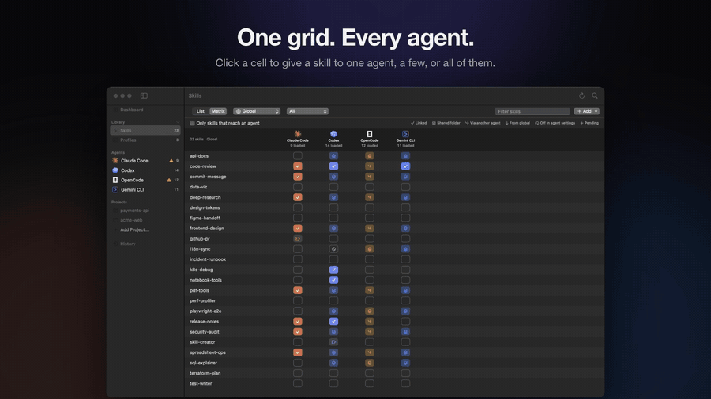
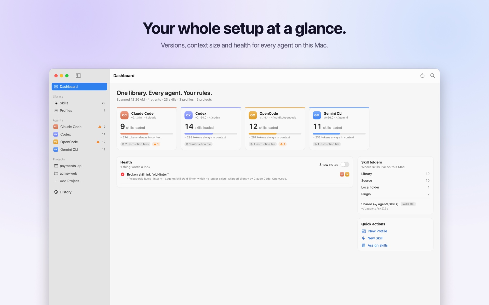

<p align="center">
  
</p>

<h1 align="center">Kitfold</h1>

<p align="center">
  <b>One library. Every agent. Your rules.</b><br>
  A native macOS app for managing Skills and instruction files across your coding agents: Claude Code, Codex, OpenCode, Gemini CLI, Cursor, Copilot, Kiro and nearly 70 more, found automatically.
</p>

<p align="center">
  English · <a href="README.zh-CN.md">简体中文</a>
</p>

<p align="center">
  <a href="https://github.com/kadaliao/kitfold/actions/workflows/ci.yml"></a>
  <a href="https://github.com/kadaliao/kitfold/releases/latest"></a>
  <a href="LICENSE"></a>
  
  
  
</p>

<p align="center">
  
</p>

## Contents

- [Why Kitfold](#why-kitfold)
- [Features](#features)
- [Screenshots](#screenshots)
- [Installation](#installation)
- [Getting started](#getting-started)
- [Command line](#command-line)
- [Supported agents](#supported-agents)
- [How it works](#how-it-works)
- [Your data](#your-data)
- [Documentation](#documentation)
- [Project status](#project-status)
- [Getting help](#getting-help)
- [Contributing](#contributing)
- [License](#license)

## Why Kitfold

Every coding agent keeps its own skills folders and instruction files (`CLAUDE.md`, `AGENTS.md`, `GEMINI.md`), with its own rules for discovery, precedence and fallbacks. They also read each other's folders: OpenCode loads Claude Code's skills, and Codex, OpenCode and Gemini CLI all read `~/.agents/skills`. So it's hard to answer simple questions:

- What does each agent **actually** load, and from where?
- How do I give a skill to Codex but not to OpenCode?
- If I change this file, which agents will notice?

Kitfold answers them, and lets you change the answer with a click, safely.

## Features

- **Every agent on your Mac.** Kitfold knows 76 agents and lists the ones it finds. A `skills` folder of an agent it doesn't know (`~/.<name>/skills`) shows up too, and you can add your own in Settings.
- **Effective view.** For every agent and project, Kitfold resolves what the agent really loads: its own folders, shared folders, other agents' folders, plugins, nested `SKILL.md` files, and skills switched off in the agent's own settings. Duplicates, broken links and oversized instructions are flagged.
- **Precise sharing and isolation.** Assign a skill to one agent, several, or all, globally or per project. Kitfold links it into that agent's own folder and tells you when another agent reads that folder too (OpenCode reads Claude Code's).
- **Each agent's own switch.** When a link can't hide a skill (it lives in a shared folder, in another agent's folder, or is enabled globally and you want it off in one project), Kitfold writes the agent's own setting: `skillOverrides`, `[[skills.config]]`, `permission.skill` or `skills.disabled`. Only that entry changes, and Kitfold takes it back when the rule goes away. Where even that isn't possible (Codex can't hide a skill in a single project), it tells you why.
- **Profiles.** Reusable instruction sets such as *Code Reviewer* or *Backend Engineer*, each bundled with its skills. Kitfold writes them into each agent's own file as one marked block per profile and never touches the rest of the file.
- **Delete a skill everywhere.** Deleting takes the skill out of every agent's folder and off the skills CLI's list, and moves it to Kitfold's trash. Links left behind by skills deleted elsewhere are found and removed in one go.
- **Safe by design.**
  - Every change is previewed as a diff first. For agent settings files, the preview lists only the entries that change, never the file (it may hold API keys).
  - Each file is re-checked right before it's written.
  - Overwritten files are backed up, and every apply is journaled.
  - Any apply can be undone, along with the assignment that caused it.
  - Unknown folders and other tools' managed blocks are never touched.
- **Local-first.** No account, no cloud, no background service. Your intent lives in a readable `~/.kitfold/kitfold.json`. The only thing it asks the internet is GitHub, once a day, whether a newer release is out (turn that off in Settings).
- **Updates itself.** A new release is downloaded, verified and swapped in with one click, or with `kitfold update`.
- **Keyboard-first.** ⌘K jumps to anything; ⌘↩ reviews and applies.
- **English and Simplified Chinese.** Follows your system's language; pick another in Settings › General. The CLI takes `--lang`.

## Screenshots

| | |
|---|---|
|  |  |
|  |  |
|  |  |

## Installation

Kitfold runs on macOS 15 or later, on Apple silicon and Intel. Releases are signed with a Developer ID and notarized by Apple.

### Homebrew

```bash
brew install --cask kadaliao/tap/kitfold
```

This installs Kitfold.app and puts the `kitfold` command in your `PATH`.

### Download

Get `Kitfold-<version>.dmg` from [Releases](https://github.com/kadaliao/kitfold/releases/latest), open it, and drag Kitfold into Applications. The command-line tool is inside the app; to type `kitfold` anywhere, link it into your `PATH`:

```bash
ln -s /Applications/Kitfold.app/Contents/Resources/kitfold ~/.local/bin/kitfold
```

### Build from source

You need Xcode 26 or later (Swift 6.2+). There are no third-party dependencies.

```bash
git clone https://github.com/kadaliao/kitfold.git && cd kitfold
make app          # builds build/Kitfold.app
open build/Kitfold.app
```

`make run` starts the app straight from the build folder, and `swift run kitfold <command>` runs the CLI. See the [development guide](docs/development.md).

### Updating

Kitfold checks GitHub for a new release once a day and shows **Kitfold X is available** in the toolbar. **Install and Reopen** downloads it, checks its SHA-256, Developer ID and notarization, swaps it in and reopens. **Kitfold › Check for Updates…** checks right away, and `kitfold update` does the same from a terminal.

Because Kitfold updates itself, `brew upgrade` skips it unless you add `--greedy`. A copy built from source doesn't update itself; pull and build again.

### Uninstalling

Run `brew uninstall --cask kitfold`, or drag Kitfold to the Trash. Both leave `~/.kitfold` alone: it holds your skill library, and the links Kitfold made in your agents' folders point into it. Delete it only when you no longer want those skills.

## Getting started

**First launch is read-only.** Kitfold creates `~/.kitfold/` for its own data and registers `~/.agents/skills` (and Magpie's library, if present) as skill sources. Nothing else on disk changes until you flip a switch and confirm the preview.

1. Open Kitfold. The sidebar lists the agents found on this Mac; pick one to see every skill and instruction file it loads, and from where.
2. Open **Skills**, switch to the matrix, and flip a switch to give a skill to an agent or take it away.
3. Press ⌘↩ to review. The sheet shows each link and file Kitfold will change. Apply it.
4. Changed your mind? **History** undoes any apply, along with the assignment that caused it.

The [tutorials](docs/tutorials/en/README.md) walk through all of it step by step, from the first launch to troubleshooting. They're also under Help › Kitfold Tutorials.

## Command line

The same core powers a CLI, sharing the app's rules, previews and history. Without `--yes`, a command that changes something only prints its preview.

```bash
kitfold status                          # agents, context size, health
kitfold skills                          # skill × agent matrix (what's actually loaded)
kitfold agents                          # folders each agent scans, files it loads
kitfold assign pdf-tools codex          # preview giving a skill to Codex
kitfold assign pdf-tools codex --yes    # …and apply it
kitfold assign pdf-tools opencode --off --project ~/work/app --yes
kitfold profiles                        # profile ids, for `kitfold profile`
kitfold profile code-reviewer '*' --project ~/work/app --yes
kitfold delete pdf-tools                # preview deleting a skill everywhere
kitfold clean                           # preview removing broken skill links
kitfold history
kitfold undo --yes                      # undo the last apply
kitfold version
kitfold update                          # check for a new release; --yes installs it
kitfold --home /tmp/sandbox status      # try anything against a sandbox $HOME
```

`status` and `agents` take `--all` to list every agent Kitfold knows, not only the ones on this Mac. `--lang en|zh-Hans` sets the output language. The full reference is in [tutorial 08](docs/tutorials/en/08-command-line.md).

## Supported agents

| Agent | Verified version | Kitfold deploys skills to | Profiles go to | Native "hide skill" setting (read and written) |
|---|---|---|---|---|
| Claude Code | 2.1.318 | `~/.claude/skills`, `.claude/skills` | `~/.claude/rules/kitfold.md`, `.claude/rules/kitfold.md` | `skillOverrides` in `settings.json`; per project in `.claude/settings.local.json` |
| Codex | 0.164.0 | `$CODEX_HOME/skills`, `.codex/skills` | `~/.codex/AGENTS.md`, `AGENTS.md` | `[[skills.config]]` in a marked section of `config.toml` (global only: Codex ignores it per project) |
| OpenCode | 1.19.4 | `~/.config/opencode/skills`, `.opencode/skills` | `~/.config/opencode/AGENTS.md`, `AGENTS.md` | `permission.skill` in `opencode.json` (global or project) |
| Gemini CLI | 0.66.0 | `~/.gemini/skills`, `.gemini/skills` | `~/.gemini/GEMINI.md`, `GEMINI.md` | `skills.disabled` in `settings.json` (global or project) |

These four are described in depth, including their native "hide skill" settings. Kitfold also knows 72 more agents that keep skills in folders of their own. It shows what each one loads, links skills into its own folder, writes profiles where the agent has a file of its own, and takes a deleted skill out of all of them:

- **Checked against their docs or source:** Cursor, GitHub Copilot, Devin (Devin Desktop, formerly Windsurf, and Devin for Terminal), Antigravity and Antigravity CLI, Kiro, Trae and Trae CN, Amp, Droid, Goose, Crush, Cline, Kilo Code, Roo Code, Pi, Warp, Zed, Junie, Augment, OpenHands, Mistral Vibe, fx, CodeBuddy, WorkBuddy, Lingma, Qoder and Qoder CN, Continue, Grok Build, OpenClaw, AutoClaw, QClaw, Kimi Code CLI, Qwen Code and Hermes Agent.
- **From the skills CLI's agent list** (marked unverified in the app): iFlow CLI, Tabnine CLI, Rovo Dev, Cortex Code, Deep Agents, ForgeCode, IBM Bob, CodeArts Agent and 28 more.

Many of them also read other agents' folders. Cursor, Amp, Goose, Grok and others load Claude Code's `~/.claude/skills`, and Warp reads ten agents' folders, so Kitfold warns when a link made for one agent reaches another. An agent counts as installed when its command or app is here. One whose folder was only left behind is listed but not managed until you switch it on.

**Agents Kitfold doesn't know:** a `skills` folder in `~/.<name>/` or `~/.config/<name>/` that holds skills shows up as an agent of its own; switch it on to manage it. For anything else, add it in Settings › Agents › **Add Agent…** or in `kitfold.json` (`customAgents`).

Each agent is a declarative descriptor (the four above) or a one-line entry in the catalog, so adding one doesn't touch the core logic. See [Adding an agent](docs/adding-an-agent.md). The research behind these paths, with sources, is in [docs/research.md](docs/research.md) (Chinese).

## How it works

```
kitfold.json (your intent) ─┐
                            ├─ Planner ─→ Plan (changes + issues) ─→ Review ─→ Executor ─→ journal / ledger
disk (scanned Snapshot)  ───┘
```

- **Rules record only explicit intent.** A skill or profile you never touched is left exactly as found, which is why the first launch changes nothing.
- **The planner works in passes:** removals first, then additions on the post-removal view, so an agent never silently loses a skill it only saw through another agent's folder. A last pass writes the agents' own switches for whatever links can't hide.
- **The executor does only four things:** create a link, remove a link, write a file, move a folder. Each one is reversible, precondition-checked and journaled in `~/.kitfold/state.sqlite`.

Details are in [docs/architecture.md](docs/architecture.md) (Chinese).

## Your data

Kitfold has no account, no cloud and no background service. Everything it keeps is in `~/.kitfold`:

| Path | What it holds |
|---|---|
| `kitfold.json` | Your intent: assignment rules, sources, custom agents. Plain, readable JSON |
| `library/` | Skills and profiles that Kitfold manages |
| `sources/` | Skill sources cloned from Git |
| `state.sqlite` | The journal of every apply, and the ledger of what Kitfold wrote |
| `backups/` | Files backed up before they were overwritten, and the trash for deleted skills |

The only network request is the daily update check: it asks GitHub's API for the latest release and sends nothing about you or your setup. Turn it off in Settings › General.

## Documentation

- [Tutorials](docs/tutorials/en/README.md): using Kitfold, step by step
- [Development guide](docs/development.md): building, testing, sandboxes, screenshots, releases
- [Adding an agent](docs/adding-an-agent.md)
- [Localization](docs/localization.md): adding or translating text
- [Design docs](docs/README.md): research, architecture, UX (Chinese)
- [Changelog](CHANGELOG.md)

## Project status

Kitfold is under active development and hasn't reached 1.0. Versions follow [Semantic Versioning](https://semver.org/), and every release is described in the [changelog](CHANGELOG.md). Until 1.0, a minor version may change behavior.

What's planned is in the [roadmap](docs/roadmap.md), and bugs not yet fixed are in [known issues](docs/known-issues.md) (both in Chinese).

## Getting help

- Something isn't working: start with [Troubleshooting](docs/tutorials/en/09-troubleshooting.md), then [open an issue](https://github.com/kadaliao/kitfold/issues/new/choose).
- An agent is missing, or Kitfold has its folders wrong: use the **Support a new agent** issue template, or see [Adding an agent](docs/adding-an-agent.md).
- A security problem: report it privately, as [SECURITY.md](SECURITY.md) describes.

Agent settings files can hold API keys. Please don't paste them into issues.

## Contributing

Contributions are welcome. Please read [CONTRIBUTING.md](CONTRIBUTING.md) first; in particular, **tests and manual checks must never write to your real `$HOME`**. This project follows the [Code of Conduct](CODE_OF_CONDUCT.md).

## License

[MIT](LICENSE) © 2026 Kada Liao

Agent names and logos are trademarks of their owners and are used only to identify the agents Kitfold works with.
