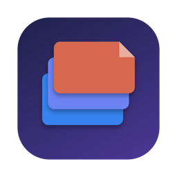
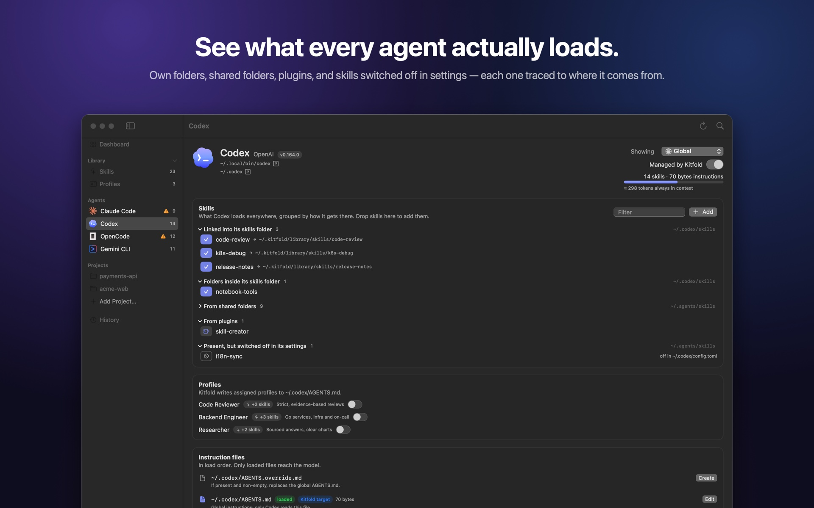
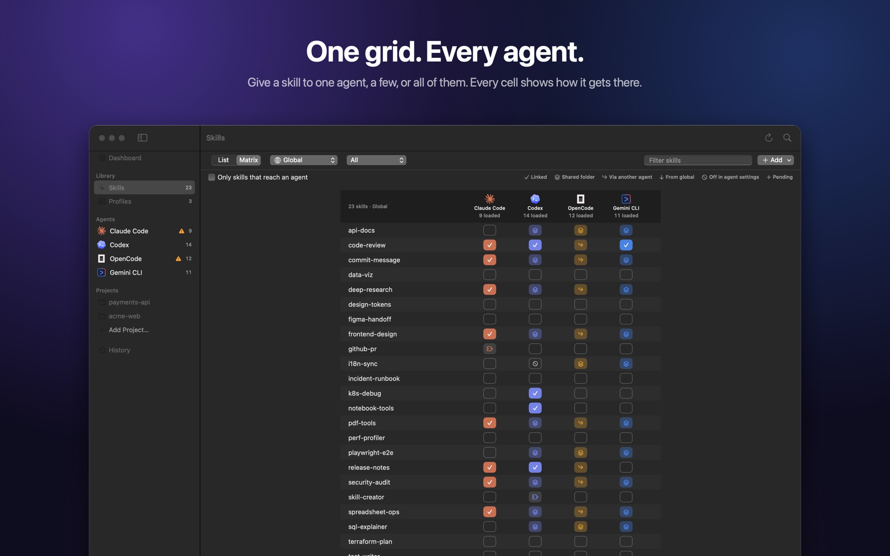
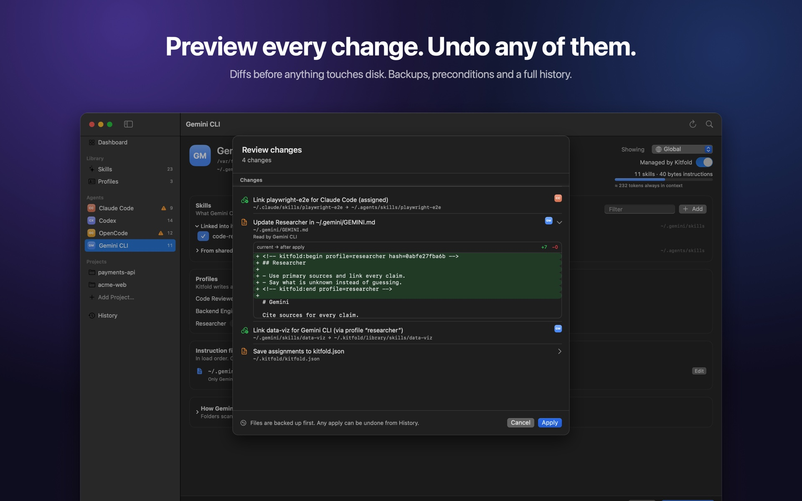
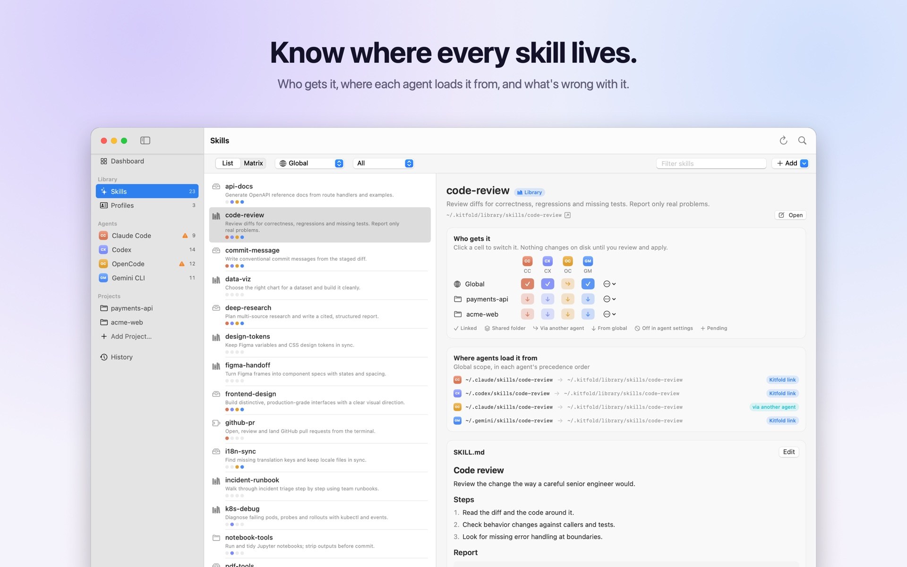
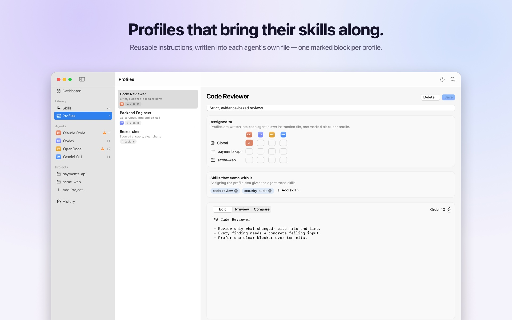

<p align="center">
  
</p>

<h1 align="center">Kitfold</h1>

<p align="center">
  <b>One library. Every agent. Your rules.</b><br>
  A native macOS app for managing Skills and instruction files across Claude Code, Codex, OpenCode and Gemini CLI.
</p>

<p align="center">
  English · <a href="README.zh-CN.md">简体中文</a>
</p>

<p align="center">
  <a href="https://github.com/kadaliao/kitfold/actions/workflows/ci.yml"></a>
  <a href="LICENSE"></a>
  
  
</p>

<p align="center">
  
</p>

## Why Kitfold

Every coding agent keeps its own skills folders and instruction files (`CLAUDE.md`, `AGENTS.md`, `GEMINI.md`), with its own rules for discovery, precedence and fallbacks. They also read each other's folders: OpenCode loads Claude Code's skills, and Codex, OpenCode and Gemini CLI all read `~/.agents/skills`. So it's hard to answer simple questions:

- What does each agent **actually** load, and from where?
- How do I give a skill to Codex but not to OpenCode?
- If I change this file, which agents will notice?

Kitfold answers them, and lets you change the answer with a click, safely.

## Features

- **Effective view.** For every agent and project, Kitfold resolves what the agent really loads: its own folders, shared folders, other agents' folders, plugins, nested `SKILL.md` files, and skills switched off in the agent's own settings. Duplicates, broken links and oversized instructions are flagged.
- **Precise sharing and isolation.** Assign a skill to one agent, several, or all, globally or per project. Kitfold deploys into the folder only that agent reads. When isolation isn't possible (for example, a skill that lives in a shared folder), it tells you why instead of pretending.
- **Profiles.** Reusable instruction sets such as *Code Reviewer* or *Backend Engineer*, each bundled with its skills. Kitfold writes them into each agent's own file as one marked block per profile and never touches the rest of the file.
- **Safe by design.**
  - Every change is previewed as a diff first.
  - Each file is re-checked right before it's written.
  - Overwritten files are backed up, and every apply is journaled.
  - Any apply can be undone, along with the assignment that caused it.
  - Unknown folders and other tools' managed blocks are never touched.
- **Local-first.** No account, no cloud, no background service. Your intent lives in a readable `~/.kitfold/kitfold.json`.
- **Keyboard-first.** ⌘K jumps to anything; ⌘↩ reviews and applies.

| | |
|---|---|
|  |  |
|  |  |

## Supported agents

| Agent | Verified version | Kitfold deploys skills to | Profiles go to | Native "hide skill" setting (read) |
|---|---|---|---|---|
| Claude Code | 2.1.318 | `~/.claude/skills`, `.claude/skills` | `~/.claude/rules/kitfold.md`, `.claude/rules/kitfold.md` | `skillOverrides` |
| Codex | 0.164.0 | `$CODEX_HOME/skills`, `.codex/skills` | `~/.codex/AGENTS.md`, `AGENTS.md` | `[[skills.config]]` |
| OpenCode | 1.19.4 | `~/.config/opencode/skills`, `.opencode/skills` | `~/.config/opencode/AGENTS.md`, `AGENTS.md` | `permission.skill` |
| Gemini CLI | 0.66.0 | `~/.gemini/skills`, `.gemini/skills` | `~/.gemini/GEMINI.md`, `GEMINI.md` | `skills.disabled` |

Each agent is a declarative descriptor, so adding one doesn't touch the core logic. See [Adding an agent](docs/adding-an-agent.md). The research behind these paths, with sources, is in [docs/research.md](docs/research.md) (Chinese).

## Getting started

Requirements: macOS 15 or later to run; Xcode 26 or later (Swift 6.2+) to build. CI builds with Swift 6.2.

```bash
git clone https://github.com/kadaliao/kitfold.git && cd kitfold
make app          # builds build/Kitfold.app
open build/Kitfold.app
```

There are no prebuilt releases yet. `make run` starts the app straight from the build folder.

**First launch is read-only.** Kitfold creates `~/.kitfold/` for its own data and registers `~/.agents/skills` (and Magpie's library, if present) as skill sources. Nothing else on disk changes until you flip a switch and confirm the preview.

### Command line

The same core powers a CLI:

```bash
swift run kitfold status                          # agents, context size, health
swift run kitfold skills                          # skill × agent matrix (what's actually loaded)
swift run kitfold agents                          # folders each agent scans, files it loads
swift run kitfold assign pdf-tools codex          # preview giving a skill to Codex
swift run kitfold assign pdf-tools codex --yes    # …and apply it
swift run kitfold profile code-reviewer '*' --project ~/work/app --yes
swift run kitfold history
swift run kitfold undo --yes                      # undo the last apply
swift run kitfold --home /tmp/sandbox status      # try anything against a sandbox $HOME
```

## How it works

```
kitfold.json (your intent) ─┐
                            ├─ Planner ─→ Plan (changes + issues) ─→ Review ─→ Executor ─→ journal / ledger
disk (scanned Snapshot)  ───┘
```

- **Rules record only explicit intent.** A skill or profile you never touched is left exactly as found, which is why the first launch changes nothing.
- **The planner works in two passes,** removals first, then additions on the post-removal view. That way an agent never silently loses a skill it only saw through another agent's folder.
- **The executor does only four things:** create a link, remove a link, write a file, move a folder. Each one is reversible, precondition-checked and journaled in `~/.kitfold/state.sqlite`.

Details are in [docs/architecture.md](docs/architecture.md) (Chinese).

## Documentation

- [Development guide](docs/development.md): building, testing, sandboxes, screenshots
- [Adding an agent](docs/adding-an-agent.md)
- [Design docs](docs/README.md): research, architecture, UX, roadmap (Chinese)
- [Changelog](CHANGELOG.md)

## Contributing

Contributions are welcome. Please read [CONTRIBUTING.md](CONTRIBUTING.md) first; in particular, **tests and manual checks must never write to your real `$HOME`**. This project follows the [Code of Conduct](CODE_OF_CONDUCT.md). To report a security issue, see [SECURITY.md](SECURITY.md).

## License

[MIT](LICENSE) © 2026 Kada Liao
