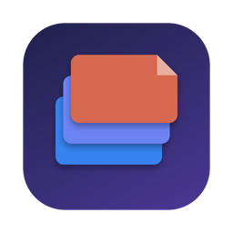
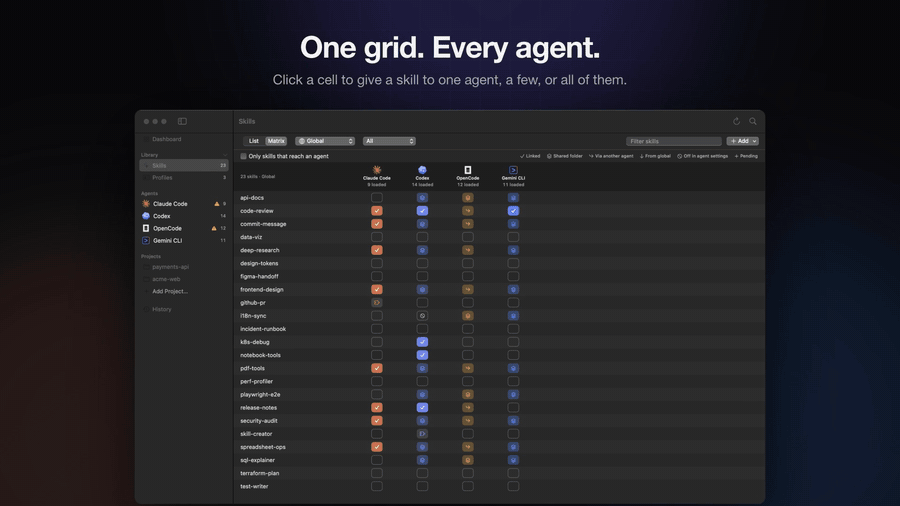
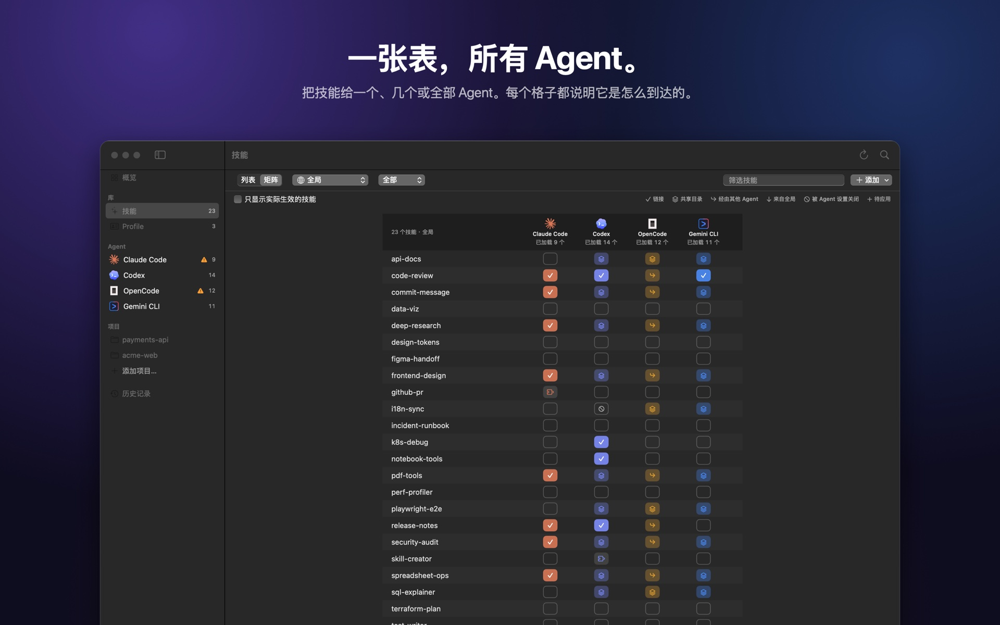
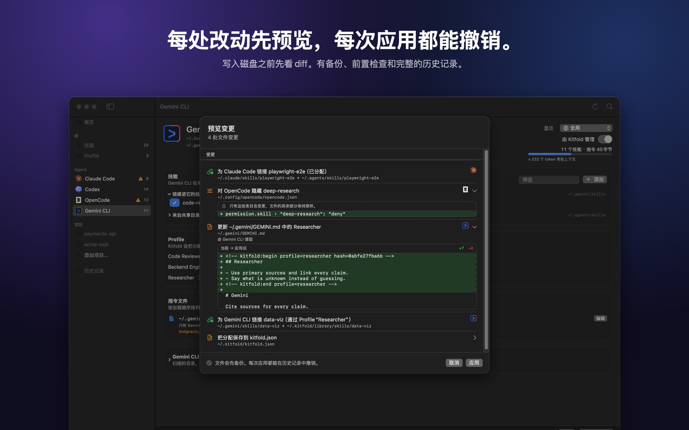
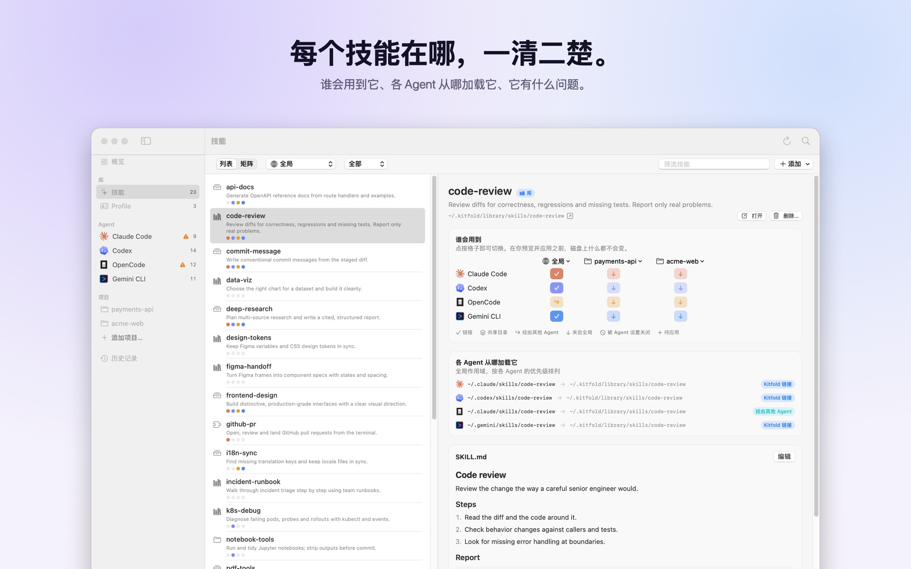
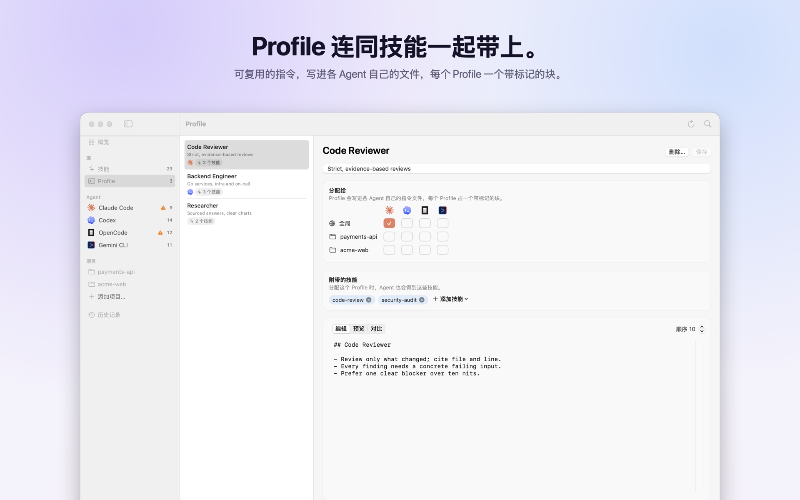

<p align="center">
  
</p>

<h1 align="center">Kitfold</h1>

<p align="center">
  <b>One library. Every agent. Your rules.</b><br>
  一款原生 macOS 应用，统一管理各种 Coding Agent 的 Skills 和指令文件：Claude Code、Codex、OpenCode、Gemini CLI、Cursor、Copilot、Kiro 等 70 多个，自动发现。
</p>

<p align="center">
  <a href="README.md">English</a> · 简体中文
</p>

<p align="center">
  <a href="https://github.com/kadaliao/kitfold/actions/workflows/ci.yml"></a>
  <a href="LICENSE"></a>
  
  
</p>

<p align="center">
  
</p>

## 为什么需要 Kitfold

每个 Coding Agent 都有自己的技能目录和指令文件（`CLAUDE.md`、`AGENTS.md`、`GEMINI.md`），发现规则、优先级、回退逻辑也各不相同。它们还会互相读对方的目录：OpenCode 会加载 Claude Code 的技能，Codex、OpenCode、Gemini CLI 都会读 `~/.agents/skills`。于是一些简单的问题很难回答：

- 每个 Agent **实际**加载了什么？从哪来？
- 怎么只给 Codex 某个技能，不给 OpenCode？
- 改了这个文件，会影响哪些 Agent？

Kitfold 回答这些问题，并且让你点一下就能安全地改变答案。

## 功能

- **Mac 上的每个 Agent**：Kitfold 认识 76 个 Agent，会列出这台 Mac 上找到的。它不认识的 Agent 的技能目录（`~/.<名字>/skills`）也会出现，还可以在设置里添加你自己的。
- **实际生效视图**：对每个 Agent、每个项目，算出它真正会加载的内容：自己的目录、共享目录、别的 Agent 的目录、插件、嵌套的 `SKILL.md`，以及被它自己的设置关闭的技能。重复、断链、指令超长都会被标出来。
- **精确共享与隔离**：可以把技能分配给一个、几个或全部 Agent，全局或按项目都行。Kitfold 把技能链接进那个 Agent 自己的目录；如果别的 Agent 也读这个目录（OpenCode 会读 Claude Code 的），会提醒你。
- **用 Agent 自己的开关**：链接藏不住的技能（放在共享目录、别的 Agent 的目录里，或者全局开着、只想在某个项目里关掉），Kitfold 会写 Agent 自己的设置：`skillOverrides`、`[[skills.config]]`、`permission.skill`、`skills.disabled`。只改那一条，规则撤掉时也会收回。连这样也做不到时（Codex 没法只在一个项目里隐藏技能），会说明原因。
- **Profiles**：可复用的指令集，比如 *Code Reviewer*、*Backend Engineer*，可以附带一组技能。每个 Profile 以一个带标记的块写进各 Agent 自己的文件，文件里的其他内容一律不碰。
- **删除技能，处处干净**：删除会把技能从每个 Agent 的目录和 skills CLI 的清单里去掉，再移到 Kitfold 的废纸篓。在别处删技能留下的失效链接，也能一次找出、一次移除。
- **安全优先**：
  - 所有改动先给出 diff 预览；Agent 的设置文件只显示变化的那几条，不显示文件原文（里面可能有 API key）；
  - 写入前重新核对文件；
  - 被覆盖的文件先备份，每次应用都记日志；
  - 任何一次应用都能撤销，连同引起它的分配一起撤回；
  - 不认识的目录、其他工具的托管块，一律不碰。
- **本地优先**：不需要账号，不依赖云，不常驻后台。你的意图保存在一个可读的 `~/.kitfold/kitfold.json` 里。它唯一会联网做的，是每天问一次 GitHub 有没有新版本（可在设置里关掉）。
- **自动更新**：有新版本时，“安装并重新打开”会下载它，核对 SHA-256、Developer ID 签名和公证，替换后重新打开。命令行：`kitfold update`。
- **键盘优先**：⌘K 跳到任何地方，⌘↩ 预览并应用。
- **中英文界面**：默认跟随系统语言，也可以在“设置 › 通用”里单独指定；命令行用 `--lang`。

| | |
|---|---|
|  |  |
|  |  |
|  |  |

## 支持的 Agent

| Agent | 验证版本 | Kitfold 把技能部署到 | Profile 写到 | 原生"隐藏技能"设置（读写） |
|---|---|---|---|---|
| Claude Code | 2.1.318 | `~/.claude/skills`、`.claude/skills` | `~/.claude/rules/kitfold.md`、`.claude/rules/kitfold.md` | `settings.json` 的 `skillOverrides`；项目级写 `.claude/settings.local.json` |
| Codex | 0.164.0 | `$CODEX_HOME/skills`、`.codex/skills` | `~/.codex/AGENTS.md`、`AGENTS.md` | `config.toml` 里带标记的 `[[skills.config]]` 段（只能全局：Codex 不认项目级） |
| OpenCode | 1.19.4 | `~/.config/opencode/skills`、`.opencode/skills` | `~/.config/opencode/AGENTS.md`、`AGENTS.md` | `opencode.json` 的 `permission.skill`（全局或项目） |
| Gemini CLI | 0.66.0 | `~/.gemini/skills`、`.gemini/skills` | `~/.gemini/GEMINI.md`、`GEMINI.md` | `settings.json` 的 `skills.disabled`（全局或项目） |

上面 4 个是深入建模的，包括它们自己的“隐藏技能”设置。此外 Kitfold 还认识 72 个用自己目录放技能的 Agent：显示每个 Agent 实际加载了什么，把技能链接进它自己的目录，在它有专属指令文件时写入 Profile，删除技能时从所有 Agent 那里一并收回：

- **对照过官方文档或源码的**：Cursor、GitHub Copilot、Devin（Devin Desktop，原 Windsurf；以及 Devin for Terminal）、Antigravity 和 Antigravity CLI、Kiro、Trae 和 Trae CN、Amp、Droid、Goose、Crush、Cline、Kilo Code、Roo Code、Pi、Warp、Zed、Junie、Augment、OpenHands、Mistral Vibe、fx、CodeBuddy、WorkBuddy、通义灵码（Lingma）、Qoder 和 Qoder CN、Continue、Grok Build、OpenClaw、AutoClaw、QClaw、Kimi Code CLI、Qwen Code、Hermes Agent。
- **取自 skills CLI 的 Agent 清单**（App 里标为未验证）：iFlow CLI、Tabnine CLI、Rovo Dev、Cortex Code、Deep Agents、ForgeCode、IBM Bob、CodeArts Agent 等 36 个。

不少 Agent 还会读别人的目录：Cursor、Amp、Goose、Grok 等会加载 Claude Code 的 `~/.claude/skills`，Warp 会读 10 个 Agent 的目录。所以为一个 Agent 建的链接会到达另一个 Agent 时，Kitfold 会提醒。Agent 的命令或 App 在这台 Mac 上才算装了；只剩下目录的会列出来，但在你打开开关之前不会去管理它。

**Kitfold 不认识的 Agent**：`~/.<名字>/` 或 `~/.config/<名字>/` 下有技能的 `skills` 目录，会自己作为一个 Agent 出现，打开开关就能管理它。其他的可以在“设置 › Agent › 添加 Agent…”或 `kitfold.json`（`customAgents`）里添加。

每个 Agent 都只是一份声明式描述（上面 4 个），或者目录里的一行，新增 Agent 不需要改核心逻辑，见[接入新 Agent](docs/adding-an-agent.md)。这些路径背后的调研和来源见 [docs/research.md](docs/research.md)。

## 开始使用

**Homebrew：**

```bash
brew install --cask kadaliao/tap/kitfold
```

会装好 Kitfold.app，并把 `kitfold` 命令放进 `PATH`。Kitfold 自己会更新，所以 `brew upgrade` 默认跳过它，要用 brew 升级就加 `--greedy`。

**下载：** 从 [Releases](https://github.com/kadaliao/kitfold/releases/latest) 下载 `Kitfold-<版本>.dmg`，打开后把 Kitfold 拖进“应用程序”。支持 macOS 15 及以上，Apple 芯片和 Intel 都能用，已用 Developer ID 签名并经过 Apple 公证。命令行工具就在 App 里，想在任何目录下直接敲 `kitfold`，把它链接进 `PATH`：

```bash
ln -s /Applications/Kitfold.app/Contents/Resources/kitfold ~/.local/bin/kitfold
```

**从源码构建**（Xcode 26 及以上，Swift 6.2+；CI 使用 Swift 6.2 构建）：

```bash
git clone https://github.com/kadaliao/kitfold.git && cd kitfold
make app          # 生成 build/Kitfold.app
open build/Kitfold.app
```

`make run` 可以直接从构建目录启动 App。

**首次启动是只读的。** Kitfold 会创建 `~/.kitfold/` 来存放自己的数据，并把 `~/.agents/skills`（以及 Magpie 的库，如果存在）登记为技能来源。在你拨动开关并确认预览之前，磁盘上的其他东西都不会改变。

第一次用？[教程](docs/tutorials/zh-CN/README.md)从第一次打开讲到排错，一步一步来。App 里的“帮助 › Kitfold 教程”也能打开。

### 命令行

App 和命令行用的是同一套核心：

```bash
swift run kitfold status                          # 各 Agent 状态、上下文大小、健康检查
swift run kitfold skills                          # 技能 × Agent 矩阵（实际生效）
swift run kitfold agents                          # 每个 Agent 扫描的目录、加载的文件
swift run kitfold assign pdf-tools codex          # 预览：把技能给 Codex
swift run kitfold assign pdf-tools codex --yes    # ……并应用
swift run kitfold profile code-reviewer '*' --project ~/work/app --yes
swift run kitfold profiles                        # Profile 的 id，供 `kitfold profile` 使用
swift run kitfold history
swift run kitfold undo --yes                      # 撤销最近一次应用
swift run kitfold --home /tmp/sandbox status      # 在沙盒 $HOME 里随便试
```

## 工作原理

```
kitfold.json（你的意图） ─┐
                          ├─ Planner ─→ Plan（变更 + 问题） ─→ 预览 ─→ Executor ─→ 日志 / 账本
磁盘（扫描得到的 Snapshot）┘
```

- **规则只记录你明确表达过的意图**。你没碰过的技能和 Profile 保持原样，所以首次启动不会改动任何东西。
- **规划分几轮**：先算删除，再在删除之后的视图上算新增，这样即使某个 Agent 只是通过另一个 Agent 的目录看到某个技能，也不会悄悄失去它。最后一轮为链接藏不住的技能写各 Agent 自己的开关。
- **执行器只做四种操作**：建链接、删链接、写文件、移动目录。每种都可逆，执行前检查前置条件，并记录在 `~/.kitfold/state.sqlite`。

详见 [docs/architecture.md](docs/architecture.md)。

## 文档

- [教程](docs/tutorials/zh-CN/README.md)：一步一步学会用 Kitfold
- [开发指南](docs/development.md)：构建、测试、沙盒、截图（英文）
- [接入新 Agent](docs/adding-an-agent.md)（英文）
- [设计文档](docs/README.md)：调研、架构、交互、路线图
- [更新日志](CHANGELOG.md)

## 参与贡献

欢迎贡献，请先阅读 [CONTRIBUTING.md](CONTRIBUTING.md)。特别注意：**测试和手动验证都不能写入你真实的 `$HOME`**。本项目遵守[行为准则](CODE_OF_CONDUCT.md)。报告安全问题请见 [SECURITY.md](SECURITY.md)。

## 许可证

[MIT](LICENSE) © 2026 Kada Liao

Agent 的名称和标志是各自所有者的商标，这里只用来指明 Kitfold 支持的 Agent。
