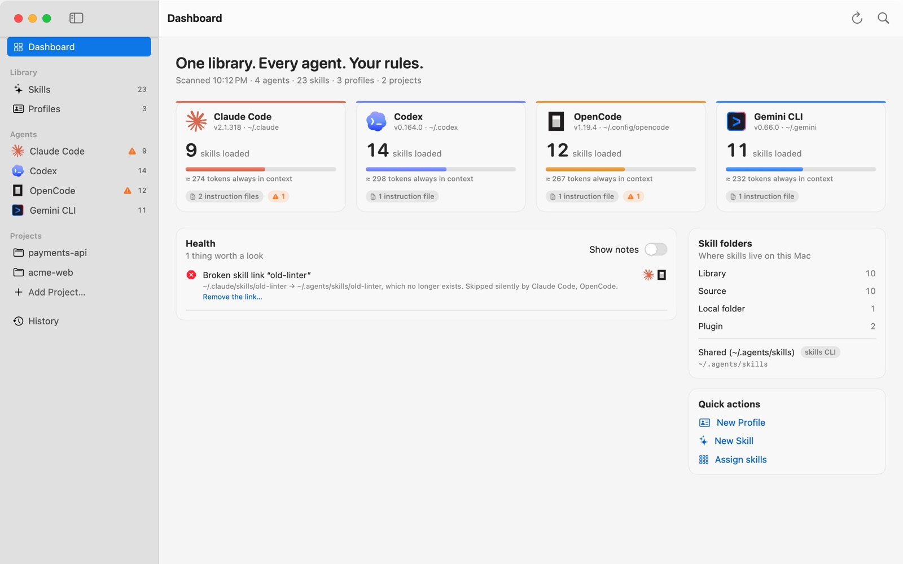
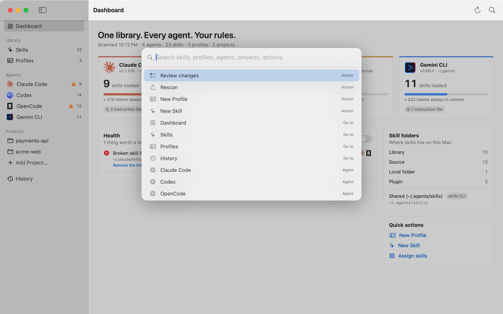
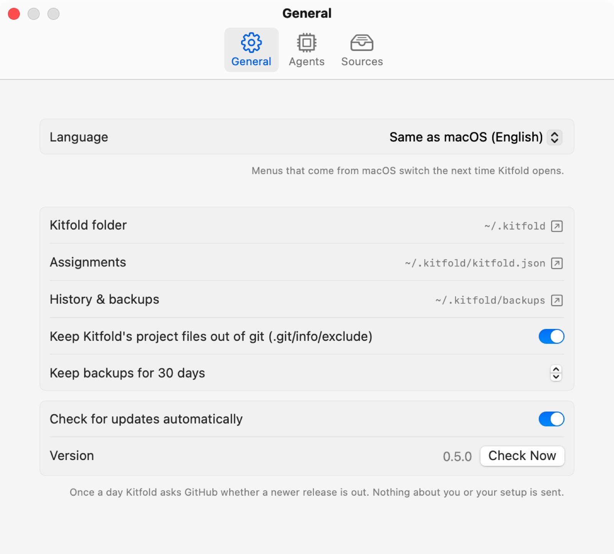

# 01 Getting started

In this tutorial you install Kitfold, open it for the first time, find your way around the window, and learn to jump anywhere with ⌘K and to switch the language. The first launch only reads your setup; it doesn't change anything.

## Requirements

- To run: macOS 15 or later, on Apple silicon or Intel.
- To build it yourself: Xcode 26 or later (Swift 6.2+).

## 1. Install and open

Download `Kitfold-<version>.dmg` from [Releases](https://github.com/kadaliao/kitfold/releases/latest), open it, and drag Kitfold into Applications. Then open it from Applications. The app is signed and notarized, so macOS opens it without warnings.

After that it updates itself. Once a day Kitfold asks GitHub whether a newer release is out; when there is one, **Kitfold X is available** appears in the toolbar. Click it to read what's new, then **Install and Reopen**: Kitfold downloads the new version, checks that it's the signed and notarized release, puts it in place of the old one and reopens. **Kitfold › Check for Updates…** checks right away, and Settings › General › **Check for updates automatically** turns the daily check off.

Or build it from source:

```bash
git clone https://github.com/kadaliao/kitfold.git && cd kitfold
make app                 # builds build/Kitfold.app
open build/Kitfold.app
```

`make app` is a release build. The app also carries the command-line tool, at `Kitfold.app/Contents/Resources/kitfold` (see [The command line](08-command-line.md)). To keep Kitfold in your Applications folder, drag `Kitfold.app` there.

While developing you can also use `make run`, which starts the app straight from the build folder.

## 2. The first launch is read-only

On the first launch, Kitfold reads your agents: which ones are installed, their versions, which folders they load skills from and which instruction files they read. A message at the top of the window says:

> Welcome. Kitfold only read your setup — nothing has been changed.

It creates only its own folder, `~/.kitfold/`:

| Path | What it holds |
|---|---|
| `~/.kitfold/kitfold.json` | Your assignment rules, plus projects, sources and preferences. A plain JSON file you can read |
| `~/.kitfold/library/` | The library: skills (`skills/`) and profiles (`profiles/`) that Kitfold keeps itself. Empty at first |
| `~/.kitfold/backups/` | Backups taken before files are written, readable only by you |
| `~/.kitfold/state.sqlite` | History and journal: what each apply did, so it can be undone |

If `~/.agents/skills` exists, Kitfold registers it as a skill source; if Magpie is installed, its library is registered too. Sources are only read, never moved or changed.

Nothing else on disk changes. The agents' skills folders, instruction files and settings files change only after you flip a switch, look at the preview and click **Apply**, and every apply can be undone. Actions in Settings (adding a project or a source, changing a preference) only touch `kitfold.json` and are saved right away.

Kitfold doesn't run in the background or watch files. If you install a skill from the terminal or change an agent's config, click **Rescan** in the toolbar (⌘R). If you change `kitfold.json` with the command line or an editor, Kitfold reloads it when you switch back to the app.

## Try it on the demo data first (optional)

The screenshots in these tutorials come from a fictional demo setup: four agents, twenty-odd skills, three profiles (Code Reviewer, Backend Engineer, Researcher) and two projects, acme-web and payments-api. To follow along without touching your own setup, build the same setup from the repository folder and point the app at it:

```bash
make build
make demo DIR=/tmp/kitfold-demo
KITFOLD_FAKE_HOME=/tmp/kitfold-demo PATH=/tmp/kitfold-demo/.local/bin:/usr/bin:/bin .build/debug/KitfoldApp
```

`KITFOLD_FAKE_HOME` makes Kitfold treat that folder as your home folder: the agents' folders and Kitfold's own data all live inside it, and your real `$HOME` isn't touched. The demo's agents are stand-ins that only answer `--version`, so all four show as installed. Note that the folder given as `DIR` is emptied and rebuilt.

## 3. Find your way around



The sidebar, from top to bottom:

- **Dashboard**: the home page, covered in the next section.
- **Library**: **Skills** and **Profiles**. The numbers are how many skills were found on this Mac (one per name) and how many profiles you have.
- **Agents**: one row for each agent on this Mac; in the demo, Claude Code, Codex, OpenCode and Gemini CLI. Kitfold knows 76 agents (Cursor, Copilot, Kiro, Devin, Amp, Grok…) and lists the ones whose command, app or folder it finds, plus the `~/.<name>/skills` folder of any agent it doesn't know. The number is how many skills the agent actually loads globally; a ⚠ before it means there's a warning. An agent Kitfold doesn't manage is grayed out: one you switched off, or one whose folder was only left behind (its app or command is gone). **Settings › Agents** lists the others and lets you add your own.
- **Projects**: the projects you've added. Click **Add Project…** and choose a project folder; Kitfold uses its git root. See [Per-project setups](06-projects.md).
- **History**: every apply and undo.

The toolbar at the top right has two buttons: **Rescan** (⌘R) and **Quick Open** (⌘K). A spinner shows next to them while Kitfold scans.

When you have changes that aren't applied yet, a bar appears at the bottom of the window. On the left it says "N file changes pending", plus "N to check" when something needs a look; on the right are **Discard** (when you've flipped switches) and **Review & Apply…** (⌘↩). Every switch in Kitfold only changes a draft; nothing is written until you review and confirm it here. See [Review, apply, undo](04-review-apply-undo.md).

## 4. The Dashboard

The Dashboard shows the overall picture:

- **The line under the title**: when Kitfold last scanned, and how many agents, skills, profiles and projects there are.
- **Agent cards**: one per agent, with its version and config folder, how many skills it loads, roughly how many tokens are always in its context, and how many instruction files it loads; an orange number means warnings. Hover over the bar to see how the estimate is made. Click a card to open the agent's page (see the [next tutorial](02-what-agents-load.md)).
- **Health**: problems worth a look, such as broken links, skills with the same name, or profile blocks edited outside Kitfold. The agent icons on the right show which agents a problem affects. Turn on **Show notes** to also see minor notes. What each problem means and what to do about it is in [Troubleshooting](09-troubleshooting.md).
- **Skill folders**: where skills live on this Mac: how many are in the library, in sources, in local folders inside the agents' folders, and in plugins, followed by the registered sources.
- **Quick actions**: **New Profile**, **New Skill** and **Assign skills** (opens the Skills page).

In the demo, Health reports a broken link, "old-linter": `~/.claude/skills/old-linter` points to a folder that no longer exists, so Claude Code and OpenCode both skip it silently. Why OpenCode too? It also reads Claude Code's skills folder, as the next tutorial shows.

## 5. Quick Open (⌘K)



Press ⌘K, or click the magnifying glass in the toolbar. With nothing typed, the list starts with common actions: **Review changes**, **Rescan**, **New Profile**, **New Skill**, then the pages to go to (**Dashboard**, **Skills**, **Profiles**, **History**) and each agent. Type a few letters to find any skill, profile, agent or project.

- ↑ ↓ to choose, ↩ to run, Esc to close.
- The gray text on the right is searched too: type "plugin" to list every plugin skill, or "project" to list every project.

## 6. Switch the language



Kitfold's interface is in English and Simplified Chinese. By default it follows macOS: of the system's preferred languages, it uses the first one Kitfold has. Any Chinese gets Simplified Chinese; any other language gets English.

To pick a language for Kitfold alone:

1. Open **Kitfold › Settings…** (⌘,) and choose **General**.
2. Under **Language**, choose **English** or **简体中文**. **Same as macOS (…)** goes back to the default; the parentheses show the current macOS language.
3. Kitfold's own text switches at once. Menus and panels that come from macOS (such as the Edit and Window menus, or the panel for choosing a file) switch the next time Kitfold opens.

The choice is stored where macOS keeps each app's own language, so **System Settings › General › Language & Region › Applications** shows the same choice, and changing it there works too. That setting applies to the bundled `Kitfold.app`.

The command line isn't affected by this setting. It follows the system language; pass `--lang en` or `--lang zh-Hans`, or set the `KITFOLD_LANG` environment variable, to choose. If `KITFOLD_LANG` is set when you start the app from a terminal, it wins over the choice in Settings.

Further down the General tab are the locations of Kitfold's folder, `kitfold.json` and the backups (click ↗ to reveal them in Finder), and options such as how many days to keep backups.

## Keyboard shortcuts

| Shortcut | What it does |
|---|---|
| ⌘K | Quick Open |
| ⌘R | Rescan agents and files |
| ⌘↩ | Review changes (when changes are pending) |
| ⌘N | New profile |
| ⇧⌘N | New skill |
| ⌘1 / ⌘2 / ⌘3 / ⌘4 | Dashboard / Skills / Profiles / History |
| ⌘S | Save the profile or `SKILL.md` you're editing; when editing an instruction file, review the edit |
| ⌘, | Settings |
| ↩ / Esc | In the review sheet: apply / cancel |

You can also open these tutorials from **Help › Kitfold Tutorials**.

---

[Contents](README.md) · [Next: 02 What each agent loads →](02-what-agents-load.md)
