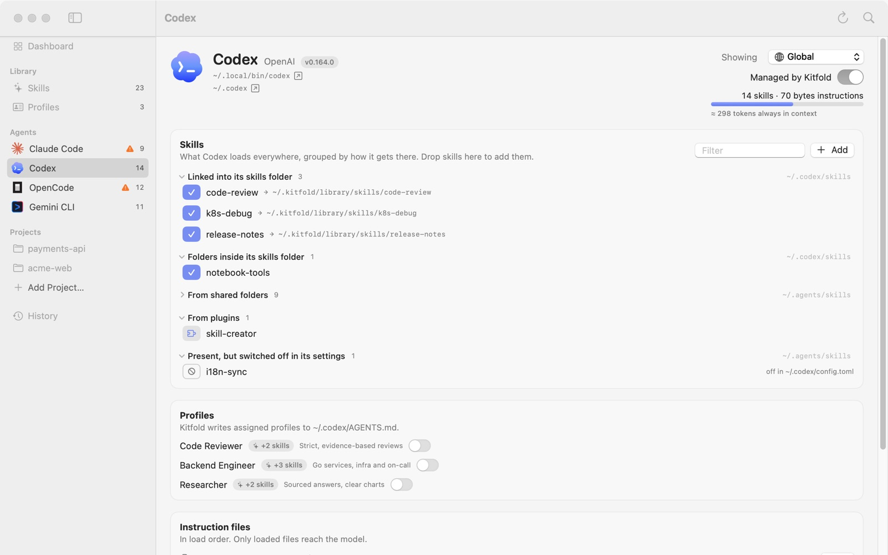

# 02 What each agent loads

Every agent has its own page listing the skills and instruction files it actually loads right now, where each one comes from, and any problems. This tutorial walks through Codex's page section by section, then uses OpenCode to show a common surprise: it also loads Claude Code's skills.

## 1. Open an agent's page

In the sidebar, under **Agents**, click **Codex**. You can also click its card on the Dashboard, or press ⌘K and type "Codex".

## 2. The header

On the left are the basics:

- name, vendor and version (Codex · OpenAI · v0.164.0);
- where the executable is (`~/.local/bin/codex`) and the config folder (`~/.codex`); click ↗ next to either to reveal it in Finder. If the executable isn't found, this reads "CLI not found on PATH (config folder exists)" or "Not detected on this Mac".

On the right, from top to bottom:

- **Showing**: the scope picker, covered in the next section.
- **Managed by Kitfold**: on by default for agents Kitfold detects. Turn it off and Kitfold stops changing any of this agent's files, and its column disappears from the matrix and from skill details; its existing links and files stay as they are. This switch only changes `kitfold.json`, takes effect at once and needs no review.
- **14 skills · 70 bytes instructions**: how many skills the agent actually loads (one per name), and the total size of the instruction files it loads.
- The bar and "≈ 298 tokens always in context": in every session the agent gives the model the name and description of each skill it loads, plus the loaded instruction files. Kitfold estimates this at 4 bytes per token, which is enough to compare agents and spot bloat. Above about 15,000 tokens the bar turns orange.

## 3. Choose a scope

**Showing** starts at **Global**: what the agent loads wherever you start it. Once you've added projects (see [Per-project setups](06-projects.md)), you can pick one here, and the page shows what the agent loads when started in that project:

- the project's own skills are listed under **Project skills**; global skills are listed too, and their cells show ↓ (from global);
- instruction files list the global ones first, then the project's, in the order the agent joins them;
- "finds skills" lists the folders scanned in that project.

## 4. Skills, grouped by how they get there

The **Skills** card answers "which skills does it load, and how does each one reach it?" A skill can arrive by different routes, so Kitfold groups them by route:

| Group | Meaning |
|---|---|
| Linked into its skills folder | Symlinks in the agent's own skills folder; the → at the end shows where each points. Links made by Kitfold and by other tools both land here |
| Folders inside its skills folder | Real folders in its own skills folder, for example ones copied in by hand |
| From shared folders | Folders several agents read directly, such as `~/.agents/skills` |
| Through another agent's folder | It also reads another agent's folder, as OpenCode reads `~/.claude/skills` |
| Nested inside other skills | A `SKILL.md` deep inside another skill's folder. Codex and OpenCode load it as a skill of its own |
| Project skills | Only when a project is chosen: skills in the project's own folders |
| From plugins | Skills from the agent's plugins, extensions or built-ins, such as Codex's own skill-creator |
| Present, but switched off in its settings | In a folder, but switched off in the agent's own settings. The end of the row says which file switches it off |

In the Codex screenshot: code-review, k8s-debug and release-notes are linked into `~/.codex/skills` by Kitfold; notebook-tools is a folder placed there directly; 9 more come from the shared folder `~/.agents/skills`; skill-creator comes from a plugin; and i18n-sync, although it's in `~/.agents/skills` too, ends with "off in ~/.codex/config.toml".

A few details:

- Each group title is followed by a count, with the folder the skills are in on the right. Groups with more than 6 skills start collapsed; click the title to expand.
- A skill that arrives through two folders appears in both groups, but the agent loads it once, and the header counts it once.
- Click a skill's name to open it on the Skills page.
- **Filter**, at the top right, filters by name. **Add** searches the skills found on this Mac (except plugin skills); click one to switch it on for this agent. You can also drag skills from the Skills page's list onto this page. A newly added skill shows "will be added" until you apply.

### Reading the cells

The cell at the start of each row is the same as in the Skills page's matrix. It shows how the skill reaches this agent now, and clicking it switches the skill (in the draft only). Cells take the agent's color; hover over one for a description.

| Cell | Meaning |
|---|---|
| Solid, ✓ | In the agent's own skills folder: a link made by Kitfold, a link made by another tool or by hand, or a real folder |
| Light, stacked layers | From a shared folder |
| Light, ↪ | Through another agent's folder |
| Light, ↓ | From global (only when a project is chosen) |
| Light, stacked squares | Nested inside another skill's folder |
| Gray, puzzle piece | From a plugin |
| Blank, ⊘ | Present, but switched off in the agent's own settings |
| Blank | Not loaded |
| Dashed outline, + or − | Pending: switched on or off when you apply |

How to use these cells to give skills to the agents you choose is in the [next tutorial](03-assign-skills.md).

## 5. Profiles

The **Profiles** card lists every profile with a switch, and says which file Kitfold writes them to (for Codex, `~/.codex/AGENTS.md`). See [Profiles](05-profiles.md).

## 6. Instruction files

The **Instruction files** card lists every file this agent may read, in load order. As the card says, only loaded files reach the model. A file may carry these marks:

| Mark | Meaning |
|---|---|
| loaded (green) | The agent reads this file now |
| not loaded (orange) | The file exists, but the agent's rules skip it this time, for example a fallback replaced by the main file |
| Kitfold target | The file Kitfold writes when you assign a profile to this agent |
| fallback | Read only when another file doesn't exist |
| symlink | The file is a link |
| "Also read by X" (orange) | Another agent loads the same file and sees whatever is written there |
| Purple tags | Profile blocks Kitfold wrote in this file, one per profile |
| Orange tag with a pencil | That profile block was edited outside Kitfold; **Keep edit** and **Overwrite…** appear next to it. See [Profiles](05-profiles.md) |
| "Contains blocks managed by X (left untouched)." | Managed blocks written by another tool, which Kitfold doesn't touch |

The gray text under a file is the agent's rule for reading it. For Codex:

- `~/.codex/AGENTS.override.md` doesn't exist. Its rule: if present and non-empty, it replaces the global `AGENTS.md`.
- `~/.codex/AGENTS.md` is loaded, and it's the Kitfold target.

Each file has **Edit** on the right, or **Create** when it doesn't exist yet. You see a diff of your edit before applying it, and like every other change it can be undone from History.

## 7. How it finds skills

Further down, **How Codex finds skills** starts collapsed. Expand it to see the folders the agent scans, highest precedence first. Each folder has a role:

- **primary**: only this agent reads it, and Kitfold links skills here;
- **shared**: several agents read it, such as `~/.agents/skills`;
- **foreign**: another agent's folder that this agent reads too;
- **bundled**: a plugin, system or admin folder.

Each folder has a one-line explanation; ones based on inference rather than evidence are marked "(unverified)". Below them are notes about the agent, such as how to hide a skill in its own settings, and an "Agent documentation" link.

## 8. Issues

When problems affect this agent, an **Issues** card appears at the bottom of the page. It lists problems in the current scope, including the notes the Dashboard hides by default. What each one means and what to do about it is in [Troubleshooting](09-troubleshooting.md).

## Example: OpenCode also loads Claude Code's skills

In the demo, click **OpenCode** in the sidebar:

1. The header says 12 skills, yet there is no "Linked into its skills folder" group: Kitfold has never put anything in OpenCode's own folder, `~/.config/opencode/skills`.
2. Its skills come from two groups, both collapsed because they hold more than 6: **Through another agent's folder** (8, in `~/.claude/skills`) and **From shared folders** (10, in `~/.agents/skills`).
3. Expand **Through another agent's folder**. code-review and release-notes point to `~/.kitfold/library/skills/…`: links Kitfold made for Claude Code. The others point to `~/.agents/skills/…`: links another tool made for Claude Code. OpenCode loads all of them as well.
4. Six skills, such as pdf-tools and deep-research, appear in both groups: the same folder, found by OpenCode along two routes. The **Issues** card at the bottom has a note: "OpenCode reaches 6 skills through two folders".
5. Expand **How OpenCode finds skills**. `~/.claude/skills` is marked **foreign**, and its note says "OpenCode also loads Claude Code's skills unless OPENCODE_DISABLE_CLAUDE_CODE_SKILLS=1."
6. Look at **Instruction files**: `~/.config/opencode/AGENTS.md` doesn't exist (it's the Kitfold target); `~/.claude/CLAUDE.md` is loaded, marked **fallback** and "Also read by Claude Code". So whatever you write in `~/.claude/CLAUDE.md` reaches OpenCode too, and once `~/.config/opencode/AGENTS.md` exists, OpenCode stops reading `~/.claude/CLAUDE.md`. When Kitfold is about to create that file, the review warns you.
7. The broken old-linter link from the Dashboard shows up in OpenCode's issues too, for the same reason: it's in `~/.claude/skills`.

The upshot: whatever goes into `~/.claude/skills` is loaded by both Claude Code and OpenCode. That's why Kitfold warns "OpenCode will load … too" when you give a skill to Claude Code. To keep it to Claude Code only, see the [next tutorial](03-assign-skills.md).

---

[← Previous: 01 Getting started](01-getting-started.md) · [Contents](README.md) · [Next: 03 Give skills to the agents you choose →](03-assign-skills.md)
