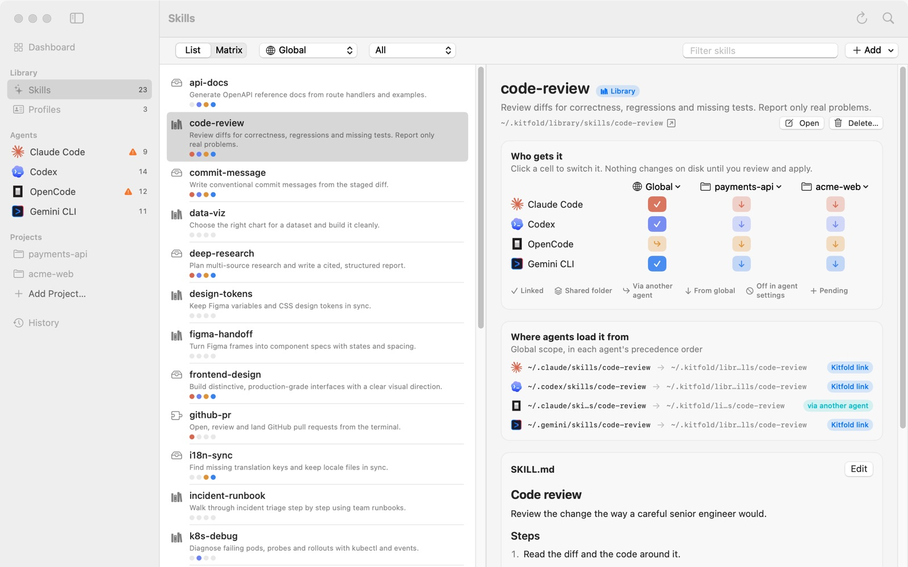
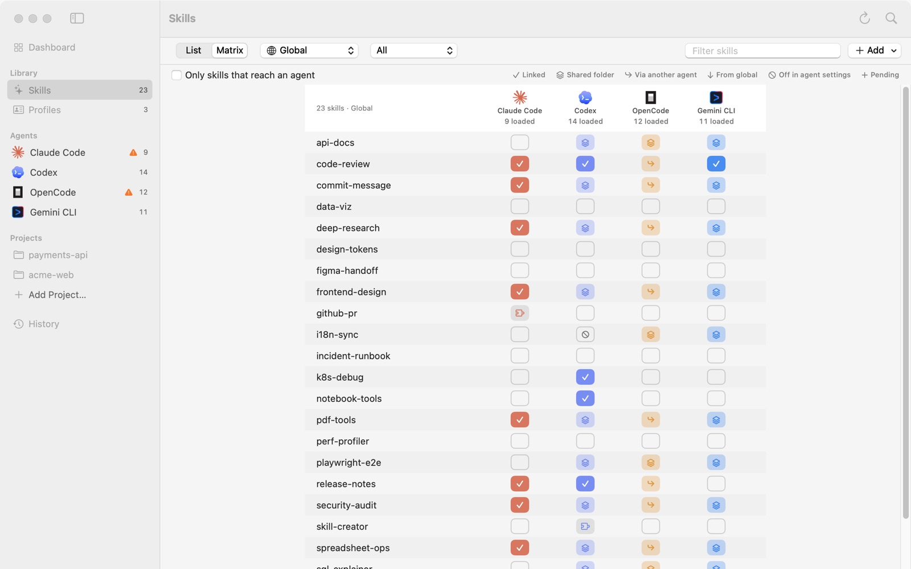
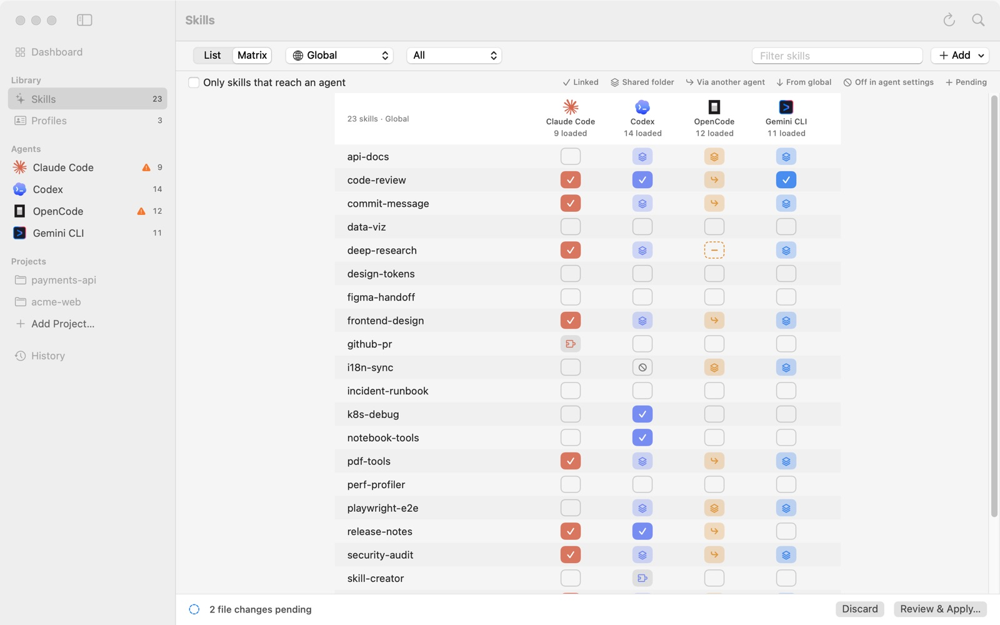

# 03 Give skills to the agents you choose

This tutorial shows how to decide which agents get each skill: for example, give one skill to Codex only, or hide one from OpenCode only, without affecting the other agents. Every switch here only changes a draft; nothing is written to disk until you review and apply.

## Two views of the same rules

- **The Skills page**: pick a skill and decide who gets it (skill → agents).
- **An agent's page**: pick an agent and adjust its skills (agent → skills). See the [previous tutorial](02-what-agents-load.md).

Both edit the same rules, kept in `~/.kitfold/kitfold.json`. Flip a switch on one and the other follows immediately.

## 1. The skill list

Click **Skills** in the sidebar (⌘2). Along the top, from left to right:

- **List** / **Matrix**: the two layouts.
- The scope: **Global** or a project. It decides which scope the dots in the list and the matrix show.
- The origin filter: **All**, **Library**, **Sources**, **Local folders**, **Plugins**, **With problems**.
- **Filter skills**: searches names and descriptions.
- **Add**: new skill, import a folder, add a source. See [Your skill library](07-skill-library.md).

Each row in the list starts with an icon for where the skill lives (library, source, local folder, plugin…), then its name and description, then a row of dots. Each dot is one agent, in the order Claude Code, Codex, OpenCode, Gemini CLI: filled means the agent will load the skill once you apply, gray means it won't, and a ring around a dot means a change is pending there.

## 2. Skill details: who gets it

Select a skill in the list to see its details on the right. Here is code-review:

- **Library** next to the title means it's in Kitfold's library. Below are the description and the path; **Open** opens `SKILL.md` in your default editor.
- **Who gets it**: one row per agent, one column per scope (**Global** and each project). Click a cell to switch it. In code-review's Global column, Claude Code, Codex and Gemini CLI show ✓ (links made by Kitfold), and OpenCode shows ↪ (through Claude Code's folder). Both project columns show ↓: installed globally, so present in the projects too. Click a column's name for **All agents on**, **All agents off** or **Clear (leave as found)** in that scope. The full key to the cells is in the [previous tutorial](02-what-agents-load.md#reading-the-cells).
- The ⋯ menu at the end of each row:
  - **All agents on** / **All agents off**: stored as one rule for "all agents";
  - **Clear (leave as found)**: removes every rule for this skill in this row. See "Rules record only what you said" below.
- **Where agents load it from**: for each agent, the global path it loads the skill from, where a link points, and the route: Kitfold link, link, local folder, shared folder, via another agent, plugin and so on. If an agent loads a different folder with the same name, it's marked "different folder".
- Further down are a preview of `SKILL.md` and **Edit**. See [Your skill library](07-skill-library.md).

## 3. Matrix mode

Click **Matrix** at the top to see every skill × every agent on one screen:

- The header shows how many skills each agent loads, for example Claude Code "9 loaded".
- Check **Only skills that reach an agent** to hide skills that no agent loads.
- The legend is at the top right: Linked, Shared folder, Via another agent, From global, Off in agent settings, Pending.
- Click a cell to switch it. Click a skill's name to switch to **List** with that skill selected and its details on the right.

The matrix is good for tidying up in bulk, or for slimming an agent's context: go down the column and switch off what it doesn't need.

## 4. Drag onto the sidebar

Drag a skill from the list, or a skill's name from the matrix, onto an agent in the sidebar to switch it on for that agent. It's switched on in the scope chosen at the top of the Skills page: **Global** or a project. A message at the top confirms it, for example "Added data-viz to Gemini CLI — review to apply." or, with acme-web chosen, "Added test-writer to Codex in acme-web — review to apply." If the agent already has the skill, it says so instead: "Codex already has test-writer."

You can also drop skills onto an agent's page; they're switched on in the scope that page shows.

## 5. What Kitfold does underneath

Switches only change the draft. Kitfold works out from the rules which files need to change, and writes them only when you apply. This is how a rule turns into files.

### Switching a skill on

- If the agent can already load it (by any route), there's nothing to write. code-review is assigned to all agents, but OpenCode already loads it through Claude Code's folder, so Kitfold didn't add a second link in OpenCode's folder.
- Otherwise Kitfold creates a link in the agent's own skills folder, pointing to the folder where the skill lives (the library or a source). The skill itself isn't copied.
- If the agent's own settings switch the skill off, Kitfold removes or overrides that entry. If the entry wasn't written by Kitfold, the review marks it "caution", and undo restores it. When even that isn't possible, the review says why.

Each agent's own skills folder:

| Agent | Global | Project |
|---|---|---|
| Claude Code | `~/.claude/skills` | `.claude/skills` |
| Codex | `~/.codex/skills` | `.codex/skills` |
| OpenCode | `~/.config/opencode/skills` | `.opencode/skills` |
| Gemini CLI | `~/.gemini/skills` | `.gemini/skills` |

### Switching a skill off

If the agent loads the skill through a link Kitfold made in its own folder, Kitfold removes that link, and that's it.

In other cases, removing a link is either impossible or would hurt another agent:

- the skill lives in a shared folder such as `~/.agents/skills`. Removing it takes it from every agent that reads the folder;
- it's in another agent's folder, as with OpenCode reading `~/.claude/skills`. Removing it takes it from Claude Code too;
- the link was made by another tool or by hand, and Kitfold doesn't delete what others made;
- it's a `SKILL.md` nested inside another skill;
- it's on globally and you want it off in one project only.

Then Kitfold writes the agent's own setting, which hides the skill from that agent alone:

| Agent | Setting written | Global file |
|---|---|---|
| Claude Code | `"skill-name": "off"` in `skillOverrides` | `~/.claude/settings.json` |
| Codex | a `[[skills.config]]` pointing to the skill's `SKILL.md`, with `enabled = false` | a marked section at the end of `~/.codex/config.toml` |
| OpenCode | `"skill-name": "deny"` in `permission.skill` | `~/.config/opencode/opencode.json` |
| Gemini CLI | the skill's name added to `skills.disabled` | `~/.gemini/settings.json` |

Which file is used in a project is covered in [Per-project setups](06-projects.md). Codex reads this setting only globally, so it can't hide a skill in one project alone; when that happens, the review's "Needs attention" section says why and suggests switching it off globally instead, and the cell shows a small orange "!".

When Kitfold edits a settings file, only that entry changes: every other byte of the file stays, comments and formatting included. The review lists only the entries that change and never shows the file, which may hold API keys. Kitfold remembers which entries it wrote and takes them back when the rule goes away; a file it created is removed once it's empty.

## 6. When another agent reads the same folder

As the previous tutorial showed, OpenCode also reads Claude Code's skills folder, `~/.claude/skills`. So when you switch a skill on for Claude Code, the link lands in `~/.claude/skills` and OpenCode loads it too. The pending bar adds "N to check", and the review's "Needs attention" section says:

> **OpenCode will load “test-writer” too**
>
> OpenCode also reads Claude Code's folder ~/.claude/skills. Switch “test-writer” off for OpenCode to keep it to Claude Code.

Do as it says: on the test-writer row, click OpenCode's cell too. The review gains "Hide test-writer from OpenCode", written to OpenCode's own settings, and the warning goes away. Once OpenCode has its own rule for a skill, globally or in that project, Kitfold doesn't warn about it.

It works the other way round as well: when a link is removed from `~/.claude/skills` and OpenCode found the skill only there, Kitfold warns "OpenCode will stop loading …". Switch it on for OpenCode to keep it.

For a link in a project's `.claude/skills`, the warning names the project, as in "OpenCode will load “test-writer” too in acme-web".

## 7. Rules record only what you said

- Each rule records a skill, an agent (or all agents), a scope, and on or off. A skill you never touched has no rule, and Kitfold leaves it exactly as found. That's why the first launch changes nothing.
- If you flip a cell and flip it back before applying, Kitfold drops the rule instead of recording "on": that's how things already are on disk.
- Flipping back a rule you've already applied records the opposite rule (for example "off"). To make Kitfold forget its rules for a skill in a scope altogether, use **Clear (leave as found)** in that row's ⋯ menu. When you apply, Kitfold takes back what it did for those rules, meaning the links it made and the settings entries it wrote, and leaves everything else as it is.
- A skill can also be switched on by a profile: assign a profile to an agent and the skills attached to it go to that agent too (see [Profiles](05-profiles.md)). A skill's own rule wins over a profile. If an assigned profile includes the skill, it stays with that agent after you clear the skill's rules.

## 8. Plugin skills can't be assigned

Skills that come from plugins, such as Claude Code's github-pr or Codex's skill-creator, show a puzzle-piece cell in the matrix and are managed by the agent's own plugin system:

- Clicking their cell only shows a message: "“github-pr” comes from a plugin — switch it in the agent's plugin settings."
- Their details have no "Who gets it" grid, only "Plugin skills are switched on and off in the agent's plugin settings."
- They aren't offered by **Add** on an agent's page.

## Example: give test-writer to Codex only, hide deep-research from OpenCode only

Here you make two changes in the demo, then review and apply them together.

### Give test-writer to Codex only

1. Press ⌘2 to open the Skills page, click **Matrix**, and keep the scope at **Global**.
2. Type "test-writer" in **Filter skills**. All four cells on its row are blank: it's in the library, and no agent loads it yet.
3. Click Codex's cell. It becomes a dashed outline with +.

No other agent is affected: the link will be made at `~/.codex/skills/test-writer`, and only Codex reads that folder. Had you chosen Claude Code, the link would land in `~/.claude/skills`, OpenCode would load it too, and Kitfold would warn you (see section 6).

### Hide deep-research from OpenCode only

1. Clear the filter and find deep-research. All four agents load it now: Claude Code shows ✓ (a link another tool made in `~/.claude/skills`); Codex and Gemini CLI get it from the shared folder `~/.agents/skills`; OpenCode shows ↪, loading it through Claude Code's folder (it could also find it in the shared folder).
2. Click OpenCode's cell. It becomes a dashed outline with −.

With both switches flipped, the bottom of the window says "2 file changes pending". test-writer is further down the list, out of the screenshot.

Kitfold deletes nothing here. deep-research reaches OpenCode through two folders that other agents read too, so removing a link or a folder would take it from Claude Code, Codex and Gemini CLI as well. Instead, Kitfold changes OpenCode's own setting.

### Review and apply

1. Press ⌘↩, or click **Review & Apply…**. The review's header says "2 file changes", and it lists:
   - **Link test-writer for Codex (assigned)**: `~/.codex/skills/test-writer → ~/.kitfold/library/skills/test-writer`;
   - **Hide deep-research from OpenCode**: an edit to `~/.config/opencode/opencode.json` that adds a single entry, `permission.skill › "deep-research": "deny"`, with the note "Only these entries change; the rest of the file is kept as is.";
   - **Save assignments to kitfold.json**: records the two rules.
2. Click **Apply**.

After the apply, test-writer's Codex cell in the matrix is a solid ✓, and deep-research's OpenCode cell shows ⊘ (off in agent settings), while the other three agents are unchanged. On OpenCode's page, deep-research is listed under "Present, but switched off in its settings", ending with "hidden by Kitfold in ~/.config/opencode/opencode.json".

To take it back, click that cell on again, or use **Clear (leave as found)** in the ⋯ menu; when you apply, Kitfold removes the entry it wrote. You can also undo the whole apply from History. Reviewing, applying and undoing are covered in the [next tutorial](04-review-apply-undo.md).

---

[← Previous: 02 What each agent loads](02-what-agents-load.md) · [Contents](README.md) · [Next: 04 Review, apply, undo →](04-review-apply-undo.md)
