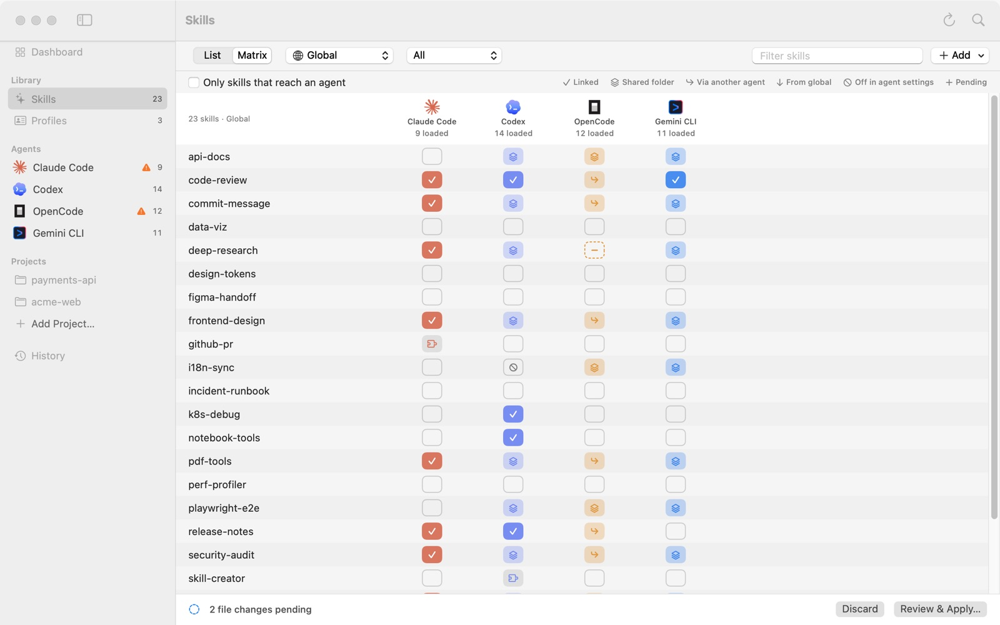
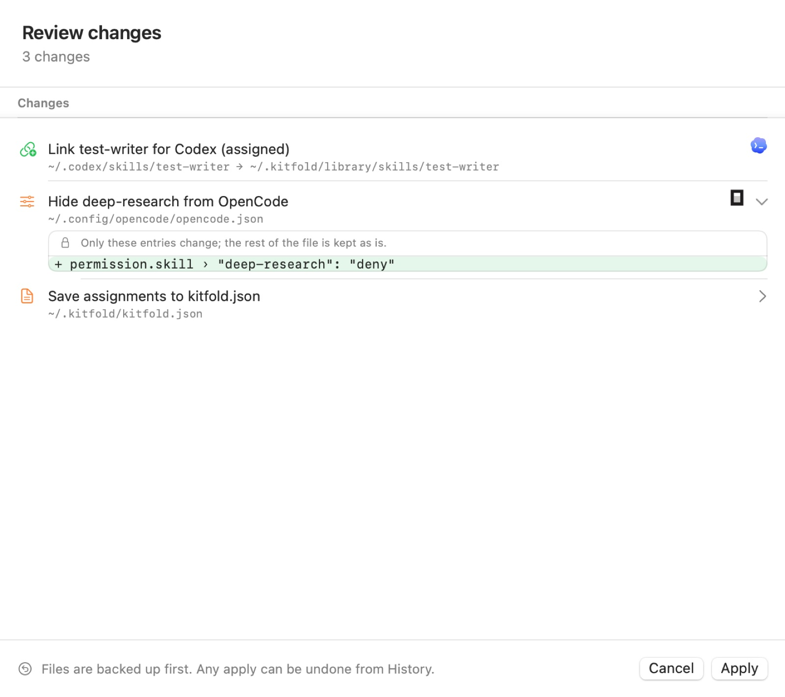
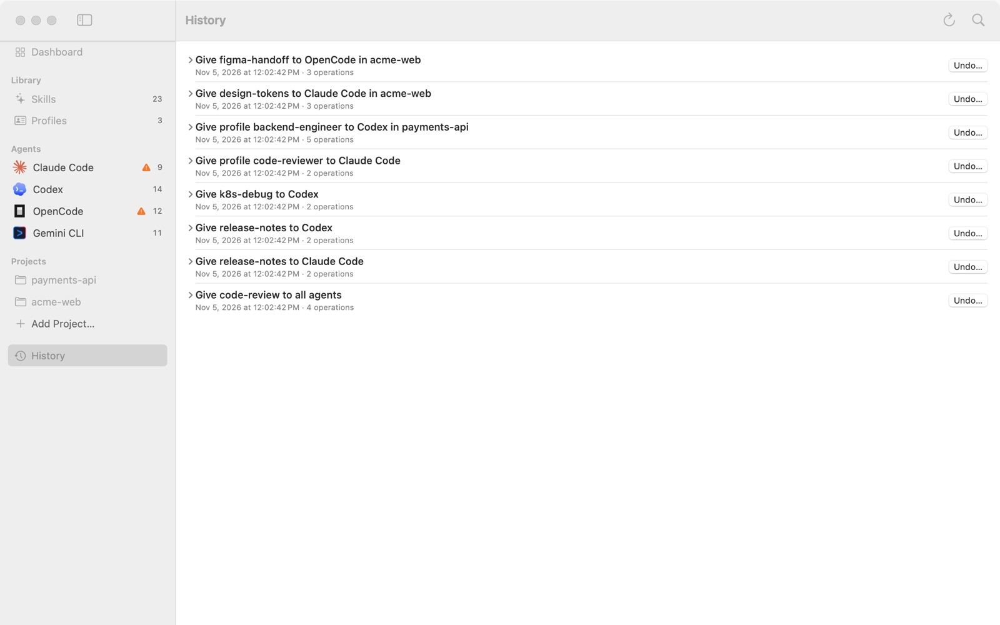

# 04 Review, apply, undo

Flipping a switch in Kitfold only changes a draft. This tutorial shows how to see every file change before it's written, apply it, and undo it later.

The examples continue from [the previous tutorial](03-assign-skills.md): give `test-writer` to Codex only, and hide `deep-research` from OpenCode only.

## 1. The draft and the pending bar

Click a cell in the matrix, in a skill's detail or on an agent's page, and it gets a dashed outline with a ＋ (switched on when you apply) or a − (switched off). Nothing on disk has changed yet; only the draft has.

While the draft differs from your saved assignments, the pending bar sits at the bottom of the window:



| On the bar | Meaning |
|---|---|
| "2 file changes pending" | How many files applying will change, not counting Kitfold's own `kitfold.json` |
| "Working out changes…" | Kitfold is recalculating after a switch; give it a moment |
| "Assignments changed — no files need to change" | The rules changed but the disk already matches, e.g. you chose **All agents on** for a skill every agent already sees. Applying just saves the rules |
| "N to check" | The review has N warnings or errors worth a look first |
| **Discard** | Puts every switch back to its saved state |
| **Review & Apply…** (⌘↩) | Opens the review |

A few things to know:

- The draft is shared by every page. Flip a few switches in the matrix, a few more on an agent's page, then review them together.
- The draft lives only as long as Kitfold is open. Switches you haven't applied are lost when you quit.
- The Kitfold menu in the menu bar has **Review Changes…** (⌘↩) and **Discard Changes** too.

## 2. Reading the review

Press ⌘↩, or click **Review & Apply…**:



Under the title is a count such as "3 changes". When something needs care, it goes on with "N touch files Kitfold didn't create" and "N to check".

### One row per change

Each row says in one sentence what will happen, with the exact path below and the affected agents on the right. The icon on the left gives the kind of change:

| Icon | Change |
|---|---|
| Link with a plus (green) | New link, shown as `link → target` |
| Link (red) | Remove a link |
| Document with a plus (green) | New file |
| Document | Edit a file: an instruction file, `kitfold.json`, `.git/info/exclude` |
| Trash (red) | Delete a file. Kitfold only deletes files it created |
| Sliders | Edit the agent's own settings file |
| Document with an arrow | Move a folder (move into the library) |

Click › at the end of a row to expand it. With three file changes or fewer, they start expanded.

- **Instruction files** expand to a line diff headed "current → after apply" ("(new file) → after apply" for a new file), with the number of lines added and removed.
- **Agent settings files** (`settings.json`, `config.toml`, `opencode.json` and the like) expand to only the entries that change, such as `+ permission.skill › "deep-research": "deny"` in the screenshot, under the line "Only these entries change; the rest of the file is kept as is." The file itself is never shown, because it may hold API keys and tokens. The write changes only that entry too: comments, formatting and every other byte stay as they were.
- **The kitfold.json row** ("Save assignments to kitfold.json") always comes last. It saves your rules in the same apply as the file changes, so undoing the apply takes the rules back too. That's why the bar said 2 file changes while the review says 3 changes.

### Changes marked caution

When a change touches something Kitfold didn't create, the row gets an orange **caution** tag and an orange note saying why. Typical cases:

- removing a link made by another tool or by hand;
- replacing a link of the same name, not made by Kitfold, that points somewhere else;
- removing or rewriting an entry you wrote in an agent's settings (for example, your own setting switches off a skill you're now switching on);
- overwriting a profile block that was edited outside Kitfold (see [05](05-profiles.md)).

These are backed up like everything else, and undo puts them back.

### Needs attention — not changed automatically

The section **Needs attention — not changed automatically** lists what Kitfold won't do or can't do, each with the reason. Errors come first, then warnings and notes. Some examples:

- **OpenCode will load “data-viz” too**: the link goes into `~/.claude/skills`, which OpenCode reads as well. To keep the skill to Claude Code, switch it off for OpenCode too.
- **“code-review” stays visible to Codex in this project**: Codex has no per-project switch; see [06](06-projects.md).
- **kitfold.md was edited outside Kitfold**: Kitfold won't write that file until you keep or overwrite the edit; see [05](05-profiles.md).

These don't block the apply. **Apply** carries out the changes listed above them and leaves these alone.

### Apply or cancel

- **Apply** (↩) carries out every change listed.
- **Cancel** (Esc) closes the review and keeps the draft as it is.

Editing an instruction file, moving a skill into the library and resolving an outside edit to a profile block all use the same review, with a different title. Those one-off reviews apply only their own change; switches you flipped but haven't applied stay in the draft.

## 3. What happens when you apply

1. **It checks again.** Right before each change, Kitfold re-checks the disk: a file must still have exactly the content the review showed, and a link must still point where it did. If something moved in between (say an agent just rewrote its settings), Kitfold stops, puts back what it already did, and shows "Something went wrong" naming the file that "changed since the preview". Open the review again and apply.
2. **It backs up.** Every file about to be overwritten or deleted is copied first to `~/.kitfold/backups/<id>/`, readable only by you. Set how long backups are kept in **Settings › General** (**Keep backups for 30 days**).
3. **It writes.** Files are written atomically (a temporary file, then a rename). If the target is a symlink, such as a `CLAUDE.md` managed by your dotfiles, Kitfold writes the real file it points to rather than replacing the link with a plain file.
4. **It records the change.** Each change, with the content before and after, goes into `~/.kitfold/state.sqlite`. That's what undo uses. If the record can't be written, the files are put back, so nothing is left changed without a way to undo it.

When it's done, a message at the top says "Applied 3 changes. Undo anytime from History.", Kitfold rescans, and the dashed cells turn solid.

## 4. History

Click **History** in the sidebar, or press ⌘4:



Each apply is one entry, newest first:

- **The title** says what it did. For a single switch it's specific: "Give test-writer to Codex", "Give design-tokens to Claude Code in acme-web". For several it reads "Update deep-research, test-writer". Profiles appear by their id, as in "Give profile code-reviewer to Claude Code".
- **The line below** has the time and the number of operations.
- Click › on the left to see each operation. Next to a file that was overwritten or deleted there's **Backup**, which shows that backup in Finder.
- An **undo** tag means the entry is itself an undo; **undone** means it has been undone.

Changes applied from the command line show up here too. The entries in the screenshot were written by the demo script through the command line.

## 5. Undo

1. Click **Undo…** on the entry you want to undo.
2. The confirmation says: "Kitfold checks every file first. If one was changed since, nothing is undone and you'll see which." Click **Undo**.
3. A message at the top says "Undid “…”.", a new entry "Undo “…”" appears at the top of History, and the original is tagged **undone**.

Undo runs the reverse of each operation, last one first: it removes the links that were made, recreates the links that were removed, and puts file contents and settings entries back the way they were.

**The rules come back too.** The rules that apply changed return to what they were, and every page shows the result right away. Settings you saved since (projects, sources, preferences) are left alone and don't get in the way.

**Undo checks first, too.** If any file was changed after that apply, Kitfold undoes nothing and lists the files, for example:

> Precondition failed: These files changed after the original apply, so undo would overwrite newer edits: ~/.config/opencode/opencode.json

When that happens:

- If a later apply changed the same file, undo that newer entry first, then this one.
- If you or an agent changed it, you can take that edit out and undo, or skip the undo: flip the switches back in Kitfold and apply again. Kitfold changes only what it needs to in the file as it is now. The file as it was before the apply is in that entry's **Backup** if you want to compare.

Undoing a "move into library" is refused while links made later still point into the moved folder, so it can't leave broken links behind. Switch the skill off for those agents first.

An undo is an entry like any other and can be undone too, which redoes the original change.

## 6. The same on the command line

The app and the command line share the same rules and the same history.

| Command | What it does |
|---|---|
| `kitfold assign <skill> <agent\|*> [--off\|--clear] [--project <path>]` | Changes one skill's rule and shows the review; add `--yes` to apply |
| `kitfold profile <id> <agent\|*> [--off\|--clear] [--project <path>]` | The same for a profile |
| `kitfold plan` | Works out what `kitfold.json` as it stands needs (changes nothing) |
| `kitfold apply [--yes]` | Applies `kitfold.json`, e.g. after you edited it by hand |
| `kitfold history` | Lists History |
| `kitfold undo [<id>] [--yes]` | Undoes an apply; with no id, the newest apply still in effect |

Without `--yes`, every command that would change the disk only shows the review:

```console
$ kitfold assign test-writer codex
  + link ~/.codex/skills/test-writer → ~/.kitfold/library/skills/test-writer
    Link test-writer for Codex (assigned)
  ~ edit ~/.kitfold/kitfold.json
    Save assignments to kitfold.json

Apply 2 change(s)? Re-run with --yes to apply.
```

The command line counts `kitfold.json` too, so its number is one more than the app's pending bar. As in the app, a settings file shows only the entries that change:

```console
$ kitfold assign deep-research opencode --off --yes
  ~ edit ~/.config/opencode/opencode.json
    Hide deep-research from OpenCode
    + permission.skill › "deep-research": "deny"
  ~ edit ~/.kitfold/kitfold.json
    Save assignments to kitfold.json

Applied. Undo with: kitfold undo 20261105-113855-3ac539
```

Undo:

```console
$ kitfold undo
Undo “Take deep-research from OpenCode” (2 operations)
  Save assignments to kitfold.json
  Hide deep-research from OpenCode

Re-run with --yes to undo.

$ kitfold undo --yes
Undo “Take deep-research from OpenCode” (2 operations)
  Save assignments to kitfold.json
  Hide deep-research from OpenCode
Undone.

$ kitfold history
20261105-113855-d1df66  Undo “Take deep-research from OpenCode”  2 ops
20261105-113855-3ac539  Take deep-research from OpenCode (undone)  2 ops
20261105-113855-f60052  Give test-writer to Codex  2 ops
…
```

All the commands are covered in [08 The command line](08-command-line.md).

---

[← Previous: 03 Give skills to the agents you choose](03-assign-skills.md) · [Contents](README.md) · [Next: 05 Profiles →](05-profiles.md)
