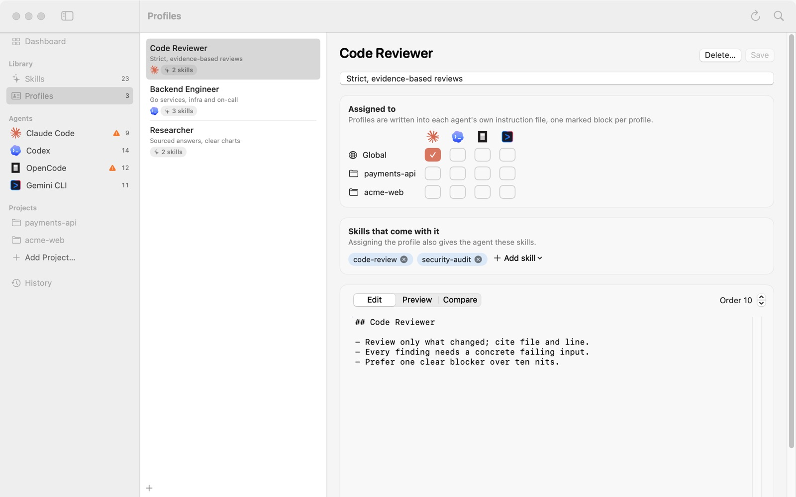

# 05 Profiles

A profile is a set of instructions you can reuse, such as "how to do a code review", optionally with a few skills attached. After this tutorial you'll be able to create and edit profiles, give them to the agents or projects you choose, and know which file each one ends up in and whether anything else in that file gets touched.

## 1. What a profile is

Each profile is a Markdown file in Kitfold's library, `~/.kitfold/library/profiles/<id>.md`: frontmatter with the name, description, attached skills and order, then the body. The demo has three: Code Reviewer, Backend Engineer and Researcher.

When you assign a profile to an agent, Kitfold writes its body into that agent's own instruction file, one marked block per profile:

```markdown
<!-- kitfold:begin profile=code-reviewer hash=fb7c330fa195 -->
## Code Reviewer

- Review only what changed; cite file and line.
- Every finding needs a concrete failing input.
- Prefer one clear blocker over ten nits.
<!-- kitfold:end profile=code-reviewer -->
```

- Everything outside the markers is yours, and Kitfold never touches it. The same goes for blocks other tools manage (Magpie's, for example).
- `hash` is a fingerprint of the body as Kitfold wrote it. If someone edits the block, the file alone is enough to tell; see section 9 below.
- New blocks go at the top of the file, or where Kitfold's blocks already are.
- When a profile is unassigned, Kitfold removes only its own block. It deletes the file only if Kitfold created it and nothing is left once the block is gone.

## 2. Which file it's written to

Wherever it can, Kitfold writes into a file only that agent reads:

| Agent | Global | In a project | Notes |
|---|---|---|---|
| Claude Code | `~/.claude/rules/kitfold.md` | `.claude/rules/kitfold.md` | Claude Code loads its rules folder at launch. Writing there leaves your `CLAUDE.md` alone, and OpenCode, which can fall back to `~/.claude/CLAUDE.md`, doesn't pick it up |
| Codex | `~/.codex/AGENTS.md` | `AGENTS.md` | Only Codex reads the global file. A project's `AGENTS.md` is shared with OpenCode |
| OpenCode | `~/.config/opencode/AGENTS.md` | `AGENTS.md` | Once the global file exists, OpenCode stops falling back to `~/.claude/CLAUDE.md`; the review warns you |
| Gemini CLI | `~/.gemini/GEMINI.md` | `GEMINI.md` | Only Gemini CLI reads it |

If you set `CODEX_HOME` or `CLAUDE_CONFIG_DIR`, or changed a config folder in **Settings › Agents**, the paths follow. When in doubt, hover over a cell in the **Assigned to** grid: it shows something like "Claude Code: written to ~/.claude/rules/kitfold.md".

## 3. Create a profile

1. Press ⌘N. You can also click ＋ at the bottom of the profile list, or choose **New Profile** in Quick Open (⌘K).
2. Fill in the name and a short description, then click **Create**.

A new profile's body is just a `## <name>` heading. Its order is 100, and it isn't assigned to any agent yet.

Kitfold derives an id from the name: Code Reviewer becomes `code-reviewer`. The id is the file name in the library and the `profile=` in the block markers, and it stays the same if you rename the profile later. The app shows profiles by name; the command line takes the id, and `kitfold profiles` lists each id with its name.

## 4. Edit

Click **Profiles** in the sidebar (⌘3) and pick one from the list:



Under each profile in the list are the logos of the agents it's assigned to and how many skills it brings. On the right is the editor:

- **Name and description**: the large title is the name; edit it in place. The line below is the description.
- **Body**: write Markdown under **Edit**; switch to **Preview** to see it rendered.
- **Order**: **Order 10** at the top right steps by 10. When several profiles go into the same file, lower order comes first.
- **Skills that come with it**: assigning the profile also gives the agent these skills. Click **Add skill** to pick one; click × next to a skill to drop it.

Click **Save** (⌘S) when you're done. Saving writes the profile file in the library right away and keeps the previous version (in `~/.kitfold/backups/profiles/<id>/`), which you'll find under **Compare**.

**Agents' files change only when you apply.** After you save a profile that's assigned to an agent, the pending bar shows the files that need the new text, such as "1 file change pending". Press ⌘↩ or click **Review & Apply…**, check the diff for each file, and click **Apply**. The bar has no **Discard** here: the saved profile is the change. On the command line, that's `kitfold apply`.

### How the attached skills are given out

When a profile is assigned to an agent, its skills are given to that agent in the same scope, as if you had switched them on yourself:

- if the agent already sees the skill (from a shared folder, say), nothing happens;
- if not, it's linked into the agent's own skills folder, shown in the review as "Link data-viz for Claude Code (via profile “Researcher”)";
- if you explicitly switched that skill off for the agent, your switch wins.

Unassign the profile and Kitfold takes back the links it made because of it.

## 5. Compare

Switch to **Compare** and pick an entry under **Compare with**:

- **Deployed in <file>**: the profile's text as it is in that file now. Use it to see the difference when you've saved an edit but not applied it, or when someone edited the block outside Kitfold.
- **Saved <time>**: a version you saved earlier. To bring back an old wording, select the text in the diff and copy it.

The diff compares the version you picked with **This editor**, the text you're editing, saved or not.

## 6. Assign

**Assigned to** in the editor is a grid: one row per scope (Global and each project), one column per agent.

To give Code Reviewer to Codex as well:

1. In the **Global** row, click Codex's cell. It shows a dashed ＋.
2. Press ⌘↩ to open the review. There's a row "Update Code Reviewer in ~/.codex/AGENTS.md" with the note "Read by Codex". The diff adds the new block at the top of the file; the existing `# Codex` lines stay as they are.
3. Click **Apply**.

Click the same cell again to unassign; after you apply, Kitfold removes the block.

You can assign profiles elsewhere too: the **Profiles** card on an agent's page has a switch for each profile, under "Kitfold writes assigned profiles to …", and a project's page has a **Profiles for this project** grid (see [06](06-projects.md)).

## 7. Several profiles in one file

An agent can have several profiles at once. Each gets its own block, sorted by order, lowest first (then by name). In the demo, Code Reviewer is 10, Backend Engineer 20 and Researcher 30, so Code Reviewer comes first in any file they share. To change the order, change **Order**, save and apply.

## 8. Shared files

A project's `AGENTS.md` is Codex's profile file and OpenCode's too. When the project has no `CLAUDE.md`, `.claude/CLAUDE.md` or `CLAUDE.local.md`, Claude Code reads it as well. One file can't be split by agent, so:

- assign a profile to Codex only, and OpenCode still reads it;
- give Codex Backend Engineer and OpenCode Researcher, and the file holds both blocks: both agents see both.

The review lists these under **Needs attention**. For example, assigning Researcher to OpenCode in payments-api gives:

> OpenCode also reads AGENTS.md
> ~/work/payments-api/AGENTS.md is shared, so OpenCode will see Backend Engineer too. Agents can't be isolated within one file.

> Claude Code also reads AGENTS.md
> ~/work/payments-api/AGENTS.md is shared, so Claude Code will see Backend Engineer, Researcher too. Agents can't be isolated within one file.

Creating a file can change what another agent reads. The first global profile you give OpenCode creates `~/.config/opencode/AGENTS.md`, and the review warns "OpenCode will stop reading CLAUDE.md": OpenCode falls back to `~/.claude/CLAUDE.md` only while that file doesn't exist.

These are warnings; they don't block the apply. The four global files are independent of each other. In a project, only Claude Code (`.claude/rules/kitfold.md`) and Gemini CLI (`GEMINI.md`) have a file of their own; Codex and OpenCode share `AGENTS.md`.

## 9. A profile block edited outside Kitfold

If you or another tool edit the text inside a block, the fingerprint no longer matches. Kitfold points this out in several places:

- **Health** on the Dashboard and **Issues** on the agent's page: "Profile “Code Reviewer” was edited outside Kitfold";
- under **Instruction files** on the agent's page, the block's tag turns orange, with the line "“Code Reviewer” was edited here outside Kitfold." and two buttons:
  - **Keep edit** opens a review that copies the edited text from the file into the profile ("Copy the edit into profile “Code Reviewer”") and rewrites the block. If the profile is also written to other files, they get the new text in the same review. The profile is written only when you apply; **Cancel** changes nothing, and undoing the apply puts the old profile back too.
  - **Overwrite…** opens a review that puts the profile's text back over the edit. The row is marked caution, with the note "Overwrites edits made outside Kitfold"; the file is backed up first, and you can undo it.

Until you choose, Kitfold won't write that file. Every review lists it under **Not written this time**, as in "~/.claude/rules/kitfold.md won't be written", and the other changes in the same apply go ahead. The command line prints the same under a "Not written this time" heading.

Edits outside the markers don't count as outside edits; Kitfold leaves them alone.

## 10. Codex's AGENTS.override.md

When a folder has an `AGENTS.override.md` that isn't empty, Codex reads it instead of the `AGENTS.md` next to it, globally (`~/.codex/AGENTS.override.md`) and in projects. A profile written to `AGENTS.md` then has no effect on Codex, and the review warns:

> Codex won't read AGENTS.md while AGENTS.override.md exists
> ~/.codex/AGENTS.override.md replaces ~/.codex/AGENTS.md, so the profile has no effect on Codex. Empty or remove the override file, or move its text into a profile.

On Codex's page, `AGENTS.md` is marked **not loaded** as well.

## 11. Delete a profile

Click **Delete…** at the top right of the editor and confirm with **Move to Trash**. The profile file goes to Kitfold's own trash (`~/.kitfold/backups/trash/`) and its assignments leave the draft. Its blocks come out of the agents' files when you apply.

## 12. On the command line

```console
$ kitfold profile code-reviewer codex
  ~ edit ~/.codex/AGENTS.md
    Update Code Reviewer in ~/.codex/AGENTS.md — Read by Codex
    + <!-- kitfold:begin profile=code-reviewer hash=fb7c330fa195 -->
    + ## Code Reviewer
    + 
    + - Review only what changed; cite file and line.
    + - Every finding needs a concrete failing input.
    + - Prefer one clear blocker over ten nits.
    + <!-- kitfold:end profile=code-reviewer -->
    + 
      # Codex
  ~ edit ~/.kitfold/kitfold.json
    Save assignments to kitfold.json

Apply 1 file change? Re-run with --yes to apply.
```

- It takes the id, not the name. `kitfold profiles` lists the ids. An id that doesn't exist is refused and nothing is saved; `--force` saves the rule anyway.
- `'*'` means all agents, `--project <path>` assigns in one project only, `--clear` removes the rule, and `--yes` actually applies.
- `kitfold agents` marks files that hold Kitfold blocks with `[kitfold: code-reviewer]`.
- After saving a profile edit in the app, `kitfold apply` writes the new text into the files it's assigned to.

---

[← Previous: 04 Review, apply, undo](04-review-apply-undo.md) · [Contents](README.md) · [Next: 06 Per-project setups →](06-projects.md)
