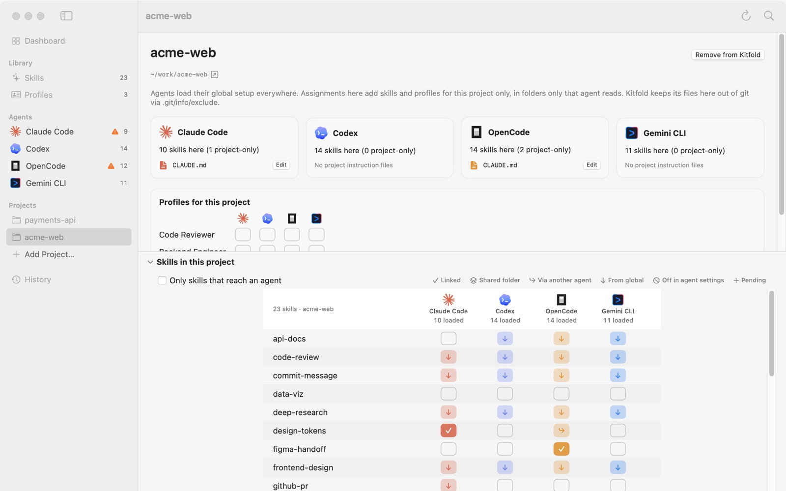

# 06 Per-project setups

Wherever an agent runs, it loads its global setup. A project setup adds to that or takes away from it: a skill or profile for one repository only, or a global skill switched off in one repository. This tutorial uses the demo's two projects, acme-web and payments-api.

## 1. Add a project

1. In the sidebar, under **Projects**, click **Add Project…**.
2. Choose the project folder. Kitfold uses its git root: pick a subfolder of a repository and the whole repository is added; if the folder isn't in a git repository, the folder itself is used.

The project is named after its folder and shows up right away in the sidebar, in every scope picker, in a skill's **Who gets it** grid, in a profile's **Assigned to** grid, and in Quick Open (⌘K).

Adding a project only records it in `~/.kitfold/kitfold.json`. There's no review, and nothing in the project is touched. On the command line you don't need to add it first: assigning with `--project <path>` adds it.

## 2. The project page

Click a project in the sidebar to open its page. From top to bottom:

- **The project's name** and a **Remove from Kitfold** button, then the project's path and a short explanation.
- **A card for each agent**: "N skills here (M project-only)", where N includes what comes from global. Below it, the instruction files the agent loads in this project, each with an **Edit** button.
- **Issues in this project**, only when there are any.
- **Profiles for this project**: a profile × agent grid that works like **Assigned to** on the Profiles page.
- **Skills in this project**: the skill matrix for this project, which you can collapse.



## 3. Switching scope on the Skills and agent pages

You can look at a project without opening its page:

- **Skills page**: the picker in the toolbar that says **Global** by default. Switch it to acme-web and the agent dots in the list, and the matrix, show that project. A skill's **Who gets it** grid already has a row for Global and one for each project.
- **An agent's page**: the picker next to **Showing** at the top right. In a project:
  - skills are grouped by how they reach the agent as usual, plus a **Project skills** group for what loads only in this project;
  - **Instruction files** lists the loaded global files first, then the project's, in the order the agent puts them together;
  - the **Profiles** card names the project's target file, such as "Kitfold writes assigned profiles to ~/work/acme-web/.claude/rules/kitfold.md."

## 4. Inheritance: "from global" in a project

A project's matrix has one more kind of cell:

| Cell | Meaning |
|---|---|
| ↓ (light) | From global. The agent loads it everywhere, this project included |
| ✓ (solid) | Linked into this project's own skills folder |
| ↪ | Via another agent's folder, e.g. OpenCode also reads the project's `.claude/skills` |
| ⊘ | Switched off in the agent's own settings |

In the screenshot:

- code-review is ↓ for all four agents, because it was given to every agent globally.
- design-tokens is linked for Claude Code only (✓), so the link is in `acme-web/.claude/skills`. OpenCode reads that folder too, so its cell is ↪.
- figma-handoff is linked for OpenCode only, in `.opencode/skills`; no other agent sees it.
- i18n-sync is ⊘ for Codex, because Codex's global `config.toml` switches it off.

## 5. Add a skill to one project

To give test-writer to Codex in acme-web only:

1. Open acme-web's page (or switch the Skills page to acme-web) and click Codex's empty cell in the test-writer row. It shows a dashed ＋.
2. Press ⌘↩ to review. You'll see:
   - "Link test-writer for Codex (assigned)", `~/work/acme-web/.codex/skills/test-writer → ~/.kitfold/library/skills/test-writer`;
   - "Keep Kitfold's files in acme-web out of git", adding `/.codex/skills/test-writer` to `.git/info/exclude` (see section 8);
   - "Save assignments to kitfold.json".
3. Click **Apply**.

Each agent's project skills folder:

| Agent | Project skills folder |
|---|---|
| Claude Code | `.claude/skills` (OpenCode reads it too) |
| Codex | `.codex/skills` |
| OpenCode | `.opencode/skills` |
| Gemini CLI | `.gemini/skills` |

If the agent already has the skill globally, nothing is linked in the project.

## 6. Switch a global skill off in one project

A global skill lives in a global folder. Removing its link would take it away everywhere, not in one project. So Kitfold writes the agent's own project setting instead, and only that one entry:

| Agent | Written to | Entry |
|---|---|---|
| Claude Code | `.claude/settings.local.json` | `skillOverrides › "code-review": "off"` |
| OpenCode | The project's last `opencode.json` that OpenCode reads (at the root or in `.opencode/`); if there's none, a new `.opencode/opencode.json` | `permission.skill › "code-review": "deny"` |
| Gemini CLI | `.gemini/settings.json` | `skills.disabled › "code-review"` |
| Codex | Not possible | Codex honors `[[skills.config]]` only in `$CODEX_HOME/config.toml`; it has no per-project switch |

To switch code-review off for every agent in acme-web:

1. On the Skills page, select code-review. In **Who gets it**, open the ⋯ menu at the end of the acme-web row and choose **All agents off**. You can also click the ↓ cells in the project's matrix one by one.
2. Press ⌘↩ to review. Claude Code, OpenCode and Gemini CLI each get a row "Hide code-review from …"; expanded, each shows just the entry from the table above. `.git/info/exclude` is updated too.
3. Under **Needs attention** there's:

   > “code-review” stays visible to Codex in this project
   > It's enabled globally, and Codex reads `[[skills.config]]` only from $CODEX_HOME/config.toml, so a skill can't be hidden in one project alone. Switch it off globally instead.

4. Click **Apply**. Those three agents' cells turn ⊘; Codex's stays ↓, with a small orange "!" because its "off" rule can't take effect. Hover over it to read why ("This switch has no effect: …").

For Codex, a skill that only some projects need shouldn't be given globally. Assign it in the projects that need it instead. On the command line, `kitfold assign code-review codex --off --project …` prints the same reason and saves nothing, because the rule wouldn't change anything; `--force` saves it anyway.

Two more things:

- `.claude/settings.local.json` is Claude Code's personal project settings file. OpenCode's and Gemini CLI's project settings files may well be committed to the repository: when Kitfold edits one that already exists, the review notes "If this file is committed, everyone using the repository gets this setting."
- It works the other way too. For a skill the agent's own settings switch off globally, switching it on in one project makes Claude Code write `"on"` and OpenCode `"allow"`. Gemini CLI and Codex can't do this; the review says why and suggests switching it on globally instead, and the cell shows the same "!".

To go back, choose **Clear (leave as found)** in the same ⋯ menu and apply. Kitfold takes back the entries it wrote, and deletes a settings file it created once it's empty. Or undo that apply from History.

## 7. Project profiles

Click a cell in **Profiles for this project** on the project page, or in the project's row of **Assigned to** on the Profiles page. In a project, profiles are written to:

| Agent | File |
|---|---|
| Claude Code | `.claude/rules/kitfold.md` |
| Codex, OpenCode | `AGENTS.md` (shared by both; see [05](05-profiles.md)) |
| Gemini CLI | `GEMINI.md` |

Global profiles still apply. Agents read the global files first, then the project's; an agent's page switched to the project shows the full order.

In the demo, Backend Engineer is given to Codex in payments-api. That assignment:

- adds a Backend Engineer block at the top of `payments-api/AGENTS.md`, leaving the existing `# payments-api` lines as they are;
- links its skills terraform-plan and test-writer into `.codex/skills`. Codex already has k8s-debug globally, so that one isn't linked;
- comes with review warnings that OpenCode and Claude Code read this `AGENTS.md` too (payments-api has no `CLAUDE.md`).

## 8. Kitfold's files and git

Links and files Kitfold creates in a project are listed in a marked section of `.git/info/exclude`. For the demo's acme-web:

```gitignore
# kitfold:begin (managed by Kitfold)
/.claude/skills/design-tokens
/.opencode/skills/figma-handoff
# kitfold:end
```

- `.git/info/exclude` applies only to your local clone and is never committed, so teammates aren't affected.
- The section is updated with every apply; in the review it's the row "Keep Kitfold's files in acme-web out of git".
- It covers only what Kitfold created. A block or entry added to a file that already existed (a committed `AGENTS.md`, say) shows up in `git status` and `git diff`.
- The project root needs a `.git` folder for this.
- To turn it off, uncheck **Keep Kitfold's project files out of git (.git/info/exclude)** in **Settings › General**.

## 9. Remove a project

Right-click the project in the sidebar and choose **Remove from Kitfold**, or use the button on the project page. This only takes it off Kitfold's list; the project folder isn't touched.

If the project still has assignments, Kitfold refuses with "This project still has assignments, including switched-off ones. Clear them (Clear in the row's menu) and apply first, so Kitfold can clean up its files there." Here "assignments" means any rule for the project, including "off" rules such as a global skill switched off in it (section 6). So what you need is to clear those rules, not just switch them off:

1. Skills: in the skill's **Who gets it**, open the ⋯ menu on the project's row and choose **Clear (leave as found)**. Do this for each skill you assigned in the project.
2. Profiles: click the switched-on cells in **Profiles for this project** to turn them off.
3. Review and apply. Kitfold takes back its links, settings entries and profile blocks in the project, deletes files it created, and cleans up its section of `.git/info/exclude`.
4. Then remove the project.

If you're not sure which rules are left, look in `rules` in `~/.kitfold/kitfold.json` for entries whose `scope` is `project:<project path>`. On the command line, this clears every rule for one skill in the project:

```console
$ kitfold assign design-tokens '*' --clear --project ~/work/acme-web --yes
```

## 10. On the command line

`skills`, `agents`, `assign` and `profile` all take `--project <path>`. The path can be relative or a subfolder of the project; Kitfold uses the git root. Switching a global skill off in a project shows the same review as the app:

```console
$ kitfold assign code-review '*' --off --project ~/work/acme-web
  + file ~/work/acme-web/.claude/settings.local.json
    Hide code-review from Claude Code
    + skillOverrides › "code-review": "off"
  + file ~/work/acme-web/.gemini/settings.json
    Hide code-review from Gemini CLI
    + skills.disabled › "code-review"
  ~ edit ~/work/acme-web/.git/info/exclude
    Keep Kitfold's files in acme-web out of git — .git/info/exclude is local to this clone and never committed.
      # kitfold:begin (managed by Kitfold)
    + /.claude/settings.local.json
      /.claude/skills/design-tokens
    + /.gemini/settings.json
    + /.opencode/opencode.json
      /.opencode/skills/figma-handoff
  + file ~/work/acme-web/.opencode/opencode.json
    Hide code-review from OpenCode
    + permission.skill › "code-review": "deny"
  ~ edit ~/.kitfold/kitfold.json
    Save assignments to kitfold.json

Needs attention
  ! “code-review” stays visible to Codex in this project
    It's enabled globally, and Codex reads `[[skills.config]]` only from $CODEX_HOME/config.toml, so a skill can't be hidden in one project alone. Switch it off globally instead.

Apply 4 file changes? Re-run with --yes to apply.
```

`kitfold skills --project ~/work/acme-web` prints the project's matrix, and `kitfold agents --project ~/work/acme-web` lists the folders and instruction files each agent reads there.

---

[← Previous: 05 Profiles](05-profiles.md) · [Contents](README.md) · [Next: 07 Your skill library →](07-skill-library.md)
