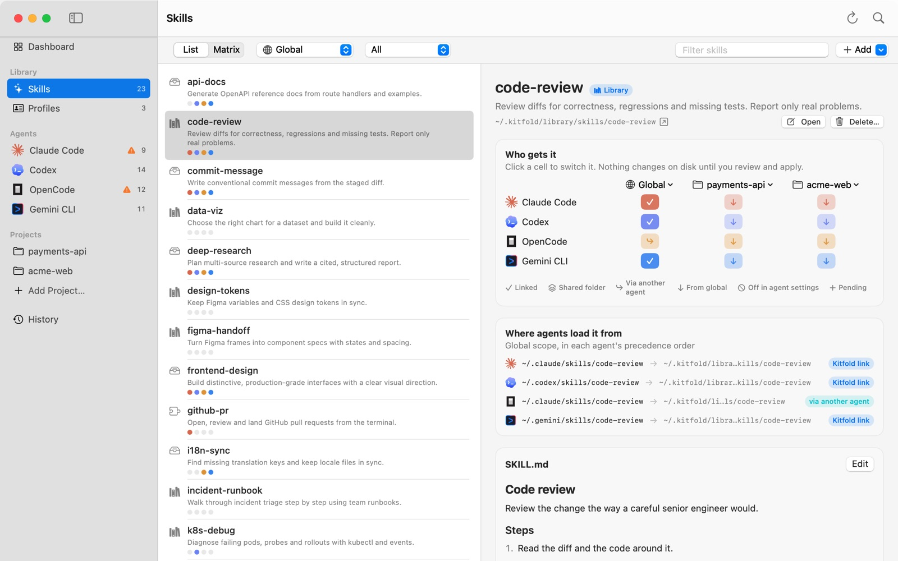
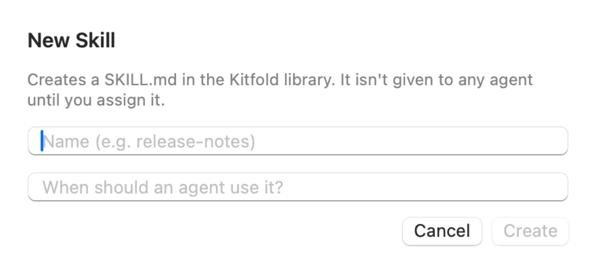

# 07 Your skill library

This tutorial covers where each skill in Kitfold comes from, and how to create a skill, edit its `SKILL.md`, import a skill folder from elsewhere, move a stray skill into the library, delete a skill, and read the problems listed on a skill's page.

## Where skills come from

The **Skills** page lists every skill Kitfold found on this Mac. Next to each skill's name is a label that says where it lives:

| Label | Where | Loaded without an assignment? | Editable in Kitfold? |
|---|---|---|---|
| Library | `~/.kitfold/library/skills`, Kitfold's own library | No. It's linked into an agent's folder when you assign it | Yes |
| Source | A folder Kitfold reads in place: `~/.agents/skills`, a folder you added, a cloned Git repository | Depends on the folder. Codex, OpenCode and Gemini CLI read `~/.agents/skills` directly; a folder you added is read by no agent | Yes |
| Local folder | A real folder sitting directly in an agent's skills folder, such as `~/.codex/skills/notebook-tools` | Yes, by that agent (and any agent that reads its folder) | Yes |
| Linked folder | A link in an agent's skills folder that points somewhere Kitfold doesn't know | Yes | Yes |
| Plugin | An agent's plugin, extension or built-in skill, such as a Claude Code plugin or Codex's `.system` skills | Up to the agent's plugin system | No, read-only |
| Nested | A `SKILL.md` inside another skill's folder | Codex and OpenCode load it as a separate skill | Can't be moved on its own |

On the first launch, if `~/.agents/skills` exists, Kitfold registers it as a source. If `~/.agents/.skill-lock.json` exists, the source is marked "skills CLI", meaning that tool manages the folder. If Magpie is installed, its library `~/.config/magpie/library/skills` is registered too.

To look at one kind at a time, use the filter menu in the **Skills** toolbar: **All**, **Library**, **Sources**, **Local folders**, **Plugins**, **With problems**. On the **Dashboard**, the **Skill folders** card counts the skills of each kind and lists the registered sources.



## Create a skill

1. Press ⇧⌘N, or click **Add › New Skill…** on the **Skills** page. (It's also under **Quick actions** on the Dashboard and in ⌘K Quick Open.)
2. Type a name, such as `api-changelog`. Use lowercase letters, digits and hyphens: Kitfold lowercases what you type and turns spaces and punctuation into hyphens, and the result becomes both the folder name and `name`.
3. In the second field, say in one sentence when an agent should use it. This becomes `description`. Agents use it to decide when to load the skill, and Codex and Gemini CLI skip skills that have none.
4. Click **Create**.



Kitfold creates `~/.kitfold/library/skills/api-changelog/SKILL.md` and selects it on the **Skills** page:

```markdown
---
name: api-changelog
description: Summarize API changes between two release tags.
---

# api-changelog

Describe when and how to use this skill.
```

A new skill isn't given to any agent. Once you've written the body, click the cells under **Who gets it** to hand it out, as described in [03 Give skills to the agents you choose](03-assign-skills.md).

## Edit SKILL.md

1. Select the skill on the **Skills** page.
2. On the **SKILL.md** card at the bottom of the details, click **Edit**.
3. Make your changes and click **Save** (⌘S), or **Cancel**.

To use your own editor instead, click **Open** below the skill's name. The `SKILL.md` opens in your default app for Markdown.

Saving works differently from an assignment:

- **It's applied straight away, without a review.** The file changes at once, and a message says "Applied 1 file change. Undo anytime from History."
- **It can be undone from History.** Each save is a History entry like any other apply, such as "Edit SKILL.md of “api-changelog”", and the old text is backed up with it in `~/.kitfold/backups/<id>/`.
- **Every agent that uses the skill gets the new text.** Agents' folders hold links to this folder, so the next time an agent loads its skills it reads the new version. Nothing more needs applying.
- **Folders managed by another tool.** If the skill's source belongs to the skills CLI or Magpie, the editor warns that the tool's next update may replace your edits (for the skills CLI, only for skills on its list). To change such a skill for good, move it into the library first (see below).
- **Plugin skills are read-only.** They have no **Edit** button.

## The frontmatter each agent requires

The part of `SKILL.md` between the `---` lines is the frontmatter. Agents require different fields, and an agent **silently skips** a skill that lacks one:

| Agent | Requires | Without it |
|---|---|---|
| Claude Code | Nothing; `name` defaults to the folder name | Loads it anyway |
| Codex | `description` | Skips it |
| OpenCode | `name` | Skips it |
| Gemini CLI | `name` and `description` | Skips it |

So write both, with `name` matching the folder name. Kitfold checks this for you. A skill that an agent will skip shows up in **Health** as a warning such as "Codex ignores “…”". If you try to give it to an agent that would skip it, the review lists "… can't load “…”" and Kitfold doesn't create that link.

## Import a folder

You have a skill folder (say, downloaded from someone's repository) and want a copy in Kitfold's library:

1. On the **Skills** page, click **Add › Import Folder…**.
2. Choose the folder. It must contain a `SKILL.md`.

Kitfold **copies** the whole folder to `~/.kitfold/library/skills/<name>`, using `name` from the frontmatter, or the folder name if there's none. The original folder is left untouched, and the skill isn't given to any agent.

If the library already has a skill with that name, the import fails with "The library already has a skill named …". Rename one of them first.

## Move into the library

**Move into Library** is different from importing: it **moves** the folder into the library and leaves a link to it in the old place. Agents and tools that used the old path keep working, and from then on the library holds the only copy, which you manage in Kitfold.

A typical case in the demo data is Codex's `notebook-tools`: a real folder someone put in `~/.codex/skills` by hand, labeled **Local folder**.

1. Select `notebook-tools` on the **Skills** page.
2. Click **Move into Library** below the skill's name.
3. The review lists what will happen:
   - Move notebook-tools into the Kitfold library;
   - Leave a link at `~/.codex/skills/notebook-tools` (agents and tools that used the old path keep working);
   - Save assignments to `kitfold.json`: each agent that had the skill as a real folder in its own folder (here, Codex) gets an "on" rule, so Kitfold treats the new link as intended rather than as a leftover.
4. Click **Apply**.

The move is recorded in **History** as "Adopt notebook-tools" and can be undone.

A few notes:

- Skills already in the library, plugin skills and nested skills don't have this button.
- If the skill comes from a source another tool manages (such as a skill the skills CLI installed in `~/.agents/skills`), the review warns that after the move the tool may treat the skill as replaced by a link, and its updates will no longer reach it.
- If the library already has a folder with that name, Kitfold refuses the move.

## Delete a skill

Deleting a skill takes it away from every agent and moves its folder to Kitfold's own trash, `~/.kitfold/backups/trash/`. Nothing is erased: like any change, it's reviewed first and can be undone.

In the demo data, `release-notes` is a library skill that Claude Code and Codex get through Kitfold's links.

1. Select `release-notes` on the **Skills** page.
2. Click **Delete…** below the skill's name. The same item is in the right-click menu of the skill list, of the matrix, and of a skill on an agent's page.
3. The review lists what will happen:
   - Unlink release-notes from Claude Code (no longer assigned), and the same for Codex;
   - Move release-notes to Kitfold's trash (the folder is kept in `~/.kitfold/backups/trash`, and undo puts it back where it was);
   - Save assignments to `kitfold.json`: the skill's assignments are cleared.

   Under **Needs attention** it adds "OpenCode will stop loading “release-notes”": OpenCode found it only through Claude Code's folder.
4. Click **Apply**.

The deletion is recorded in **History** as "Delete release-notes". Undoing it puts back the folder, the links and the assignments.

What else goes with the skill, when there is any:

- **Every other link to its folder**, so none is left broken: in the folder of every agent Kitfold knows (Kiro's and Cursor's as much as Claude Code's), in a shared folder, one left behind by **Move into Library**, one another tool made. A link Kitfold didn't make is marked caution, and undo restores it.
- **Its entry in the skills CLI's list.** A skill the skills CLI installed is taken off `~/.agents/.skill-lock.json`, as `npx skills remove` would, so `npx skills update` doesn't install it again. Only that entry changes.
- **Entries Kitfold wrote in an agent's own settings** to switch the skill off, such as OpenCode's `permission.skill`.
- **Its place in profiles.** A profile that bundles the skill drops it from its skill list.

A few notes:

- Plugin skills belong to the agent's plugin system and a nested skill to the skill around it, so their **Delete…** is greyed out; hover over it for the reason. Switch them off instead.
- A skill that's only linked into agents' folders from somewhere else (a linked folder, such as a repository checkout) can be deleted too, but only its links go: the folder itself isn't Kitfold's, so it stays where it is, and the review says so.
- Deleting a skill from a folder several agents read, such as `~/.agents/skills`, takes it from all of them. The review names them under **Needs attention**, such as "Codex, OpenCode, Gemini CLI read this folder".
- If another tool manages the folder and Kitfold can't take the skill off its list (Magpie, or a skills CLI folder whose list can't be read), or it's a cloned Git repository, the review warns that the tool's next update, or the next `git pull`, may bring the skill back. A skill in `~/.agents/skills` that isn't on the skills CLI's list was put there by hand or by another tool; the skills CLI never touches it, so there's no warning.
- If another folder has the same name, the review says so. That folder stays, and agents may keep loading a skill by that name.
- The trash isn't cleaned up with old backups. Empty `~/.kitfold/backups/trash/` yourself once you're sure.

From the command line, it's `kitfold delete <skill>`; see [08 The command line](08-command-line.md#deleting-a-skill-delete).

## Skill sources

A source is a skill folder Kitfold **reads in place**: nothing is copied, and its skills are simply listed for you to assign.

**Add a local folder:** on the **Skills** page, click **Add › Add Source Folder…** and choose a folder of skills. Kitfold looks one level down: each subfolder with a `SKILL.md` is a skill.

**Add a Git repository:** click **Add › Add Git Repository…**, enter the repository's URL and click **Clone**. Kitfold makes a shallow clone in `~/.kitfold/sources/<repository name>` and lists every folder with a `SKILL.md`, a few levels deep. Kitfold doesn't pull updates for you; run `git pull` in that folder when you want them.

Either way, nothing is given to any agent. Assign the skills you want.

**Manage sources:** open **Settings** (⌘,) and go to the **Sources** tab. **Skill folders Kitfold reads in place** lists each source with its name, path and the tool that manages it. Click the minus button to remove one. Removing a source only stops Kitfold from reading it; no files are deleted. The Kitfold library (`~/.kitfold/library`) is always included and isn't in this list.

## Problems shown on a skill

When something is wrong with a skill's `SKILL.md`, an orange exclamation mark appears next to its name in the list, and its details get a **Problems** card. Choose **With problems** in the filter menu to find them all.

| Problem | Meaning | What to do |
|---|---|---|
| SKILL.md has no frontmatter (name/description) | The file doesn't start with a frontmatter block between `---` lines | Add `name` and `description`, as in the template above |
| Missing description — agents use it to decide when to load the skill | `description` is missing or empty | Write one sentence on when to use it. Codex and Gemini CLI skip skills without one |
| Name “…” should be at most 64 characters: lowercase letters, digits, “-”, “_” or “:” | `name` is too long, or has capitals, spaces or other characters | Use a name like `api-changelog` |
| Frontmatter is not closed with --- / Frontmatter has no readable keys / Unreadable frontmatter line: … | The frontmatter can't be read | Fix its format against the template |
| 2 folders are named “…”. Agents pick one; Kitfold assigns the library copy first. | Skills with the same name live in different places | The card lists the other folder's path. Keep one, or rename one of them |

For skills in the library and in sources, the **Dashboard**'s **Health** card lists these problems too, as notes: turn on **Show notes** to see them. Nested `SKILL.md` files, name clashes and skills an agent skips appear in **Health** directly. [09 Troubleshooting](09-troubleshooting.md) explains them and what to do.

---

[← Previous: 06 Per-project setups](06-projects.md) · [Contents](README.md) · [Next: 08 The command line →](08-command-line.md)
