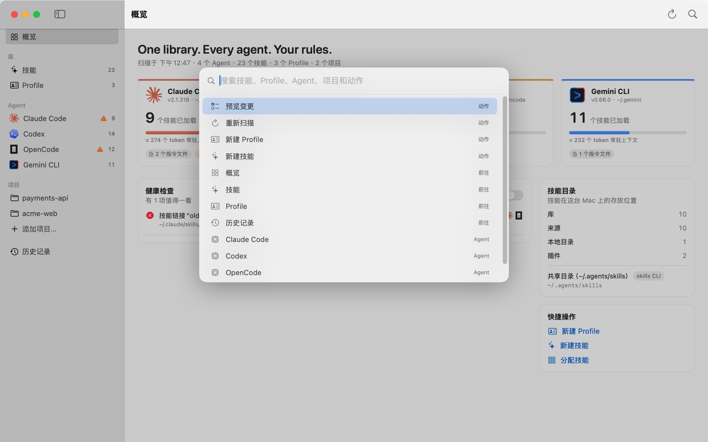
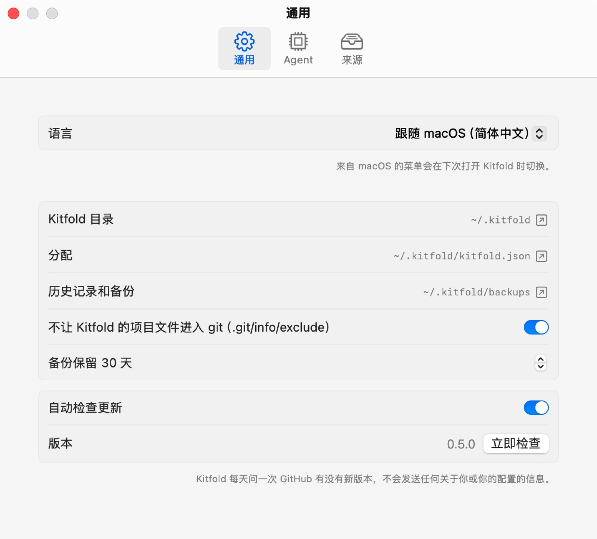

# 01 安装与第一次打开

这一篇从源码构建 Kitfold，第一次打开它，认识窗口的各个部分，再学会用 ⌘K 快速跳转和切换界面语言。第一次打开时，Kitfold 只读取你的配置，不做任何改动。

## 准备

- 运行：macOS 15 或更高版本。
- 构建：Xcode 26 或更高版本（Swift 6.2+）。
- 目前还没有预编译的安装包，需要自己构建。

## 1. 构建并打开

```bash
git clone https://github.com/kadaliao/kitfold.git && cd kitfold
make app                 # 生成 build/Kitfold.app
open build/Kitfold.app
```

`make app` 是发布构建，App 里还带着一份命令行工具 `Kitfold.app/Contents/Resources/kitfold`（用法见[命令行](08-command-line.md)）。想放进“应用程序”文件夹，直接把 `Kitfold.app` 拖过去即可。

开发时也可以用 `make run`，直接从构建目录启动。

## 2. 第一次打开：只读

第一次打开时，Kitfold 会把你的 Agent 读一遍：装了哪些、版本多少、从哪些目录加载技能、读哪些指令文件。窗口顶部会提示：

> 欢迎使用。Kitfold 只读取了你的配置，没有做任何改动。

它只在自己的目录 `~/.kitfold/` 里创建这些东西：

| 路径 | 用途 |
|---|---|
| `~/.kitfold/kitfold.json` | 你的分配规则，以及项目、来源和偏好设置。是普通的 JSON 文件，可以直接打开看 |
| `~/.kitfold/library/` | 库：Kitfold 自己保管的技能（`skills/`）和 Profile（`profiles/`），一开始是空的 |
| `~/.kitfold/backups/` | 写入文件前留的备份，只有你自己能读 |
| `~/.kitfold/state.sqlite` | 历史记录和日志：每次应用做了什么，撤销时要用 |

如果 `~/.agents/skills` 存在，Kitfold 会把它登记为技能来源；装了 Magpie 的话，它的库也会登记进来。来源只会被读取，不会被移动或修改。

除此之外，磁盘上什么都不会变。Agent 的技能目录、指令文件和设置文件，只有在你拨动开关、看过预览并点了**应用**之后才会改动，而且每次都能撤销。设置里的操作（添加项目、添加来源、调整偏好）只改 `kitfold.json`，会直接保存。

Kitfold 不在后台运行，也不监视文件。如果你在终端里装了新技能，或者改了某个 Agent 的配置，点一下工具栏的**重新扫描**（⌘R）。`kitfold.json` 被命令行或编辑器改过时，App 回到前台就会重新读取它，见[命令行](08-command-line.md)。

## 先用演示数据试试（可选）

教程里的截图都来自一个虚构的演示环境：四个 Agent、二十多个技能、三个 Profile（Code Reviewer、Backend Engineer、Researcher），以及 acme-web 和 payments-api 两个项目。想跟着操作、又不想碰自己的配置，可以在仓库目录里生成同样的环境，再让 App 使用它：

```bash
make build
KITFOLD_LANG=zh-Hans make demo DIR=/tmp/kitfold-demo
KITFOLD_FAKE_HOME=/tmp/kitfold-demo PATH=/tmp/kitfold-demo/.local/bin:/usr/bin:/bin .build/debug/KitfoldApp
```

`KITFOLD_FAKE_HOME` 让 Kitfold 把这个目录当作主目录：Agent 的目录、Kitfold 自己的数据都在里面，你真实的 `$HOME` 不受影响。演示数据里的 Agent 是只会回答 `--version` 的替身，所以四个都显示为已安装。生成时加上 `KITFOLD_LANG=zh-Hans`，演示数据里的历史记录就是中文的。注意 `DIR` 指向的目录会先被清空再重建。

## 3. 认识窗口


左边的侧栏从上到下是：

- **概览**：首页，下一节细说。
- **库**：**技能**和 **Profile**。后面的数字是这台 Mac 上找到的技能总数（同名的算一个）和 Profile 数。
- **Agent**：Claude Code、Codex、OpenCode、Gemini CLI 各占一行。数字是它在全局实际加载的技能数；有警告时，数字前会出现 ⚠。没检测到的 Agent，或者你关掉了“由 Kitfold 管理”的，显示为灰色。
- **项目**：你添加的项目。点**添加项目…**选择一个项目目录，Kitfold 会使用它的 git 根目录。详见[按项目配置](06-projects.md)。
- **历史记录**：每次应用和撤销的记录。

右上角的工具栏有两个按钮：**重新扫描**（⌘R）和**快速打开**（⌘K）。扫描时旁边会转圈。

有还没应用的改动时，窗口底部会出现一条待应用栏：左边写着“N 处文件变更待应用”，有需要留意的地方时还会多一个“N 项待检查”；右边是**预览并应用…**（⌘↩），改过分配时还有**放弃**。Kitfold 里的开关都只改草稿，到这里预览、确认之后才写入磁盘，详见[预览、应用和撤销](04-review-apply-undo.md)。

## 4. 概览页

概览页告诉你现在的整体情况：

- **标题下的一行**：上次扫描的时间，以及 Agent、技能、Profile、项目各有多少。
- **Agent 卡片**：每个 Agent 一张，写着版本和配置目录、实际加载了几个技能、大约多少 token 常驻上下文、加载了几个指令文件；有警告时还有一个橙色的数字。把鼠标停在进度条上，可以看到这个估算是怎么算的。点卡片进入这个 Agent 的页面，见[下一篇](02-what-agents-load.md)。
- **健康检查**：值得一看的问题，比如失效的链接、同名技能、在 Kitfold 之外被修改过的 Profile 块。右边的 Agent 图标表示它影响哪些 Agent。打开**显示提示**，还会列出不那么要紧的提示。每种问题的含义和处理办法见[常见问题与排错](09-troubleshooting.md)。
- **技能目录**：技能在这台 Mac 上都放在哪：库、来源、Agent 目录里的本地目录、插件各有多少个，下面列出登记过的来源。
- **快捷操作**：**新建 Profile**、**新建技能**、**分配技能**（打开技能页）。

演示数据里，健康检查报告了一个失效的链接“old-linter”：`~/.claude/skills/old-linter` 指向的目录已经不存在，Claude Code 和 OpenCode 都会静默跳过它。为什么 OpenCode 也受影响？因为它也读 Claude Code 的技能目录，下一篇会讲到。

## 5. 快速打开（⌘K）



按 ⌘K，或者点工具栏的放大镜。什么都不输入时，最上面是常用动作：**预览变更**、**重新扫描**、**新建 Profile**、**新建技能**，接着是前往**概览**、**技能**、**Profile**、**历史记录**，以及各个 Agent。输入几个字，就能找到任意一个技能、Profile、Agent 或项目。

- ↑ ↓ 选择，↩ 执行，Esc 关闭。
- 右边的灰字也参与匹配：输入“插件”会列出所有插件技能，输入“项目”会列出所有项目。

## 6. 切换界面语言



Kitfold 的界面有英文和简体中文两种。默认跟随 macOS：在系统的首选语言里，取排在最前、Kitfold 又支持的那一种。任何一种中文都会显示为简体中文，其他语言显示为英文。

要单独给 Kitfold 指定语言：

1. 打开 **Kitfold › 设置…**（⌘,），选**通用**。
2. 在**语言**里选 **English** 或**简体中文**。选**跟随 macOS（…）**就恢复默认，括号里是 macOS 当前的语言。
3. Kitfold 自己的文字立即切换。macOS 提供的菜单和面板（比如“编辑”“窗口”菜单、选择文件的面板）要等下次打开 Kitfold 时才切换。

这个选择存在 macOS 为每个 App 单独记录语言的地方，所以**系统设置 › 通用 › 语言与地区 › 应用程序**里显示的也是它，在那里改也一样。这一项针对的是打包好的 `Kitfold.app`。

命令行不受这个设置影响：它跟随系统语言，也可以用 `--lang en` 或 `--lang zh-Hans` 指定，或者设置环境变量 `KITFOLD_LANG`。从终端启动 App 时如果设置了 `KITFOLD_LANG`，它会优先于设置里的选择。

“通用”页下面还列出了 Kitfold 目录、`kitfold.json` 和备份的位置（点 ↗ 在访达中显示），以及备份保留几天等选项。

## 快捷键

| 快捷键 | 作用 |
|---|---|
| ⌘K | 快速打开 |
| ⌘R | 重新扫描 Agent 和文件 |
| ⌘↩ | 预览变更（有待应用的改动时） |
| ⌘N | 新建 Profile |
| ⇧⌘N | 新建技能 |
| ⌘1 / ⌘2 / ⌘3 / ⌘4 | 概览 / 技能 / Profile / 历史记录 |
| ⌘S | 保存正在编辑的 Profile 或 `SKILL.md`；编辑指令文件时，进入预览 |
| ⌘, | 设置 |
| ↩ / Esc | 在预览窗口里：应用 / 取消 |

这些教程也可以从菜单**帮助 › Kitfold 教程**打开。

---

[目录](README.md) · [下一篇：02 看懂 Agent 实际加载了什么 →](02-what-agents-load.md)
