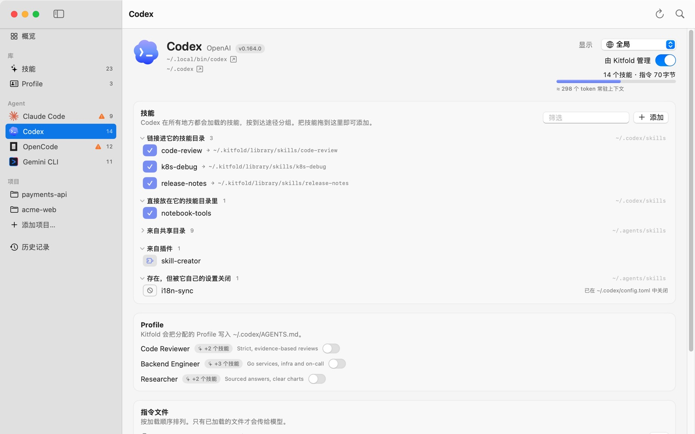

# 02 看懂 Agent 实际加载了什么

每个 Agent 都有自己的页面，列出它此刻真正会加载的技能和指令文件、每一项是从哪来的，以及有没有问题。这一篇以 Codex 的页面为例逐块讲解，最后用 OpenCode 看一个常见的意外：它也会加载 Claude Code 的技能。

## 1. 打开 Agent 页

在侧栏的 **Agent** 下点 **Codex**。也可以在概览页点它的卡片，或者按 ⌘K 输入“Codex”。

## 2. 页头

左边是 Agent 的基本信息：

- 名称、厂商和版本（Codex · OpenAI · v0.164.0）；
- 可执行文件的位置（`~/.local/bin/codex`）和配置目录（`~/.codex`），点旁边的 ↗ 在访达中显示。找不到可执行文件时，这里会写“在 PATH 中找不到 CLI（配置目录存在）”或“这台 Mac 上未检测到”。

右边从上到下是：

- **显示**：作用域选择器，见下一节。
- **由 Kitfold 管理**：检测到的 Agent 默认打开。关掉后，Kitfold 不再改动这个 Agent 的任何文件，矩阵和技能详情里也不再有它这一列；它现有的链接和文件保持原样。这个开关只改 `kitfold.json`，立即生效，不需要预览。
- **14 个技能 · 指令 70字节**：它实际加载的技能数（同名的只算一次），以及已加载的指令文件的总大小。
- 用量条和“≈ 298 个 token 常驻上下文”：每次会话，Agent 都会把它加载的每个技能的名称和描述，连同已加载的指令文件一起交给模型。Kitfold 按每个 token 4 字节粗略估算，方便你比较各个 Agent、发现哪里太臃肿。超过约 15,000 个 token 时，用量条变成橙色。

## 3. 选择作用域

**显示**默认是**全局**，也就是在任意目录启动这个 Agent 时它会加载的内容。添加过项目后（见[按项目配置](06-projects.md)），可以在这里选一个项目，页面就改为显示在那个项目里启动时的情况：

- 项目自己的技能列在**项目技能**里；全局装的技能也会列出来，格子显示 ↓（来自全局）。
- 指令文件先列全局的，再列项目的，和 Agent 实际拼接的顺序一致。
- “怎么找技能”换成这个项目里扫描的目录。

## 4. 技能：按到达途径分组

**技能**卡片回答“它加载了哪些技能，各自是怎么到它手里的”。Kitfold 按到达途径分组，每个技能只列一次，放在它实际生效的那条途径下：

| 分组 | 含义 |
|---|---|
| 链接进它的技能目录 | Agent 自己技能目录里的符号链接，行尾的 → 是链接指向的位置。Kitfold 建的和别的工具建的都在这里 |
| 直接放在它的技能目录里 | 自己技能目录里的真实目录，比如手工拷贝进去的 |
| 来自共享目录 | 几个 Agent 都直接读的目录，比如 `~/.agents/skills` |
| 经由其他 Agent 的目录 | 它也读别的 Agent 的目录，比如 OpenCode 读 `~/.claude/skills` |
| 嵌套在其他技能里 | 某个技能目录深处的 `SKILL.md`。Codex 和 OpenCode 会把它当作一个独立的技能 |
| 项目技能 | 只在选了项目时出现：项目自己目录里的技能 |
| 来自插件 | Agent 的插件、扩展或内置的技能，比如 Codex 自带的 skill-creator |
| 存在，但被它自己的设置关闭 | 目录里有，但 Agent 自己的设置把它关掉了。行尾写明是在哪个文件里关的 |

在 Codex 的截图里：code-review、k8s-debug、release-notes 是 Kitfold 链接进 `~/.codex/skills` 的；notebook-tools 是直接放在那里的目录；还有 9 个来自共享目录 `~/.agents/skills`；skill-creator 来自插件；i18n-sync 虽然也在 `~/.agents/skills` 里，但行尾写着“已在 ~/.codex/config.toml 中关闭”。

几点细节：

- 分组标题后面是数量，右边是这些技能所在的目录。超过 6 项的分组默认收起，点标题展开。
- 同一个技能如果在别的目录里也能找到，它那一行会注明，比如“也在 ~/.agents/skills 中”。Agent 只加载一次，页头的技能数也只算一次。
- 点技能名会跳到技能页，打开它的详情。
- 右上角的**筛选**按名称过滤；**添加**从这台 Mac 上找到的技能里搜索（插件技能除外），点一下就给这个 Agent 打开。也可以把技能名从技能页的列表或矩阵拖到这个页面上，用的是**显示**里选的作用域。新加的技能在应用之前显示为“将添加”。

### 格子的含义

每行开头的格子和技能页矩阵里的一样：它说明技能现在是怎么到达这个 Agent 的，点一下就能切换（只改草稿）。格子的颜色是这个 Agent 的颜色；鼠标停在格子上会显示文字说明。

| 格子 | 含义 |
|---|---|
| 实心，✓ | 在 Agent 自己的技能目录里：Kitfold 建的链接、别的工具或手工建的链接，或者一个真实目录 |
| 浅色，层叠图标 | 来自共享目录 |
| 浅色，↪ | 经由其他 Agent 的目录 |
| 浅色，↓ | 来自全局（只在选了项目时出现） |
| 浅色，叠放的方块 | 嵌套在另一个技能的目录里 |
| 灰色，拼图 | 来自插件 |
| 空白，⊘ | 存在，但被 Agent 自己的设置关闭 |
| 空白 | 没有加载 |
| 虚线框，＋ 或 － | 待应用：应用后会打开或关闭 |
| 右上角橙色的“!” | 这一格有规则，但它不起作用，比如 Codex 没法只在一个项目里隐藏技能。鼠标停在上面会显示“这个开关不起作用：…”和原因 |

怎么用这些格子把技能分给指定的 Agent，见[下一篇](03-assign-skills.md)。

## 5. Profile

**Profile** 卡片列出所有 Profile，每个一个开关，说明里写着 Kitfold 会把它写进哪个文件（Codex 是 `~/.codex/AGENTS.md`）。详见[用 Profile 管理指令](05-profiles.md)。

## 6. 指令文件

**指令文件**卡片按加载顺序列出这个 Agent 可能读取的每个文件。正如卡片上写的：只有已加载的文件才会传给模型。每个文件旁边可能有这些标记：

| 标记 | 含义 |
|---|---|
| 已加载（绿色） | Agent 现在会读这个文件 |
| 未加载（橙色） | 文件存在，但按 Agent 的规则这次不读，比如回退文件已被主文件取代 |
| Kitfold 写入目标 | 给这个 Agent 分配 Profile 时，Kitfold 写的就是这个文件 |
| 回退 | 只在另一个文件不存在时才读 |
| 符号链接 | 这个文件是一个链接 |
| “X 也会读取它”（橙色） | 另一个 Agent 也加载同一个文件，写进去的内容它也会看到 |
| 紫色标签 | 文件里由 Kitfold 写入的 Profile 块，一个 Profile 一个 |
| 橙色、带铅笔的标签 | 这个 Profile 块在 Kitfold 之外被修改过，旁边有**保留修改**和**覆盖…**两个按钮，见[用 Profile 管理指令](05-profiles.md) |
| “包含由 X 管理的块（不会改动）” | 别的工具写入的托管块，Kitfold 不碰 |

文件下面的灰字说明这个 Agent 按什么规则读取它。以 Codex 为例：

- `~/.codex/AGENTS.override.md` 不存在。灰字写着它的规则：存在且非空时，会替代全局的 `AGENTS.md`。
- `~/.codex/AGENTS.md` 已加载，也是 Kitfold 写入目标。

文件存在时右边是**编辑**，不存在时是**创建**。编辑完先看 diff，确认后再应用，和其他改动一样能在历史记录里撤销。

## 7. 它怎么找技能

页面下方的 **Codex 怎么找技能**默认收起，点开后按优先级从高到低列出它扫描的目录。每个目录前有一个角色标记：

- **自己的**：只有这个 Agent 读，Kitfold 把技能链接到这里；
- **共享**：几个 Agent 都读，比如 `~/.agents/skills`；
- **别的 Agent**：另一个 Agent 的目录，这个 Agent 也会读；
- **内置**：插件、系统或管理员的目录。

每个目录下面有一句说明；还没有证据、只是推断的会标上“（未验证）”。再往下是这个 Agent 的注意事项，比如在它自己的设置里怎么隐藏一个技能，最后是“Agent 文档”的链接。

## 8. 问题

如果有问题影响这个 Agent，页面最底部会出现**问题**卡片。它列出当前作用域里的问题，也包括概览页默认不显示的提示。每种问题的含义和处理办法见[常见问题与排错](09-troubleshooting.md)。

## 例子：OpenCode 也加载 Claude Code 的技能

在演示数据里点侧栏的 **OpenCode**：

1. 页头写着 12 个技能，但没有“链接进它的技能目录”这一组：Kitfold 从来没往 OpenCode 自己的目录 `~/.config/opencode/skills` 里放过东西。
2. 技能来自两组：**经由其他 Agent 的目录**（8 个，`~/.claude/skills`，超过 6 项所以默认收起）和**来自共享目录**（4 个，`~/.agents/skills`）。
3. 展开**经由其他 Agent 的目录**：code-review 和 release-notes 指向 `~/.kitfold/library/skills/…`，这是 Kitfold 为 Claude Code 建的链接；其余几个指向 `~/.agents/skills/…`，是另一个工具为 Claude Code 建的。OpenCode 顺带把它们全都加载了。
4. pdf-tools、deep-research 等 6 个技能的行上写着“也在 ~/.agents/skills 中”：同一个目录，OpenCode 经由两条路都能找到，Kitfold 把它们列在先生效的 `~/.claude/skills` 下。底部的**问题**里有一条提示：“OpenCode 通过两个目录重复找到 6 个技能”。
5. 展开 **OpenCode 怎么找技能**：`~/.claude/skills` 标着**别的 Agent**，说明写着“OpenCode 也会加载 Claude Code 的技能，除非设置了 OPENCODE_DISABLE_CLAUDE_CODE_SKILLS=1。”Kitfold 能看到这个变量（或 `OPENCODE_DISABLE_CLAUDE_CODE`）时，这个目录就不会列出来，见[常见问题与排错](09-troubleshooting.md)。
6. 再看**指令文件**：`~/.config/opencode/AGENTS.md` 不存在（它是 Kitfold 写入目标）；`~/.claude/CLAUDE.md` 已加载，标着**回退**和“Claude Code 也会读取它”。也就是说，你写进 `~/.claude/CLAUDE.md` 的内容 OpenCode 也会看到；而一旦创建了 `~/.config/opencode/AGENTS.md`，OpenCode 就不再读 `~/.claude/CLAUDE.md`。Kitfold 要创建这个文件时，会在预览里提醒你。
7. 概览页报告的失效链接 old-linter 也出现在 OpenCode 的问题里，原因相同：它在 `~/.claude/skills` 里。

结论：放进 `~/.claude/skills` 的东西，Claude Code 和 OpenCode 都会加载。所以你把一个技能分给 Claude Code 时，Kitfold 会提醒“OpenCode 也会加载……”。只想给 Claude Code 怎么办，见[下一篇](03-assign-skills.md)。

---

[← 上一篇：01 安装与第一次打开](01-getting-started.md) · [目录](README.md) · [下一篇：03 把技能分给指定的 Agent →](03-assign-skills.md)
