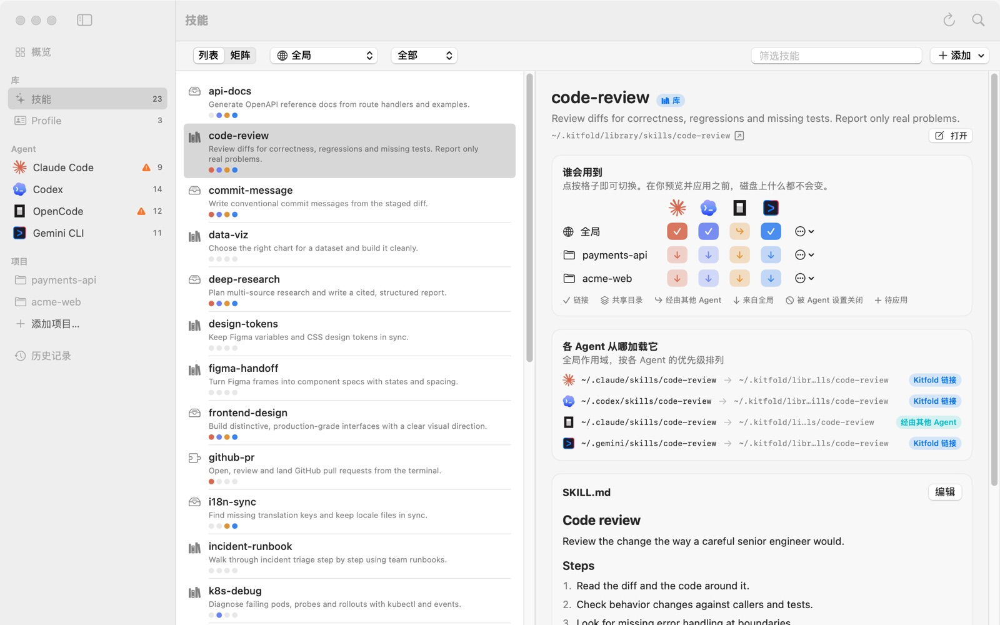
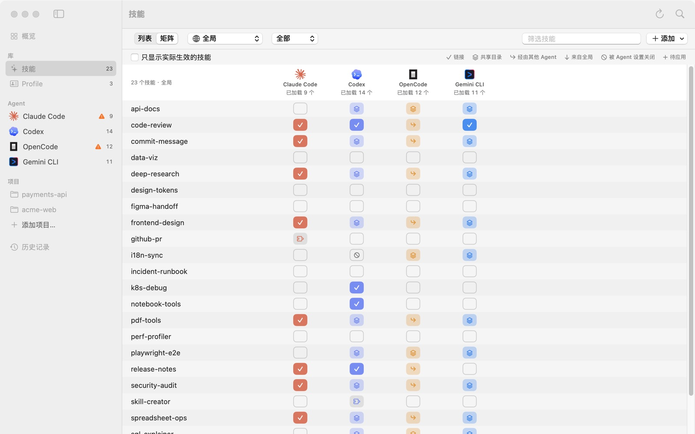
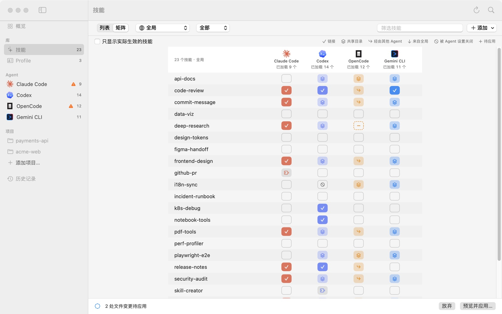

# 03 把技能分给指定的 Agent

这一篇教你决定每个技能给哪些 Agent，比如只给 Codex 装一个技能，或者只对 OpenCode 隐藏一个技能，其他 Agent 不受影响。这里的每个开关都只改草稿，预览并应用之后才会写入磁盘。

## 两种视角，同一份规则

- **技能页**：选一个技能，决定谁会用到它（技能 → Agent）。
- **Agent 页**：选一个 Agent，调整它有哪些技能（Agent → 技能），见[上一篇](02-what-agents-load.md)。

两边改的是同一份规则，保存在 `~/.kitfold/kitfold.json`。在一边拨了开关，另一边立刻跟着变。

## 1. 技能列表

点侧栏的**技能**（⌘2）。顶部从左到右是：

- **列表** / **矩阵**：两种显示方式。
- 作用域：**全局**或某个项目，决定列表里的色点和矩阵显示哪个作用域。
- 来源筛选：**全部**、**库**、**来源**、**本地目录**、**插件**、**有问题的**。
- **筛选技能**：按名称和描述搜索。
- **添加**：新建技能、导入目录、添加来源，见[管理技能库](07-skill-library.md)。

列表的每一行，左边的图标表示技能放在哪（库、来源、本地目录、插件……），然后是名称和描述，最下面一排色点。每个点代表一个 Agent，依次是 Claude Code、Codex、OpenCode、Gemini CLI：实心表示应用后它会加载这个技能，灰色表示不会，外面多一圈表示这里有待应用的改动。

## 2. 技能详情：谁会用到

在列表里选一个技能，右边是它的详情。下图是 code-review：

- 标题旁的**库**表示它在 Kitfold 的库里；下面是描述和所在路径，**打开**用默认的编辑器打开 `SKILL.md`。
- **谁会用到**：行是作用域（**全局**和每个项目），列是 Agent，点格子即可切换。code-review 的全局这一行，Claude Code、Codex、Gemini CLI 都是 ✓（Kitfold 建的链接），OpenCode 是 ↪（经由 Claude Code 的目录）。两个项目行都是 ↓：全局装了，在项目里自然也有。格子的完整说明见[上一篇](02-what-agents-load.md#格子的含义)。
- 每行末尾的 ⋯ 菜单：
  - **所有 Agent 都打开** / **所有 Agent 都关闭**：记成一条针对“所有 Agent”的规则；
  - **清除（保持原样）**：删掉这个技能在这一行的全部规则，见下文“规则只记录你说过的话”。
- **各 Agent 从哪加载它**：每个 Agent 在全局从哪个路径加载它、链接指向哪里，以及途径：Kitfold 链接、链接、本地目录、共享目录、经由其他 Agent、插件等。如果某个 Agent 加载的是另一个同名目录，会标出“另一个目录”。
- 再往下是 `SKILL.md` 的预览和**编辑**，见[管理技能库](07-skill-library.md)。

## 3. 矩阵模式

点顶部的**矩阵**，一屏看到所有技能 × 所有 Agent：

- 表头是每个 Agent 已加载的技能数，比如 Claude Code“已加载 9 个”。
- 勾选**只显示实际生效的技能**，没有任何 Agent 加载的技能就不显示了。
- 右上角是图例：链接、共享目录、经由其他 Agent、来自全局、被 Agent 设置关闭、待应用。
- 点格子切换；点技能名会切到**列表**并选中它，右边就是它的详情。
- 格子右上角有橙色的“!”时，说明这一格的规则不起作用，鼠标停在上面会显示原因（“这个开关不起作用：…”）。

矩阵适合批量整理，或者给某个 Agent 的上下文瘦身：从上往下扫一遍，把它用不到的关掉。

## 4. 拖到侧栏

在列表或矩阵里，把技能名拖到侧栏里的某个 Agent 上，就为这个 Agent 打开了它。作用域是技能页顶部选的那个：**全局**，或者某个项目。顶部会提示，比如“已把 data-viz 添加给 Gemini CLI，预览后应用。”；在项目里是“已在 acme-web 中把 test-writer 添加给 Codex，预览后应用。”。这个 Agent 已经有它时，提示“Codex 已经有 test-writer 了。”，草稿不变。

也可以拖到 Agent 页上，用的是那个页面**显示**里选的作用域。

## 5. Kitfold 在底下做了什么

开关只改草稿。Kitfold 根据规则算出要改哪些文件，等你应用时才写入。规则是这样落到磁盘上的。

### 打开一个技能

- 如果这个 Agent 已经能加载它（不管经由哪条路），什么都不用写。code-review 分给了所有 Agent，但 OpenCode 早已经由 Claude Code 的目录加载了它，所以 Kitfold 没在 OpenCode 的目录里再建一个链接。
- 否则，Kitfold 在这个 Agent 自己的技能目录里建一个链接，指向技能所在的目录（库或来源）。技能本身不会被复制。
- 如果它被 Agent 自己的设置关掉了，Kitfold 会删掉或盖过那一条设置。那条设置不是 Kitfold 写的话，预览里会标“注意”，撤销可以恢复它。实在做不到时，预览里会说明原因。

各 Agent 自己的技能目录：

| Agent | 全局 | 项目 |
|---|---|---|
| Claude Code | `~/.claude/skills` | `.claude/skills` |
| Codex | `~/.codex/skills` | `.codex/skills` |
| OpenCode | `~/.config/opencode/skills` | `.opencode/skills` |
| Gemini CLI | `~/.gemini/skills` | `.gemini/skills` |

### 关闭一个技能

如果这个 Agent 是通过 Kitfold 在它自己目录里建的链接加载它的，Kitfold 删掉这个链接就行。

其他情况下，删链接要么做不到，要么会误伤别的 Agent：

- 技能放在共享目录里，比如 `~/.agents/skills`。删掉它，每个读这个目录的 Agent 都会失去它；
- 它在另一个 Agent 的目录里，比如 OpenCode 读的 `~/.claude/skills`。删掉它，Claude Code 也会失去它；
- 链接是别的工具或手工建的，Kitfold 不删别人的东西；
- 它是嵌套在另一个技能里的 `SKILL.md`；
- 它在全局打开，你只想在某个项目里关掉。

这时 Kitfold 改写这个 Agent 自己的设置，把技能隐藏起来，只对这一个 Agent 生效：

| Agent | 写入的设置 | 全局的文件 |
|---|---|---|
| Claude Code | `skillOverrides` 里的 `"技能名": "off"` | `~/.claude/settings.json` |
| Codex | 一个 `[[skills.config]]`，指向技能的 `SKILL.md`，`enabled = false` | `~/.codex/config.toml` 末尾一段带标记的区域 |
| OpenCode | `permission.skill` 里的 `"技能名": "deny"` | `~/.config/opencode/opencode.json` |
| Gemini CLI | 把技能名加进 `skills.disabled` | `~/.gemini/settings.json` |

项目里写的是哪个文件，见[按项目配置](06-projects.md)。Codex 只认全局的这项设置，所以没法只在一个项目里隐藏技能；遇到这种情况，矩阵里那一格会带一个橙色的“!”，预览的“需要注意”里也会说明原因，建议改在全局关闭。

改设置文件时，Kitfold 只动那一条：文件里其他内容一个字节都不变，包括注释和格式。预览里只列出要变的条目，不显示文件原文，因为设置文件里可能有 API key。Kitfold 记得哪些条目是它写的，规则撤掉时会把它们收回；文件是它新建的，空了就删掉。

## 6. 别的 Agent 也读这个目录时

上一篇讲过，OpenCode 也读 Claude Code 的技能目录 `~/.claude/skills`。所以给 Claude Code 打开一个技能时，链接落在 `~/.claude/skills`，OpenCode 也会加载它。待应用栏会多一个“N 项待检查”，预览的“需要注意”里写着：

> **OpenCode 也会加载“test-writer”**
>
> OpenCode 也会读取 Claude Code 的目录 ~/.claude/skills。要让它只给 Claude Code 用，请为 OpenCode 关闭“test-writer”。

照着做：在 test-writer 这一行再点一下 OpenCode 的格子。预览里会多出一项“对 OpenCode 隐藏 test-writer”，写进 OpenCode 自己的设置，这条提醒也就没有了。OpenCode 对这个技能已经有自己的规则时，Kitfold 不会提醒。

在项目里给 Claude Code 打开时，提醒会写明是哪个项目，比如“在 acme-web 中，OpenCode 也会加载“test-writer””，因为 OpenCode 也读项目里的 `.claude/skills`。

反过来也一样：从 `~/.claude/skills` 删掉一个链接时，如果 OpenCode 只在那里找到过这个技能，Kitfold 会提醒“OpenCode 将不再加载……”。为 OpenCode 打开它，就能保住。

## 7. 规则只记录你说过的话

- 每条规则记的是：哪个技能、给哪个 Agent（或所有 Agent）、哪个作用域、打开还是关闭。你没碰过的技能没有规则，Kitfold 让它保持原样。这也是第一次打开时什么都不改的原因。
- 拨了一个格子、又在应用前拨回来，Kitfold 会把这条规则删掉，而不是记一条“打开”：磁盘上本来就是这样。
- 已经应用过的规则，再拨回去会记成相反的规则（比如“关闭”）。想让 Kitfold 彻底忘掉一个技能在某个作用域的规则，用那一行 ⋯ 菜单里的**清除（保持原样）**。应用后，Kitfold 收回它当初为这条规则做的事：它建的链接、它写的设置条目。其他东西保持原样。
- 技能也会随 Profile 一起打开：给 Agent 分配一个 Profile，它附带的技能也会给这个 Agent（见[用 Profile 管理指令](05-profiles.md)）。技能自己的规则优先于 Profile。如果某个已分配的 Profile 附带了这个技能，清除技能规则之后，它仍然留在那个 Agent 上。

## 8. 插件技能不能分配

插件带来的技能，比如 Claude Code 的 github-pr、Codex 的 skill-creator，在矩阵里显示为拼图格子，由 Agent 自己的插件系统管理：

- 点它的格子只会弹出提示：“github-pr”来自插件，请在 Agent 的插件设置中打开或关闭。
- 它的详情里没有“谁会用到”网格，只写着“插件技能要在 Agent 的插件设置里打开或关闭。”
- Agent 页**添加**的列表里也没有它。

## 例子：只给 Codex 装 test-writer，只对 OpenCode 隐藏 deep-research

下面在演示数据里做两件事，然后一起预览、应用。

### 只给 Codex 装 test-writer

1. 按 ⌘2 打开技能页，点**矩阵**，作用域保持**全局**。
2. 在**筛选技能**里输入“test-writer”。这一行四个格子都是空的：它在库里，还没有任何 Agent 加载它。
3. 点 Codex 那一格，格子变成虚线框加 ＋。

不会波及别的 Agent：链接会建在 `~/.codex/skills/test-writer`，只有 Codex 读这个目录。换成 Claude Code，链接会落在 `~/.claude/skills`，OpenCode 也会加载，Kitfold 会提醒你（见第 6 节）。

### 只对 OpenCode 隐藏 deep-research

1. 清空筛选，找到 deep-research。四个 Agent 现在都加载它：Claude Code 是 ✓（另一个工具在 `~/.claude/skills` 里建的链接）；Codex 和 Gemini CLI 来自共享目录 `~/.agents/skills`；OpenCode 是 ↪，经由 Claude Code 的目录加载（共享目录里它也能找到一份）。
2. 点 OpenCode 那一格，格子变成虚线框加 －。

两个开关都拨好后，底部出现“2 处文件变更待应用”。test-writer 在列表靠下的位置，截图里没显示。

这里 Kitfold 不删任何东西：deep-research 经由两个目录到达 OpenCode，而这两个目录别的 Agent 也在读，删掉链接或目录，Claude Code、Codex、Gemini CLI 都会失去它。所以它改的是 OpenCode 自己的设置。

### 预览并应用

1. 按 ⌘↩，或点**预览并应用…**。标题下写着“2 处文件变更”，列表里有三行：
   - **为 Codex 链接 test-writer（已分配）**：`~/.codex/skills/test-writer → ~/.kitfold/library/skills/test-writer`；
   - **对 OpenCode 隐藏 deep-research**：改 `~/.config/opencode/opencode.json`，只多一条 `permission.skill › "deep-research": "deny"`，并注明只有这些条目会变更，文件的其余部分保持原样；
   - **把分配保存到 kitfold.json**：记下这两条规则。
2. 点**应用**。

应用之后，矩阵里 test-writer 的 Codex 格子变成实心 ✓；deep-research 的 OpenCode 格子变成 ⊘（被 Agent 设置关闭），另外三个 Agent 不变。在 OpenCode 的页面里，deep-research 出现在“存在，但被它自己的设置关闭”下，行尾写着“已由 Kitfold 在 ~/.config/opencode/opencode.json 中隐藏”。

想撤回，可以把那个格子再点开，或者用 ⋯ 菜单的**清除（保持原样）**，应用后 Kitfold 会删掉它写的那条设置；也可以在历史记录里撤销整次应用。预览、应用和撤销的细节见[下一篇](04-review-apply-undo.md)。

---

[← 上一篇：02 看懂 Agent 实际加载了什么](02-what-agents-load.md) · [目录](README.md) · [下一篇：04 预览、应用和撤销 →](04-review-apply-undo.md)
