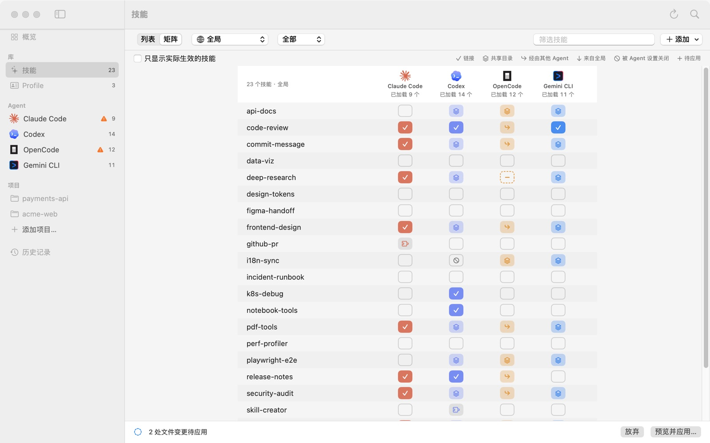
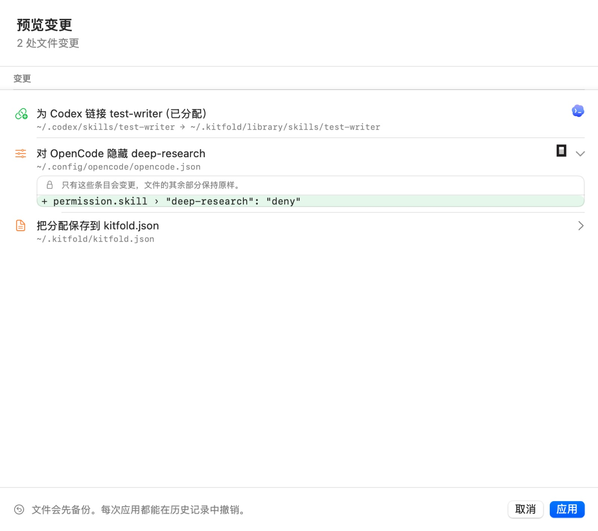
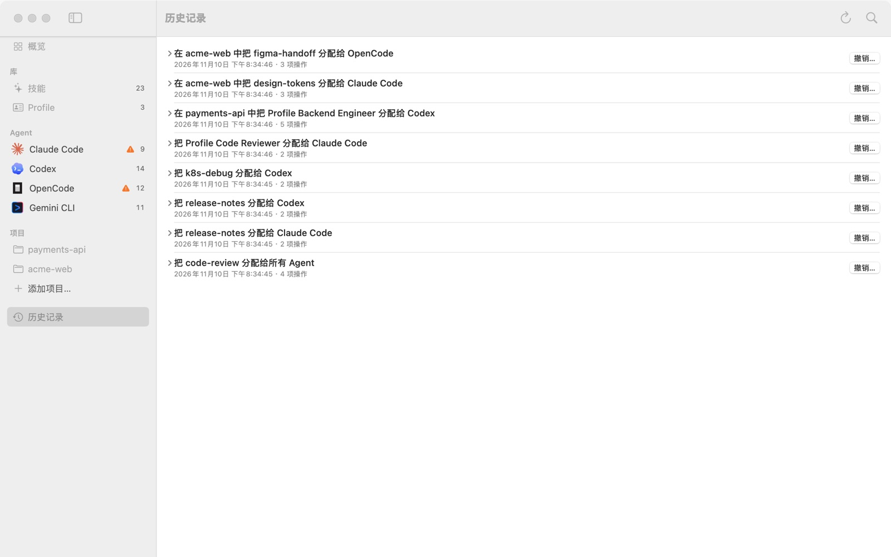

# 04 预览、应用和撤销

在 Kitfold 里拨开关，改的只是草稿。这一篇讲怎么在写入之前看清每一处文件变更、确认应用，以及事后怎么撤销。

下面沿用[上一篇](03-assign-skills.md)的两个例子：把 `test-writer` 只给 Codex，只对 OpenCode 隐藏 `deep-research`。

## 1. 草稿和待应用栏

在矩阵、技能详情或 Agent 页上点一个格子，格子会变成虚线框，里面是 ＋（应用后打开）或 －（应用后关闭）。这时磁盘上什么都没变，变的只是草稿。

草稿和已保存的分配不一样，或者有文件需要按规则更新（比如保存了一个已经分配出去的 Profile），窗口底部就会出现待应用栏：



| 栏上的内容 | 含义 |
|---|---|
| “2 处文件变更待应用” | 应用时会改动的文件数，不含 Kitfold 自己的 `kitfold.json` |
| “正在计算变更…” | 刚拨完开关，Kitfold 正在重新计算；稍等一下 |
| “分配已更改，但没有文件需要变更” | 规则变了，但磁盘已经是你要的样子，比如对一个所有 Agent 都已经能看到的技能选了**所有 Agent 都打开**。应用时只保存规则 |
| “N 项待检查” | 预览里有 N 个警告或错误，值得先看一眼 |
| **放弃** | 把所有开关恢复成已保存的状态。只在分配有改动时出现 |
| **预览并应用…**（⌘↩） | 打开预览 |

几点说明：

- 草稿在各个页面之间共用。可以先在矩阵里拨几个，再去 Agent 页拨几个，最后一起预览。
- 草稿只保存在这次打开的 Kitfold 里。退出时还没应用的开关会丢掉。
- 菜单栏的 **Kitfold** 菜单里也有**预览变更…**（⌘↩）和**放弃变更**。

## 2. 看懂预览

按 ⌘↩，或点**预览并应用…**：



标题下面是计数，算法和待应用栏一样：文件变更不含 `kitfold.json`，“待检查”只算警告和错误。这个例子是“2 处文件变更”；有需要留意的，后面还会接上“N 项涉及不是 Kitfold 创建的文件”和“N 项待检查”，比如“2 处文件变更 · 1 项待检查”。只改了规则、没有文件要变时，写的是“只保存分配，没有文件需要变更”。

### 每一行是一处变更

每一行先用一句话说明要做什么，下面是具体路径，右侧是受影响的 Agent。左边的图标表示操作类型：

| 图标 | 操作 |
|---|---|
| 链接加号（绿色） | 新建链接，路径写成 `链接 → 目标` |
| 链接（红色） | 删除链接 |
| 文档加号（绿色） | 新建文件 |
| 文档 | 修改文件，比如指令文件、`kitfold.json`、`.git/info/exclude` |
| 废纸篓（红色） | 删除文件。Kitfold 只删自己建的文件 |
| 滑块 | 修改 Agent 自己的设置文件 |
| 文档箭头 | 移动目录（移入库） |

点行尾的 › 可以展开细节。文件变更不超过 3 处时，细节默认展开。

- **指令文件**展开后是逐行 diff，上方写着“当前 → 应用后”（新文件是“（新文件） → 应用后”）和增删的行数。
- **Agent 的设置文件**（`settings.json`、`config.toml`、`opencode.json` 这类）展开后只列出会变的条目，例如截图里的 `+ permission.skill › "deep-research": "deny"`，上方注明“只有这些条目会变更，文件的其余部分保持原样。”。文件原文永远不显示，因为里面可能有 API key 和 token。写入时也只改这一条，注释、格式和其余字节都保持原样。
- **kitfold.json 那一行**（“把分配保存到 kitfold.json”）永远排在最后。它保存的是你的规则，和文件变更放在同一次应用里，所以撤销时规则也会一起撤回。它不算在“N 处文件变更”里。

### 标着“注意”的变更

如果一处变更要动不是 Kitfold 创建的东西，行尾会有橙色的**注意**标签，下面用橙色字说明原因。常见的有：

- 删除别的工具或你手动建的链接；
- 替换一个不是 Kitfold 建的、指向别处的同名链接；
- 删除或改写你自己在 Agent 设置里写的条目（比如你要打开的技能被你自己的设置关掉了）；
- 覆盖在 Kitfold 之外被修改过的 Profile 块（见 [05](05-profiles.md)）。

这些操作同样会先备份，撤销时也会恢复原样。

### 这次不会写入

某个指令文件里的 Profile 块在 Kitfold 之外被修改过时，这个文件会单独列在**这次不会写入**下，比如“这次不会写入 ~/.claude/rules/kitfold.md”，说明里写着是哪个 Profile 的块被改了。在你选择保留还是覆盖之前，Kitfold 不会写这个文件，其余的变更照常应用，见 [05](05-profiles.md)。

### 需要注意：不会自动更改

列表下方的**需要注意：不会自动更改**列出 Kitfold 不会做、或者做不到的事，每一条都写明原因。错误排在前面，然后是警告和提示；提示也列在这里，但不算进“N 项待检查”。几个例子：

- **OpenCode 也会加载“data-viz”**：链接放进 `~/.claude/skills` 后，OpenCode 也会读到它。要让它只给 Claude Code 用，就再为 OpenCode 关掉它。
- **在这个项目中，Codex 仍能看到“code-review”**：Codex 没有项目级的开关，见 [06](06-projects.md)。

这些问题不会阻止应用。点**应用**时，上面列出的变更照常执行，下面列出的事情保持不动。

### 应用或取消

- **应用**（↩）：执行上面列出的所有变更。
- **取消**（Esc）：关掉预览，草稿原样保留。

编辑指令文件、把技能移入库、处理 Profile 块的外部修改，用的也是同一个预览，只是标题不同。这些一次性的预览只应用它自己的变更，你拨过但还没应用的开关会继续留在草稿里。

## 3. 点“应用”之后

1. **再核对一遍。** 每一处变更执行前，Kitfold 都会重新检查磁盘：文件内容必须和预览时完全一样，链接必须还指向原来的位置。如果中间有东西变了（比如 Agent 刚好重写了自己的设置），Kitfold 会停下来，把已经做了的部分改回去，并弹出“出错了”，说明是哪个文件“在预览之后被修改了”。重新打开预览再应用即可。
2. **先备份。** 每个要被覆盖或删除的文件，都先拷贝到 `~/.kitfold/backups/<编号>/`，只有你自己能读。备份保留多久，在**设置 › 通用**里的**备份保留 30 天**调整。
3. **写入。** 写文件是原子操作（先写临时文件再替换）。如果目标是一个符号链接（比如用 dotfiles 管理的 `CLAUDE.md`），Kitfold 写的是它指向的真实文件，不会把链接换成普通文件。
4. **记进历史记录。** 每处变更连同变更前后的内容一起记进 `~/.kitfold/state.sqlite`，撤销靠的就是它。万一记录失败，已经改的文件会全部改回去，不会留下没法撤销的改动。

完成后窗口顶部会提示“已应用 2 处文件变更。随时可以在历史记录中撤销。”，Kitfold 会重新扫描，虚线框变成实心的格子。

## 4. 历史记录

点侧栏的**历史记录**，或按 ⌘4：



每次应用是一条记录，最新的在最上面：

- **标题**说明做了什么。只拨了一个开关时写得很具体，比如“把 test-writer 分配给 Codex”“在 acme-web 中把 design-tokens 分配给 Claude Code”；拨了好几个时写成“更新 deep-research、test-writer”。Profile 显示的是名称，比如“把 Profile Code Reviewer 分配给 Claude Code”。
- **下面一行**是时间和操作数。
- 点左边的 › 展开，可以看到每一项操作。被覆盖或删除过的文件旁边有**备份**，点它会在访达里显示那份备份。
- **撤销**标签表示这一条本身是一次撤销；**已撤销**表示这一条已经被撤销过。

用命令行应用的改动也会出现在这里。截图里的记录就是演示脚本用命令行写入的。

## 5. 撤销

1. 在要撤销的那条记录上点**撤销…**。
2. 确认框会提示：“Kitfold 会先检查每个文件。如果有文件在此之后被改过，就不会撤销任何内容，并告诉你是哪个文件。”点**撤销**。
3. 成功后顶部会提示已撤销，历史记录最上面多出一条以“撤销”开头的记录，原来那条标上**已撤销**。

撤销会按相反的顺序执行每一项操作的反操作：删掉当时建的链接，重建当时删掉的链接，把文件内容和设置条目恢复成应用前的样子。

**规则也会一起撤回。** 那次应用改动过的规则会回到之前的状态，矩阵和各个页面马上显示撤销后的样子。之后保存的其他设置（项目列表、技能来源、偏好）不受影响，也不会妨碍撤销。

**撤销前同样会检查。** 只要有一个文件在那次应用之后又被改过，Kitfold 就一处都不撤销，并列出是哪些文件，例如：

> 前置检查未通过：这些文件在那次应用之后又被修改过，撤销会覆盖较新的修改：~/.config/opencode/opencode.json

遇到这种情况：

- 如果是后来的一次应用又改了同一个文件，先撤销较新的那一条，再撤销这一条。
- 如果是你自己或某个 Agent 改的，可以先去掉那次修改再撤销；也可以不撤销，直接在 Kitfold 里把开关拨回去，再应用一次，Kitfold 会在文件现在的内容上只改它需要改的部分。应用前的原文件在那条记录的**备份**里，需要时可以手动对照。

另外，撤销一次**移入库**时，如果之后又有链接指向库里那个目录，Kitfold 会拒绝，以免留下失效的链接。先为那些 Agent 关掉这个技能，再撤销。

撤销本身也是一条记录，也可以再撤销，相当于把原来的改动重新做一遍。

## 6. 命令行里的对应操作

App 和命令行用的是同一份规则、同一份历史记录。

| 命令 | 作用 |
|---|---|
| `kitfold assign <技能> <agent\|*> [--off\|--clear] [--project <路径>]` | 改一个技能的规则并显示预览；加 `--yes` 才应用 |
| `kitfold profile <id> <agent\|*> [--off\|--clear] [--project <路径>]` | 同上，针对 Profile |
| `kitfold profiles` | 列出 Profile 的 id 和名称，`profile` 命令要用 id |
| `kitfold plan` | 按现在的 `kitfold.json` 算出需要的变更（只看不改） |
| `kitfold apply [--yes]` | 应用 `kitfold.json`，比如你手动编辑过它之后 |
| `kitfold history` | 列出历史记录 |
| `kitfold undo [<编号>] [--yes]` | 撤销一次应用；不写编号就撤销最近一次还在生效的应用 |

不加 `--yes` 时，每个会改动磁盘的命令都只显示预览：

```console
$ kitfold assign test-writer codex
  + 链接 ~/.codex/skills/test-writer → ~/.kitfold/library/skills/test-writer
    为 Codex 链接 test-writer（已分配）
  ~ 修改 ~/.kitfold/kitfold.json
    把分配保存到 kitfold.json

要应用 1 处文件变更吗？加上 --yes 重新运行即可应用。
```

数量和 App 里一样，不含 `kitfold.json`。设置文件也只显示会变的条目：

```console
$ kitfold assign deep-research opencode --off --yes
  ~ 修改 ~/.config/opencode/opencode.json
    对 OpenCode 隐藏 deep-research
    + permission.skill › "deep-research": "deny"
  ~ 修改 ~/.kitfold/kitfold.json
    把分配保存到 kitfold.json

已应用。撤销请运行：kitfold undo 20261105-113827-911127
```

撤销：

```console
$ kitfold undo
撤销“从 OpenCode 收回 deep-research”（2 项操作）
  把分配保存到 kitfold.json
  对 OpenCode 隐藏 deep-research

加上 --yes 重新运行即可撤销。

$ kitfold undo --yes
撤销“从 OpenCode 收回 deep-research”（2 项操作）
  把分配保存到 kitfold.json
  对 OpenCode 隐藏 deep-research
已撤销。

$ kitfold history
20261105-113848-8d5a2b  撤销“从 OpenCode 收回 deep-research”  2 项操作
20261105-113827-911127  从 OpenCode 收回 deep-research（已撤销）  2 项操作
20261105-113827-a88d58  把 test-writer 分配给 Codex  2 项操作
…
```

命令行的完整说明见 [08 命令行](08-command-line.md)。

---

[← 上一篇：03 把技能分给指定的 Agent](03-assign-skills.md) · [目录](README.md) · [下一篇：05 用 Profile 管理指令 →](05-profiles.md)
