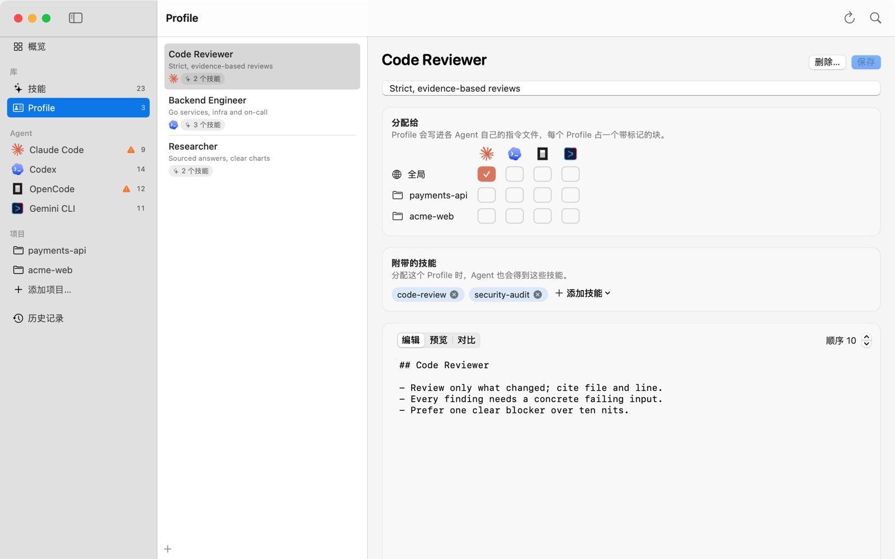

# 05 用 Profile 管理指令

Profile 是一段可以复用的指令，比如“代码审查时该怎么做”，还可以附带几个技能。学完这一篇，你可以新建和修改 Profile，把它分给指定的 Agent 或项目，并且知道它最后写到了哪个文件、文件里的其他内容会不会被动到。

## 1. Profile 是什么

每个 Profile 是 Kitfold 库里的一个 Markdown 文件，`~/.kitfold/library/profiles/<id>.md`：开头的 frontmatter 记录名称、描述、附带的技能和顺序，后面是正文。演示数据里有三个：Code Reviewer、Backend Engineer、Researcher。

把 Profile 分配给某个 Agent 后，Kitfold 会把正文写进这个 Agent 自己的指令文件，每个 Profile 占一个带标记的块：

```markdown
<!-- kitfold:begin profile=code-reviewer hash=fb7c330fa195 -->
## Code Reviewer

- Review only what changed; cite file and line.
- Every finding needs a concrete failing input.
- Prefer one clear blocker over ten nits.
<!-- kitfold:end profile=code-reviewer -->
```

- 标记外面的内容都是你的，Kitfold 从来不碰。别的工具写的托管块（比如 Magpie 的）也一样。
- `hash` 是 Kitfold 写入时正文的指纹。有人改了块里的内容，只看文件本身就能发现，见下面第 9 节。
- 新块放在文件开头；文件里已经有 Kitfold 的块时，放在原来那些块的位置。
- 不再分配时，Kitfold 只删掉自己的块。文件是 Kitfold 新建的、删完块后又什么都不剩，才会把文件一起删掉。

## 2. 写到哪个文件

每个 Agent 都写进只有它自己会读的文件，能做到的地方都是这样：

| Agent | 全局 | 项目里 | 说明 |
|---|---|---|---|
| Claude Code | `~/.claude/rules/kitfold.md` | `.claude/rules/kitfold.md` | Claude Code 启动时会加载 rules 目录。写在这里不用改你的 `CLAUDE.md`，OpenCode 回退读取 `~/.claude/CLAUDE.md` 时也读不到它 |
| Codex | `~/.codex/AGENTS.md` | `AGENTS.md` | 全局文件只有 Codex 读。项目里的 `AGENTS.md` 和 OpenCode 共用 |
| OpenCode | `~/.config/opencode/AGENTS.md` | `AGENTS.md` | 新建全局文件后，OpenCode 就不再回退读取 `~/.claude/CLAUDE.md`，预览里会提醒 |
| Gemini CLI | `~/.gemini/GEMINI.md` | `GEMINI.md` | 只有 Gemini CLI 读 |

设置了 `CODEX_HOME` 或 `CLAUDE_CONFIG_DIR`，或者在**设置 › Agent**里改过配置目录，路径会跟着变。不确定的话，把鼠标停在**分配给**网格的格子上，会显示“Claude Code：写入 ~/.claude/rules/kitfold.md”这样的提示。

## 3. 新建 Profile

1. 按 ⌘N。也可以点 Profile 列表底部的 ＋，或者在快速打开（⌘K）里选**新建 Profile**。
2. 填名称和简短描述，点**创建**。

新 Profile 的正文只有一行 `## <名称>` 标题，顺序是 100，还没有分配给任何 Agent。

Kitfold 会根据名称生成一个 id，比如 Code Reviewer 的 id 是 `code-reviewer`。它是库里的文件名，也是块标记里的 `profile=`，之后改名称也不会变。命令行用的是 id（`kitfold profiles` 会列出来），App 的预览和历史记录里显示的是名称。

## 4. 编辑

在侧栏点 **Profile**（⌘3），在左边的列表里选一个：



列表里每个 Profile 下面，是它已经分配给的 Agent 的图标，以及它附带几个技能。右边是编辑器：

- **名称和描述**：顶部的大标题就是名称，可以直接改；下面一行是描述。
- **正文**：在**编辑**里写 Markdown，切到**预览**看排版后的样子。
- **顺序**：右上角的**顺序 10**，每次加减 10。多个 Profile 写进同一个文件时，顺序值小的排在前面。
- **附带的技能**：分配这个 Profile 时，Agent 也会得到这些技能。点**添加技能**从列表里选，点技能旁的 × 去掉。

改完点**保存**（⌘S）。保存会立刻写进库里的 Profile 文件，旧版本也会留下来（在 `~/.kitfold/backups/profiles/<id>/`），可以在**对比**里找到。

**Agent 的文件要等应用之后才会更新。** 保存一个已经分配出去的 Profile 后，底部会出现待应用栏，比如“1 处文件变更待应用”。点**预览并应用…**（⌘↩），看一遍每个文件的 diff，再点**应用**。分配没变，所以栏上没有**放弃**。命令行里是 `kitfold apply`。

### 附带的技能是怎么给出去的

Profile 分配给某个 Agent 后，它附带的技能也会在同一个作用域里分给这个 Agent，和你自己打开一样：

- Agent 已经能看到这个技能（比如在共享目录里），就什么都不做；
- 看不到，就链接进它自己的技能目录，预览里写成：为 Claude Code 链接 data-viz（通过 Profile“Researcher”）；
- 你为这个 Agent 明确关掉过这个技能，就以你关掉的为准。

取消分配 Profile 时，Kitfold 会收回当时因为它建的链接。

## 5. 对比

切到**对比**，在**对比对象**里选一项：

- **已部署到 <文件>**：这个 Profile 现在写在那个文件里的内容。保存了修改但还没应用，或者有人在外面改过块时，用它看差别。
- **保存于 <时间>**：以前保存过的版本。想找回旧的写法时，在 diff 里选中文字拷贝回来。

diff 比较的是所选的版本和**编辑器中的内容**，也就是你正在编辑、可能还没保存的文字。

## 6. 分配

编辑器里的**分配给**是一张网格：每一行是一个作用域（全局和每个项目），每一列是一个 Agent。

以“把 Code Reviewer 也给 Codex”为例：

1. 在**全局**那一行点 Codex 的格子，格子变成虚线框的 ＋。
2. 按 ⌘↩ 打开预览。会看到一行“更新 ~/.codex/AGENTS.md 中的 Code Reviewer”，下面注明“由 Codex 读取”。diff 里新块加在文件开头，原来的 `# Codex` 那几行不变。
3. 点**应用**。

再点一次同一个格子就是取消分配，应用后 Kitfold 会把这个块删掉。

其他地方也能分配 Profile：Agent 页的 **Profile** 卡片里每个 Profile 有一个开关，上方写着“Kitfold 会把分配的 Profile 写入 …”；项目页有**这个项目的 Profile**网格，见 [06](06-projects.md)。

## 7. 多个 Profile 写进同一个文件

一个 Agent 可以同时有好几个 Profile。每个 Profile 是一个独立的块，按顺序值从小到大排列（相同时按名称）。演示数据里 Code Reviewer 是 10，Backend Engineer 是 20，Researcher 是 30，所以同一个文件里 Code Reviewer 排在最前面。想调整先后，改**顺序**再保存、应用。

## 8. 共用的文件

项目里的 `AGENTS.md` 既是 Codex 的 Profile 文件，也是 OpenCode 的；项目里没有 `CLAUDE.md`、`.claude/CLAUDE.md` 和 `CLAUDE.local.md` 时，Claude Code 也会读它。一个文件没法按 Agent 拆开，所以：

- 只给 Codex 分配，OpenCode 照样能读到；
- 给 Codex 分配 Backend Engineer、给 OpenCode 分配 Researcher，文件里两个块都有，两个 Agent 都会看到两个。

预览会把这些情况列在**需要注意**里，例如在 payments-api 里给 OpenCode 分配 Researcher 时：

> OpenCode 也会读取 AGENTS.md
> ~/work/payments-api/AGENTS.md 是共享的，所以 OpenCode 也会看到 Backend Engineer。同一个文件里无法按 Agent 隔离。

> Claude Code 也会读取 AGENTS.md
> ~/work/payments-api/AGENTS.md 是共享的，所以 Claude Code 也会看到 Backend Engineer、Researcher。同一个文件里无法按 Agent 隔离。

新建一个文件可能会改变别的 Agent 读什么。比如第一次给 OpenCode 分配全局 Profile 会新建 `~/.config/opencode/AGENTS.md`，预览会提醒“OpenCode 将不再读取 CLAUDE.md”，因为 OpenCode 只在这个文件不存在时才回退读取 `~/.claude/CLAUDE.md`。

这些只是提醒，不会阻止应用。全局的四个文件互不相干；在项目里，只有 Claude Code（`.claude/rules/kitfold.md`）和 Gemini CLI（`GEMINI.md`）有各自独立的文件，Codex 和 OpenCode 只能共用 `AGENTS.md`。

## 9. Profile 块在 Kitfold 之外被修改了

你或者别的工具改了某个块里面的文字，指纹就对不上了。Kitfold 会在几个地方提示：

- 概览的**健康检查**和 Agent 页的**问题**里，会出现 **Profile“Code Reviewer”在 Kitfold 之外被修改过**；
- Agent 页的**指令文件**里，这个块的标签变成橙色，下面多了一行提示（“Code Reviewer”在 Kitfold 之外被修改过。）和两个按钮：
  - **保留修改**：打开预览，里面除了重新写入这个块，还有一项“把修改写回 Profile“Code Reviewer””。这个 Profile 如果还写在别的文件里，那些文件会在同一次预览里一起更新成新文字。点**应用**之后 Profile 才会改；点**取消**什么都不变；撤销这次应用，Profile 也会恢复原样。
  - **覆盖…**：打开预览，用 Profile 里的文字盖掉外面的修改。这一行会标上**注意**，写明“会覆盖在 Kitfold 之外做的修改”；原文件先备份，也可以撤销。

在你选择之前，Kitfold 不会写这个文件。之后的每次预览都会把它列在**这次不会写入**下，比如“这次不会写入 ~/.claude/rules/kitfold.md”，同一次应用里的其他变更照常执行。命令行的输出里也有同样的“这次不会写入”。

只改了标记外面的内容，不算外部修改，Kitfold 也不会管。

## 10. Codex 的 AGENTS.override.md

同一个目录里有 `AGENTS.override.md` 并且不是空的，Codex 就用它代替 `AGENTS.md`。全局（`~/.codex/AGENTS.override.md`）和项目里都是这样。这时写进 `AGENTS.md` 的 Profile 对 Codex 不起作用，预览会提醒：

> AGENTS.override.md 存在时，Codex 不会读取 AGENTS.md
> ~/.codex/AGENTS.override.md 会替代 ~/.codex/AGENTS.md，所以这个 Profile 对 Codex 不起作用。请清空或移除这个覆盖文件，或者把其中的内容移到 Profile 里。

Codex 的 Agent 页上，`AGENTS.md` 也会标成**未加载**。

## 11. 删除 Profile

点编辑器右上角的**删除…**，确认**移到废纸篓**。Profile 文件会移到 Kitfold 自己的废纸篓（`~/.kitfold/backups/trash/`），它的分配从草稿里去掉。应用之后，各个文件里它的块才会被删除。

## 12. 命令行

```console
$ kitfold profile code-reviewer codex
  ~ 修改 ~/.codex/AGENTS.md
    更新 ~/.codex/AGENTS.md 中的 Code Reviewer — 由 Codex 读取
    + <!-- kitfold:begin profile=code-reviewer hash=fb7c330fa195 -->
    + ## Code Reviewer
    + 
    + - Review only what changed; cite file and line.
    + - Every finding needs a concrete failing input.
    + - Prefer one clear blocker over ten nits.
    + <!-- kitfold:end profile=code-reviewer -->
    + 
      # Codex
  ~ 修改 ~/.kitfold/kitfold.json
    把分配保存到 kitfold.json

要应用 1 处文件变更吗？加上 --yes 重新运行即可应用。
```

- 用的是 id，不是名称。`kitfold profiles` 会列出每个 Profile 的 id 和名称；写错 id 会直接报错，什么都不保存（加 `--force` 仍会保存）。
- `'*'` 表示所有 Agent，`--project <路径>` 只在一个项目里分配，`--clear` 去掉这条规则，`--yes` 才真正应用。
- `kitfold agents` 会在含有 Kitfold 块的文件后面标出 `[kitfold: code-reviewer]`。
- 在 App 里保存了 Profile 的修改，也可以用 `kitfold apply` 把新内容写进已经分配的文件。

---

[← 上一篇：04 预览、应用和撤销](04-review-apply-undo.md) · [目录](README.md) · [下一篇：06 按项目配置 →](06-projects.md)
