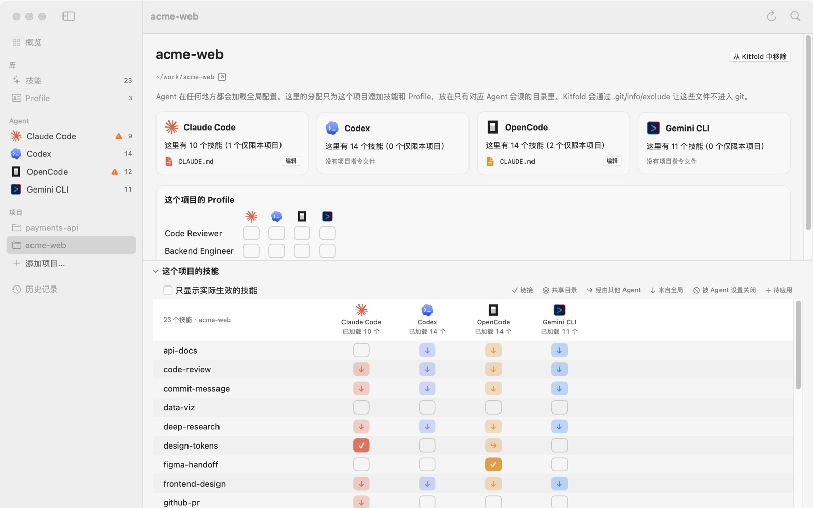

# 06 按项目配置

Agent 不管在哪个目录里运行，都会加载全局配置。项目配置是在这之上做加减：只给某个仓库加一个技能或 Profile，或者在某个仓库里关掉一个全局技能。这一篇用演示数据里的 acme-web 和 payments-api 两个项目来讲。

## 1. 添加项目

1. 在侧栏**项目**下点**添加项目…**。
2. 选择项目目录。Kitfold 会使用它的 git 根目录：选了仓库里的子目录，添加的也是整个仓库；不是 git 仓库时，就用你选的目录本身。

项目以目录名命名，马上出现在侧栏、各个作用域选择器、技能详情的**谁会用到**网格、Profile 的**分配给**网格，以及快速打开（⌘K）里。

添加项目只是记进 `~/.kitfold/kitfold.json`，不经过预览，也不会碰项目里的任何文件。命令行里不需要单独添加：带上 `--project <路径>` 分配时，项目会自动加进来。

## 2. 项目页面

在侧栏点一个项目，打开它的页面。从上到下是：

- **项目名称**和**从 Kitfold 中移除**按钮，下面是项目路径和一段说明。
- **每个 Agent 一张卡片**：“这里有 N 个技能（M 个仅限本项目）”，N 包括从全局继承来的；下面列出这个 Agent 在项目里加载的指令文件，每个都可以点**编辑**。
- **这个项目的问题**：只在有问题时出现。
- **这个项目的 Profile**：Profile × Agent 的网格，用法和 Profile 页的**分配给**一样。
- **这个项目的技能**：这个项目的技能矩阵，可以折叠。



## 3. 在技能页和 Agent 页切换作用域

不进项目页也能看项目里的情况：

- **技能页**：工具栏上默认显示**全局**的那个选择器，改成 acme-web，列表里的 Agent 色点和矩阵就都换成这个项目的。技能详情里的**谁会用到**网格本来就把全局和每个项目各列一行。
- **Agent 页**：右上角**显示**旁边的选择器。切到项目后：
  - 技能按到达途径分组，多出一组**项目技能**，是只在这个项目里加载的；
  - **指令文件**先列出已加载的全局文件，再列出项目里的文件，和 Agent 实际拼接的顺序一致；
  - **Profile** 卡片写的是项目里的目标文件，比如“Kitfold 会把分配的 Profile 写入 ~/work/acme-web/.claude/rules/kitfold.md。”。

## 4. 继承：项目里的“来自全局”

在项目的矩阵里，格子多了一种样子：

| 格子 | 含义 |
|---|---|
| ↓（浅色） | 来自全局。Agent 在所有地方都会加载它，这个项目也不例外 |
| ✓（实心） | 链接进了这个项目自己的技能目录 |
| ↪ | 经由其他 Agent 的目录，比如 OpenCode 也读项目里的 `.claude/skills` |
| ⊘ | 被 Agent 自己的设置关闭了 |

对照截图：

- code-review 四个 Agent 都是 ↓，因为它在全局分给了所有 Agent。
- design-tokens 只链接给了 Claude Code（✓），所以链接在 `acme-web/.claude/skills` 里；OpenCode 也读这个目录，于是它那一格是 ↪。
- figma-handoff 只链接给了 OpenCode，在 `.opencode/skills` 里，别的 Agent 都看不到。
- i18n-sync 在 Codex 那一格是 ⊘，因为 Codex 的全局 `config.toml` 把它关了。

## 5. 只给一个项目加技能

以“只在 acme-web 里给 Codex 加 test-writer”为例：

1. 打开 acme-web 的页面（或者在技能页把作用域切到 acme-web），在 test-writer 那一行点 Codex 的空格子，格子变成虚线框的 ＋。
2. 按 ⌘↩ 预览。会看到：
   - “为 Codex 链接 test-writer（已分配）”，`~/work/acme-web/.codex/skills/test-writer → ~/.kitfold/library/skills/test-writer`；
   - “让 git 忽略 acme-web 中 Kitfold 的文件”，在 `.git/info/exclude` 里加一行 `/.codex/skills/test-writer`，见第 8 节；
   - “把分配保存到 kitfold.json”。
3. 点**应用**。

各 Agent 的项目技能目录：

| Agent | 项目技能目录 |
|---|---|
| Claude Code | `.claude/skills`（OpenCode 也会读） |
| Codex | `.codex/skills` |
| OpenCode | `.opencode/skills` |
| Gemini CLI | `.gemini/skills` |

技能已经在全局给了这个 Agent 时，项目里不会再链接一份。

## 6. 在一个项目里关掉全局技能

全局技能放在全局目录里，删链接只能让它在所有地方都消失，没法只在一个项目里藏起来。所以 Kitfold 会改 Agent 自己的项目设置，并且只改那一条：

| Agent | 写到哪里 | 写入的条目 |
|---|---|---|
| Claude Code | `.claude/settings.local.json` | `skillOverrides › "code-review": "off"` |
| OpenCode | 项目里 OpenCode 最后读取的那个 `opencode.json`（根目录或 `.opencode/` 下）；一个都没有就新建 `.opencode/opencode.json` | `permission.skill › "code-review": "deny"` |
| Gemini CLI | `.gemini/settings.json` | `skills.disabled › "code-review"` |
| Codex | 做不到 | Codex 只认 `$CODEX_HOME/config.toml` 里的 `[[skills.config]]`，没有项目级的开关 |

以“在 acme-web 里对所有 Agent 关掉 code-review”为例：

1. 在技能页选中 code-review，在**谁会用到**里 acme-web 那一行，点行尾的 ⋯ 菜单，选**所有 Agent 都关闭**。也可以在项目矩阵里逐个点 ↓ 格子。
2. 按 ⌘↩ 预览。Claude Code、OpenCode、Gemini CLI 各有一行“对 … 隐藏 code-review”，展开只看到上表里那一条；`.git/info/exclude` 也会更新。
3. **需要注意**里会有一条：

   > 在这个项目中，Codex 仍能看到“code-review”
   > 它在全局启用，而 Codex 只从 $CODEX_HOME/config.toml 读取 `[[skills.config]]`，所以无法只在一个项目里隐藏技能。请改为在全局关闭它。

4. 点**应用**。之后这三个 Agent 的格子变成 ⊘。Codex 仍然是 ↓，格子右上角带一个橙色的“!”，鼠标停在上面会显示“这个开关不起作用：…”和原因。

对 Codex 来说，如果某个技能只有部分项目需要，就别在全局给它，改为只在需要的项目里分配。命令行里只对 Codex 这样做（`kitfold assign code-review codex --off --project …`）时，Kitfold 会说明原因并拒绝保存，见 [08 命令行](08-command-line.md)。

再注意两点：

- `.claude/settings.local.json` 是 Claude Code 给个人用的项目设置。OpenCode 和 Gemini CLI 的项目设置文件则可能已经提交进仓库：Kitfold 改的是一个已经存在的项目设置文件时，预览会注明“如果这个文件被提交，使用这个仓库的所有人都会得到这项设置。”。
- 反过来也可以：全局被 Agent 自己的设置关掉的技能，想在一个项目里打开，Claude Code 会写 `"on"`，OpenCode 会写 `"allow"`。Gemini CLI 和 Codex 做不到，预览会说明原因，建议改为在全局打开。

想恢复，在同一行的 ⋯ 菜单里选**清除（保持原样）**再应用。Kitfold 会收回它写的条目，自己新建的设置文件变空后也会删掉。也可以直接在历史记录里撤销那次应用。

## 7. 项目级 Profile

在项目页的**这个项目的 Profile**里点格子，或者在 Profile 页**分配给**网格的项目那一行点格子。项目里的 Profile 写到：

| Agent | 文件 |
|---|---|
| Claude Code | `.claude/rules/kitfold.md` |
| Codex、OpenCode | `AGENTS.md`（两者共用，见 [05](05-profiles.md)） |
| Gemini CLI | `GEMINI.md` |

全局的 Profile 照样生效，Agent 会先读全局文件、再读项目文件，切到项目作用域的 Agent 页能看到完整的顺序。

演示数据里，Backend Engineer 在 payments-api 里分给了 Codex。这次分配：

- 在 `payments-api/AGENTS.md` 的开头加上 Backend Engineer 的块，原来的 `# payments-api` 那几行不变；
- 把它附带的 terraform-plan 和 test-writer 链接进 `.codex/skills`。k8s-debug 已经在全局给了 Codex，所以不再链接；
- 预览时会提醒 OpenCode 和 Claude Code 也会读这个 `AGENTS.md`（payments-api 没有 `CLAUDE.md`）。

## 8. Kitfold 的文件和 git

Kitfold 在项目里新建的链接和文件，会写进 `.git/info/exclude` 里一段带标记的内容，演示数据的 acme-web 是：

```gitignore
# kitfold:begin (managed by Kitfold)
/.claude/skills/design-tokens
/.opencode/skills/figma-handoff
# kitfold:end
```

- `.git/info/exclude` 只对你本地这个克隆生效，不会被提交，队友那边不受影响。
- 这一段跟着每次应用一起更新，预览里是“让 git 忽略 acme-web 中 Kitfold 的文件”那一行。
- 只包括 Kitfold 新建的东西。往一个已有的文件里写块或条目（比如已经提交的 `AGENTS.md`），改动会出现在 `git status` 和 `git diff` 里。
- 项目根目录下要有 `.git` 目录才会写。
- 不想要这个行为，在**设置 › 通用**里关掉**不让 Kitfold 的项目文件进入 git（.git/info/exclude）**。

## 9. 移除项目

右键点侧栏里的项目选**从 Kitfold 中移除**，或者点项目页上的同名按钮。这只是把它从 Kitfold 的列表里去掉，项目目录本身不会被碰。

如果这个项目还有分配，Kitfold 会拒绝，提示“这个项目还有分配，包括已关闭的。请先清除它们（行尾菜单里的“清除”）并应用，让 Kitfold 清理它在那里写入的文件。”。这里的“分配”指这个项目里的任何一条规则，包括“关闭”的规则（比如第 6 节里在项目里关掉全局技能）。所以要做的是清除这些规则，而不只是把开关关掉：

1. 技能：在技能详情的**谁会用到**里，这个项目那一行的 ⋯ 菜单选**清除（保持原样）**。每个在这个项目里分配过的技能都做一次。
2. Profile：在**这个项目的 Profile**里把打开的格子点掉。
3. 预览并应用。Kitfold 会收回它在项目里建的链接、写的设置条目和 Profile 块，删掉它新建的文件，并清理 `.git/info/exclude` 里那一段。
4. 再移除项目。

不确定还剩哪些规则，可以在 `~/.kitfold/kitfold.json` 的 `rules` 里找 `scope` 是 `project:<项目路径>` 的条目。命令行里清除一个技能的所有规则：

```console
$ kitfold assign design-tokens '*' --clear --project ~/work/acme-web --yes
```

## 10. 命令行

`skills`、`agents`、`assign`、`profile`、`history` 都接受 `--project <路径>`，路径可以是相对路径或项目里的子目录，Kitfold 会换成 git 根目录。在项目里关掉一个全局技能时，预览和 App 里一样：

```console
$ kitfold assign code-review '*' --off --project ~/work/acme-web
  + 文件 ~/work/acme-web/.claude/settings.local.json
    对 Claude Code 隐藏 code-review
    + skillOverrides › "code-review": "off"
  + 文件 ~/work/acme-web/.gemini/settings.json
    对 Gemini CLI 隐藏 code-review
    + skills.disabled › "code-review"
  ~ 修改 ~/work/acme-web/.git/info/exclude
    让 git 忽略 acme-web 中 Kitfold 的文件 — .git/info/exclude 只对本地这个克隆生效，不会被提交。
      # kitfold:begin (managed by Kitfold)
    + /.claude/settings.local.json
      /.claude/skills/design-tokens
    + /.gemini/settings.json
    + /.opencode/opencode.json
      /.opencode/skills/figma-handoff
  + 文件 ~/work/acme-web/.opencode/opencode.json
    对 OpenCode 隐藏 code-review
    + permission.skill › "code-review": "deny"
  ~ 修改 ~/.kitfold/kitfold.json
    把分配保存到 kitfold.json

需要注意
  ! 在这个项目中，Codex 仍能看到“code-review”
    它在全局启用，而 Codex 只从 $CODEX_HOME/config.toml 读取 `[[skills.config]]`，所以无法只在一个项目里隐藏技能。请改为在全局关闭它。

要应用 4 处文件变更吗？加上 --yes 重新运行即可应用。
```

`kitfold skills --project ~/work/acme-web` 显示这个项目的矩阵，`kitfold agents --project ~/work/acme-web` 列出每个 Agent 在项目里扫描的目录和指令文件，这两个命令也可以指向还没添加的目录。`kitfold history --project ~/work/acme-web` 只列出改动过这个项目里文件的应用。

---

[← 上一篇：05 用 Profile 管理指令](05-profiles.md) · [目录](README.md) · [下一篇：07 管理技能库 →](07-skill-library.md)
