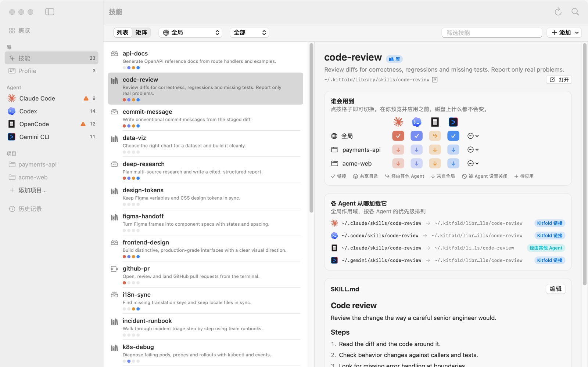
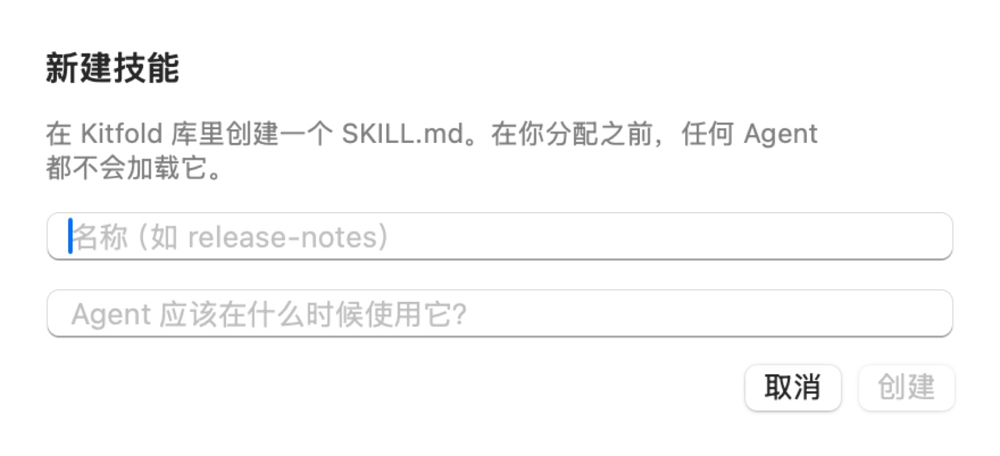

# 07 管理技能库

读完这篇，你会知道 Kitfold 里的每个技能是从哪来的，能新建技能、编辑 `SKILL.md`、导入别处的技能目录、把散落的技能移入库、删除技能，也能看懂技能页上列出的问题。

## 技能从哪来

“技能”页面列出的是 Kitfold 在这台 Mac 上找到的所有技能，每个技能的名称旁边都有一个标签，说明它放在哪里：

| 标签 | 位置 | 不分配，Agent 会加载它吗 | Kitfold 能编辑吗 |
|---|---|---|---|
| 库 | `~/.kitfold/library/skills`，Kitfold 自己的库 | 不会。分配之后才会链接进 Agent 的目录 | 能 |
| 来源 | Kitfold 原地读取的目录，比如 `~/.agents/skills`、你添加的目录、克隆下来的 Git 仓库 | 要看目录。`~/.agents/skills` 会被 Codex、OpenCode、Gemini CLI 直接读取；你自己添加的目录不会 | 能 |
| 本地目录 | 直接放在某个 Agent 技能目录里的真实目录，比如 `~/.codex/skills/notebook-tools` | 会，只有那个 Agent（以及读这个目录的其他 Agent） | 能 |
| 链接的目录 | Agent 技能目录里的一个链接，指向 Kitfold 不认识的位置 | 会 | 能 |
| 插件 | Agent 的插件、扩展或内置技能，比如 Claude Code 插件、Codex 的 `.system` | 由 Agent 的插件系统决定 | 不能，只读 |
| 嵌套 | 另一个技能目录里的 `SKILL.md` | Codex 和 OpenCode 会把它当成单独的技能 | 不能单独移动 |

第一次打开时，如果 `~/.agents/skills` 存在，Kitfold 会把它登记为来源（同时存在 `~/.agents/.skill-lock.json` 的话，还会标上“skills CLI”，表示这个目录归 skills CLI 管）；装了 Magpie 的话，它的库 `~/.config/magpie/library/skills` 也会登记进来。

想按来源查看，用“技能”页面工具栏上的筛选菜单：“全部”“库”“来源”“本地目录”“插件”“有问题的”。“概览”页右侧的“技能目录”卡片会统计每一类各有多少个技能，并列出登记的来源。



## 新建技能

1. 按 ⇧⌘N，或者在“技能”页面点“添加 › 新建技能…”（“概览”页的“快捷操作”和 ⌘K 快速打开里也有）。
2. 填写名称，比如 `api-changelog`。名称请用小写英文字母、数字和连字符：Kitfold 会把输入转成小写，空格和标点换成连字符，结果同时用作目录名和 `name`。用中文命名的话，中文会保留下来，但会被标出名称不合规的问题（见下文“技能页上的问题”）。
3. 在第二栏写一句话，说明 Agent 应该在什么时候用它。这句话会成为 `description`，Agent 靠它判断何时加载这个技能，Codex 和 Gemini CLI 还会跳过没有描述的技能。
4. 点“创建”。



Kitfold 会在库里创建 `~/.kitfold/library/skills/api-changelog/SKILL.md`，并在“技能”页面选中它：

```markdown
---
name: api-changelog
description: 对比两个发布标签之间的 API 变化，整理成变更说明。
---

# api-changelog

说明何时以及如何使用这个技能。
```

新建的技能不会分配给任何 Agent。写好正文之后，在“谁会用到”里点格子把它分出去，做法见 [03 把技能分给指定的 Agent](03-assign-skills.md)。

## 编辑 SKILL.md

1. 在“技能”页面选中技能。
2. 在详情最下面的“SKILL.md”卡片上点“编辑”。
3. 修改后点“保存”（⌘S），不想保存就点“取消”。

想用自己的编辑器，就点技能名称下方的“打开”，`SKILL.md` 会用系统默认的应用打开。

保存时有几点要注意：

- **保存就是一次应用，没有单独的预览。** 点“保存”，文件马上就改了，顶部提示“已应用 1 处文件变更。随时可以在历史记录中撤销。”。“历史记录”里会多一条“编辑“api-changelog”的 SKILL.md”，可以在那里撤销。
- **旧版本会保留。** 和其他应用一样，旧内容先备份到 `~/.kitfold/backups/<编号>/`：在“历史记录”里展开这一条，点“备份”就能找到。
- **所有用到它的 Agent 都会看到新内容。** Agent 目录里放的是指向这个目录的链接，下次 Agent 加载技能时读到的就是新版本，不需要再应用。
- **别的工具管理的目录。** 如果技能所在的来源属于 skills CLI 或 Magpie，编辑时会提示“这个目录由 … 管理，它下次更新时可能会覆盖你的修改”（skills CLI 只对它清单上的技能提示）。想长期改它，先把它移入库（见下文）。
- **插件技能是只读的**，没有“编辑”按钮。

## 每个 Agent 要求的 frontmatter

`SKILL.md` 开头 `---` 之间的部分叫 frontmatter。各 Agent 对它的要求不一样，缺了必需的字段，Agent 会**静默跳过**这个技能：

| Agent | 必须有 | 缺了会怎样 |
|---|---|---|
| Claude Code | 都不是必需的，`name` 默认取目录名 | 照常加载 |
| Codex | `description` | 跳过 |
| OpenCode | `name` | 跳过 |
| Gemini CLI | `name` 和 `description` | 跳过 |

所以最稳妥的写法是两个都写，`name` 和目录名保持一致。Kitfold 会替你检查：Agent 实际会跳过的技能，“健康检查”里会有一条警告，比如 **Codex 会忽略“quick-notes”**；你想把它分给会跳过它的 Agent 时，预览里会提示 **Codex 无法加载“quick-notes”**，Kitfold 也不会去创建这个链接。

## 导入目录

手上有一个技能目录（比如从别人的仓库下载的），想让 Kitfold 的库里也有一份：

1. 在“技能”页面点“添加 › 导入目录…”。
2. 选择那个目录，里面必须有 `SKILL.md`。

Kitfold 会把整个目录**拷贝**到 `~/.kitfold/library/skills/<名称>`，名称取 frontmatter 里的 `name`，没有的话取目录名。原目录保持不变，导入后也不会分配给任何 Agent。

如果库里已经有同名技能，导入会失败并提示“库中已有名为 … 的技能”。这时先给其中一个改名。

## 移入库

“移入库”和导入不同：它把目录**移动**到库里，再在原来的位置留下一个指向库的链接。原来用这个路径的 Agent 和工具照常工作，以后这个技能只有库里一份，你在 Kitfold 里管理它。

适合的情况，比如演示数据里 Codex 的 `notebook-tools`：它是手动放进 `~/.codex/skills` 的真实目录，标签是“本地目录”。

1. 在“技能”页面选中 `notebook-tools`。
2. 点技能名称下方的“移入库”。
3. 预览里会列出这次要做的事：
   - 把 notebook-tools 移入 Kitfold 库；
   - 在 `~/.codex/skills/notebook-tools` 留下链接（使用旧路径的 Agent 和工具可以照常工作）；
   - 把分配保存到 `kitfold.json`：原来在自己目录里有这个技能的 Agent（这里是 Codex），会记下一条“打开”的规则，这样 Kitfold 就把新链接当成你要的，而不是遗留下来的。
4. 点“应用”。

这次操作会以“将 notebook-tools 移入库”记进“历史记录”，可以撤销。

几点说明：

- 已经在库里的技能、插件技能和嵌套的技能没有这个按钮。
- 如果技能来自别的工具管理的来源（比如 skills CLI 装在 `~/.agents/skills` 里的技能），预览里会提醒：移动之后，那个工具可能会认为技能已被换成链接，它的更新将不再同步到这里。
- 库里已经有同名目录时，Kitfold 会拒绝移动。

## 删除技能

删除一个技能，会让所有 Agent 都不再用到它，并把它的目录移到 Kitfold 自己的废纸篓 `~/.kitfold/backups/trash/`。不会真的抹掉：和其他改动一样，先预览，之后也能撤销。

演示数据里的 `release-notes` 是库里的技能，Claude Code 和 Codex 通过 Kitfold 的链接用到它。

1. 在“技能”页面选中 `release-notes`。
2. 点技能名称下方的“删除…”。在技能列表、矩阵和 Agent 页面上右键点一个技能，菜单里也有这一项。
3. 预览里会列出这次要做的事：
   - 为 Claude Code 移除 release-notes 的链接（已不再分配），Codex 也一样；
   - 把 release-notes 移到 Kitfold 的废纸篓（目录会保留在 `~/.kitfold/backups/trash`，撤销会把它放回原处）；
   - 把分配保存到 `kitfold.json`：这个技能的分配会被清除。

   “需要注意”里还会提醒“OpenCode 将不再加载“release-notes””：OpenCode 只是通过 Claude Code 的目录找到它的。
4. 点“应用”。

这次操作会以“删除 release-notes”记进“历史记录”。撤销后，目录、链接和分配都会回来。

如果有下面这些，也会随技能一起处理：

- **指向这个目录的其他链接**，免得留下失效的链接：Kitfold 认识的每个 Agent 目录里的（Kiro、Cursor 的和 Claude Code 的一样）、共享目录里的、“移入库”时留在原处的、别的工具创建的。不是 Kitfold 创建的链接会标为“注意”，撤销可以恢复。
- **skills CLI 清单里的那一条**。skills CLI 装的技能会从 `~/.agents/.skill-lock.json` 里去掉，和 `npx skills remove` 一样，这样 `npx skills update` 不会再把它装回来。只改这一条。
- **Kitfold 在 Agent 自己的设置里写的条目**，也就是为关闭这个技能写的，比如 OpenCode 的 `permission.skill`。
- **它在 Profile 里的位置**。附带它的 Profile 会把它从技能列表里去掉。

几点说明：

- 插件技能归 Agent 的插件系统管，嵌套技能属于外面那个技能，所以它们的“删除…”是灰的，鼠标停在上面可以看到原因。请改为关闭它们。
- 只是从别处链接进 Agent 目录的技能（“链接的目录”，比如一个仓库的检出目录）也能删除，但只收回链接：目录本身不归 Kitfold 管，会留在原处，预览里也会说明。
- 从多个 Agent 都读取的目录（比如 `~/.agents/skills`）里删除技能，这些 Agent 都会失去它。预览会在“需要注意”里列出它们，比如“Codex、OpenCode、Gemini CLI 会读取这个目录”。
- 如果目录由别的工具管理，而 Kitfold 没法把技能从它的清单里去掉（Magpie，或者清单读不出来的 skills CLI 目录），或者是克隆的 Git 仓库，预览会提醒：那个工具下次更新、或者下次 `git pull`，可能会把这个技能带回来。`~/.agents/skills` 里不在 skills CLI 清单上的技能，是手动或别的工具放进去的，skills CLI 不会碰它，所以不提醒。
- 如果还有别的目录同名，预览也会说明。那个目录会保留，Agent 可能仍会加载同名的技能。
- 清理旧备份时不会清理废纸篓。确定不再需要之后，自己清空 `~/.kitfold/backups/trash/`。

在命令行里用 `kitfold delete <技能>`，见 [08 命令行](08-command-line.md#删除技能delete)。

## 技能来源

来源是 Kitfold **原地读取**的技能目录：不拷贝，只把里面的技能列出来供你分配。

**添加一个本地目录：** 在“技能”页面点“添加 › 添加来源目录…”，选择一个存放技能的目录。Kitfold 只看它下面一层：每个带 `SKILL.md` 的子目录就是一个技能。

**添加一个 Git 仓库：** 点“添加 › 添加 Git 仓库…”，填写仓库地址，再点“克隆”。Kitfold 会把它浅克隆到 `~/.kitfold/sources/<仓库名>`，往下找几层，把带 `SKILL.md` 的目录都列出来。Kitfold 不会自动拉取更新，想更新就自己在那个目录里运行 `git pull`。

不论哪种，添加之后都不会分配给任何 Agent，要用哪个技能就分配哪个。

**管理来源：** 打开“设置”（⌘,）里的“来源”标签页，“Kitfold 原地读取的技能目录”下列出了每个来源的名称、路径，以及管理它的工具。点右边的减号可以移除来源。移除只是让 Kitfold 不再读取它，不会删除任何文件。Kitfold 库（`~/.kitfold/library`）始终包含在内，不在这个列表里。

## 技能页上的问题

技能的 `SKILL.md` 有毛病时，列表里技能名称旁边会出现一个橙色感叹号，详情页多出一张“问题”卡片。用筛选菜单里的“有问题的”可以把它们都找出来。

| 问题 | 意思 | 怎么办 |
|---|---|---|
| SKILL.md 没有 frontmatter（name/description） | 文件开头没有 `---` 包起来的 frontmatter | 按上面的模板补上 `name` 和 `description` |
| 缺少描述：Agent 靠它判断何时加载这个技能 | 没有 `description`，或者是空的 | 写一句什么时候该用它。Codex 和 Gemini CLI 会跳过没有描述的技能 |
| 名称“…”最多 64 个字符，只能包含小写字母、数字、“-”“_”或“:” | `name` 太长，或者里面有大写字母、空格或中文 | 改成 `api-changelog` 这样的名称 |
| frontmatter 没有用 --- 结束 / frontmatter 中没有可读的键 / 无法读取的 frontmatter 行：… | frontmatter 写错了，读不出来 | 对照模板修正格式 |
| 有 2 个目录都叫“…”。Agent 只会选其中一个；Kitfold 优先分配库里的那份。 | 不同位置有同名技能 | 卡片下方列出了另一个目录的路径。保留一个，或者给其中一个改名 |

库和来源里的技能有这些问题时，“概览”页的“健康检查”也会列出来，不过它们只是提示，要打开“显示提示”才看得到。嵌套的 `SKILL.md`、同名冲突、Agent 跳过技能这类问题会直接出现在“健康检查”里，含义和处理办法见 [09 常见问题与排错](09-troubleshooting.md)。

---

[← 上一篇：06 按项目配置](06-projects.md) · [目录](README.md) · [下一篇：08 命令行 →](08-command-line.md)
